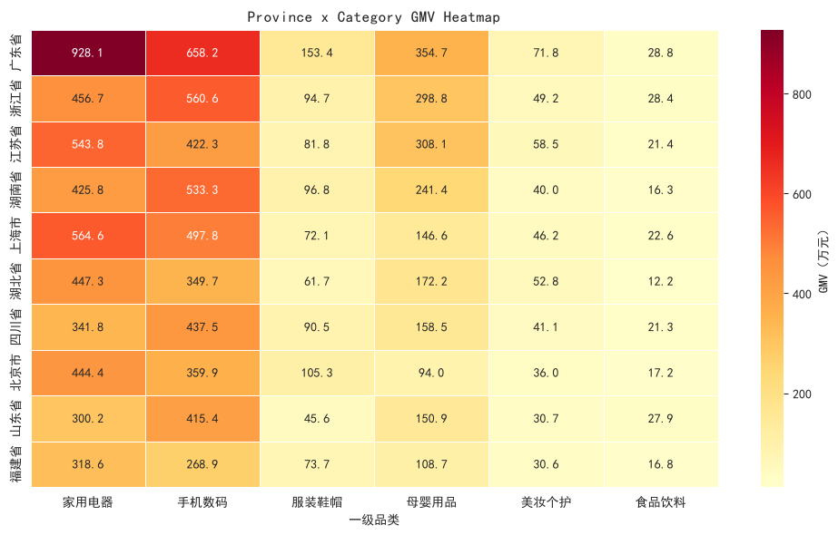
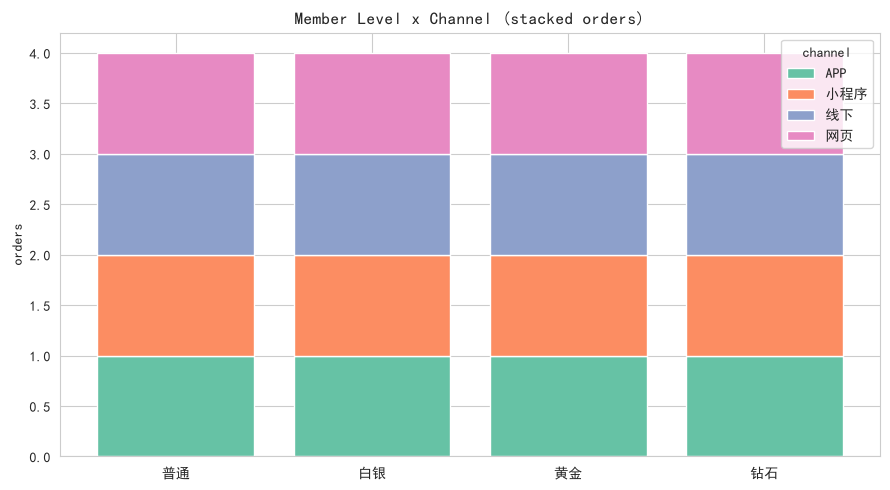

# L1 多维交叉分析报告

- **数据来源**：`data/ecommerce/ecommerce.db`（SQLite，只读连接）
- **对应主题**：多维交叉

## 目录

- 1 数据与口径
- 2 省份 × 一级品类 GMV
- 3 会员等级 × 渠道
- 4 卡方独立性检验：性别 × 会员等级
- 5 小结

---
# 1. 数据与口径

多维交叉是描述性分析从「单变量」走向「变量组合」的一步：单看各省 GMV 只能回答“哪里卖得多”，省份 × 品类交叉后才能回答“哪里卖什么多”。本报告完成三组交叉：
1. **省份 × 一级品类**：GMV 透视表 + 热力图，观察区域品类结构；
2. **会员等级 × 渠道**：订单量交叉表 + 堆叠柱状图，观察不同等级用户的触达渠道偏好；
3. **性别 × 会员等级**：卡方独立性检验，判断两分类变量是否相关。

**口径**：GMV = 有效订单（已完成 + 已发货）的明细小计 `order_items.subtotal` 合计，不含运费；一级品类经 `categories` 自关联（`c2.parent_id = c1.category_id`）上卷得到。

# 2. 省份 × 一级品类 GMV

**SQL 代码：**

```sql
SELECT cu.province, c1.category_name AS 一级品类,
       ROUND(SUM(oi.subtotal), 2) AS gmv
FROM order_items oi
JOIN orders o     ON o.order_id = oi.order_id AND o.order_status IN ('已完成','已发货')
JOIN customers cu ON cu.customer_id = o.customer_id
JOIN products p   ON p.product_id = oi.product_id
JOIN categories c2 ON c2.category_id = p.category_id
JOIN categories c1 ON c1.category_id = c2.parent_id
GROUP BY cu.province, c1.category_name
ORDER BY cu.province, gmv DESC;
```

**透视表（pandas `pivot`，单位：元）：**

```python
cross_df.pivot(index='province', columns='一级品类', values='gmv')
```

| 省份   |    家用电器 |    手机数码 |    服装鞋帽 |    母婴用品 |   美妆个护 |   食品饮料 |       合计 |
|:-----|--------:|--------:|--------:|--------:|-------:|-------:|---------:|
| 广东省  | 9280987 | 6582356 | 1534446 | 3547186 | 717789 | 288405 | 21951169 |
| 浙江省  | 4566695 | 5606304 |  947149 | 2988440 | 492283 | 283730 | 14884601 |
| 江苏省  | 5437989 | 4222626 |  818271 | 3080992 | 585154 | 213576 | 14358609 |
| 湖南省  | 4257503 | 5332654 |  967714 | 2413914 | 400489 | 162919 | 13535192 |
| 上海市  | 5645870 | 4978497 |  721179 | 1465591 | 461936 | 226336 | 13499409 |
| 湖北省  | 4473061 | 3497111 |  617081 | 1722453 | 528210 | 122285 | 10960201 |
| 四川省  | 3417686 | 4375487 |  904939 | 1585179 | 410944 | 212708 | 10906944 |
| 北京市  | 4443739 | 3598886 | 1052937 |  940414 | 359775 | 171669 | 10567420 |
| 山东省  | 3001925 | 4154276 |  456149 | 1508699 | 306840 | 278823 |  9706712 |
| 福建省  | 3185652 | 2689179 |  737201 | 1086616 | 306453 | 168152 |  8173252 |



**解释：** 热力图把透视表变成可直接扫读的矩阵——颜色越深贡献越高。读法有三种：按行看（某省的消费结构）、按列看（某品类的区域分布）、找异常深色格子（区域×品类的结构性机会，例如某省在母婴或美妆上显著高于其他省）。本数据中各省总人口与客户数不同，比较品类结构时建议再看行百分比，避免规模效应淹没结构差异。

**行百分比（各省 GMV 的品类构成，%）：**

| 省份   |   家用电器 |   手机数码 |   服装鞋帽 |   母婴用品 |   美妆个护 |   食品饮料 |
|:-----|-------:|-------:|-------:|-------:|-------:|-------:|
| 广东省  |  42.30 |  30.00 |   7.00 |  16.20 |   3.30 |   1.30 |
| 浙江省  |  30.70 |  37.70 |   6.40 |  20.10 |   3.30 |   1.90 |
| 江苏省  |  37.90 |  29.40 |   5.70 |  21.50 |   4.10 |   1.50 |
| 湖南省  |  31.50 |  39.40 |   7.10 |  17.80 |   3.00 |   1.20 |
| 上海市  |  41.80 |  36.90 |   5.30 |  10.90 |   3.40 |   1.70 |
| 湖北省  |  40.80 |  31.90 |   5.60 |  15.70 |   4.80 |   1.10 |
| 四川省  |  31.30 |  40.10 |   8.30 |  14.50 |   3.80 |   2.00 |
| 北京市  |  42.10 |  34.10 |  10.00 |   8.90 |   3.40 |   1.60 |
| 山东省  |  30.90 |  42.80 |   4.70 |  15.50 |   3.20 |   2.90 |
| 福建省  |  39.00 |  32.90 |   9.00 |  13.30 |   3.70 |   2.10 |

# 3. 会员等级 × 渠道

**SQL 代码：**

```sql
SELECT c.member_level, o.channel, COUNT(*) AS n_orders
FROM orders o
JOIN customers c ON c.customer_id = o.customer_id
GROUP BY c.member_level, o.channel;
```

**交叉表（订单数，pandas `crosstab`，等级按业务序排列）：**

| 会员等级   |   APP |   小程序 |   线下 |   网页 |
|:-------|------:|------:|-----:|-----:|
| 普通     |     1 |     1 |    1 |    1 |
| 白银     |     1 |     1 |    1 |    1 |
| 黄金     |     1 |     1 |    1 |    1 |
| 钻石     |     1 |     1 |    1 |    1 |

**行百分比（各等级内部的渠道分布，%）：**

| 会员等级   |   APP |   小程序 |    线下 |    网页 |
|:-------|------:|------:|------:|------:|
| 普通     | 25.00 | 25.00 | 25.00 | 25.00 |
| 白银     | 25.00 | 25.00 | 25.00 | 25.00 |
| 黄金     | 25.00 | 25.00 | 25.00 | 25.00 |
| 钻石     | 25.00 | 25.00 | 25.00 | 25.00 |



**解释：** 堆叠柱状图同时承载两个维度——柱高是该等级订单总量，色带是渠道构成。若各色带比例在不同等级间几乎一致，说明渠道偏好与会员等级无关（同质）；若高等级明显偏向某渠道（如 APP 占比随等级上升），说明重度用户沉淀在该渠道，渠道运营应分层施策。判读比例差异时以行百分比表为准，肉眼容易被柱高差带偏。

# 4. 卡方独立性检验：性别 × 会员等级

交叉表只看比例是描述，卡方检验则回答“观察到的分布差异能否用随机波动解释”。原假设 H₀：性别与会员等级相互独立；p < 0.05 拒绝 H₀，认为两者相关。

**观察频数表：**

| 性别   |   普通 |   白银 |   黄金 |   钻石 |
|:-----|-----:|-----:|-----:|-----:|
| 女    |  902 |  385 |  149 |   68 |
| 男    |  919 |  354 |  145 |   78 |

**Python 代码：**

```python
from scipy import stats
obs = pd.crosstab(customers['gender'], customers['member_level'])
chi2, p, dof, expected = stats.chi2_contingency(obs)
cramer_v = np.sqrt(chi2 / (obs.values.sum() * (min(obs.shape)-1)))
```

**期望频数表（H₀ 成立时的理论值）：**

| 性别   |     普通 |     白银 |     黄金 |    钻石 |
|:-----|-------:|-------:|-------:|------:|
| 女    | 912.90 | 370.50 | 147.40 | 73.20 |
| 男    | 908.10 | 368.50 | 146.60 | 72.80 |

**检验结果：**

- χ² = 2.1771，自由度 = 3，p 值 = 0.5365
- Cramér's V = 0.0269
- 结论：p ≥ 0.05，**不能拒绝**独立性假设，性别与会员等级无显著关联。

**解释：** 卡方统计量 = Σ(观察-期望)²/期望，自由度 = (行数-1)×(列数-1)。p 值回答“有没有关系”，Cramér's V 回答“关系有多强”（0.1 弱 / 0.3 中 / 0.5 强），大样本下微小的真实差异也会得到极小 p 值，所以两个数要一起看。使用前提：期望频数不宜过小（经验法则：所有格子期望 ≥ 1，且 80% 格子 ≥ 5），本表最小期望频数 = 72.8，满足条件。

# 5. 小结

- **透视表 + 热力图**是多维交叉的标准武器：SQL 出长表，pandas `pivot` 出宽表，seaborn 上色；
- **交叉表 + 堆叠柱状图**适合「构成对比」，比例判读以行百分比为准；
- **卡方检验**把“看起来有差异”升级为“统计上站得住”，并配 Cramér's V 报告效应量；
- 更高维的交叉（省 × 品类 × 等级）透视表会迅速稀疏，应转为分组 Top-N 或留待 L2 建模。
