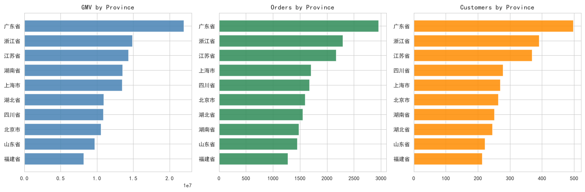
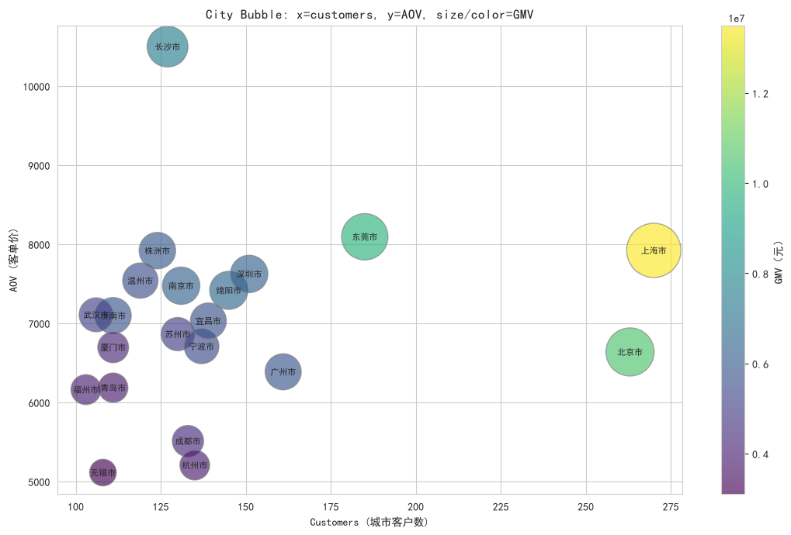
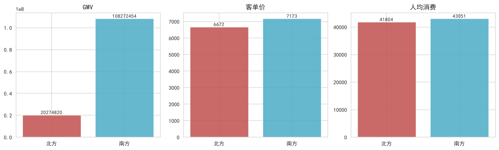

# L1 地理空间描述报告

- **数据来源**：`data/ecommerce/ecommerce.db`（SQLite，只读连接）
- **对应主题**：地理空间描述

## 目录

- 1 数据与口径
- 2 省级排名：GMV / 订单量 / 客户数
- 3 城市级气泡图
- 4 区域分组对比：南方 vs 北方
- 5 关于地图可视化

---
# 1. 数据与口径

地理维度的描述性分析回答三个问题：生意在哪里（区域排名）、城市之间什么结构（规模 × 质量）、大区域之间有没有差异（南北方对比）。

**口径**：GMV / 订单量 = 有效订单（已完成 + 已发货）按下单客户归属地汇总；客户数 = customers 表按注册地统计；客单价 = GMV / 订单数。本数据集覆盖 10 省 23 市。

# 2. 省级排名：GMV / 订单量 / 客户数

**SQL 代码：**

```sql
WITH oc AS (
  SELECT c.province,
         ROUND(SUM(o.total_amount), 2) AS gmv,
         COUNT(o.order_id) AS n_orders
  FROM orders o
  JOIN customers c ON c.customer_id = o.customer_id
  WHERE o.order_status IN ('已完成','已发货')
  GROUP BY c.province
),
cc AS (
  SELECT province, COUNT(*) AS n_customers FROM customers GROUP BY province
)
SELECT oc.province, oc.gmv, oc.n_orders, cc.n_customers,
       ROUND(oc.gmv / oc.n_orders, 2) AS aov,
       ROUND(oc.gmv / cc.n_customers, 2) AS gmv_per_customer
FROM oc JOIN cc ON cc.province = oc.province
ORDER BY oc.gmv DESC;
```

**省级汇总表：**

| 省份   |      GMV(元) |   订单数 |   客户数 |   客单价(元) |   人均消费(元) |
|:-----|------------:|------:|------:|---------:|----------:|
| 广东省  | 21951725.07 |  2953 |   497 |  7433.70 |  44168.46 |
| 浙江省  | 14885079.07 |  2294 |   391 |  6488.70 |  38069.26 |
| 江苏省  | 14358994.81 |  2172 |   369 |  6610.96 |  38913.27 |
| 湖南省  | 13535520.50 |  1475 |   251 |  9176.62 |  53926.38 |
| 上海市  | 13499768.63 |  1704 |   270 |  7922.40 |  49999.14 |
| 湖北省  | 10960629.35 |  1551 |   245 |  7066.81 |  44737.26 |
| 四川省  | 10907220.17 |  1673 |   278 |  6519.56 |  39234.60 |
| 北京市  | 10567712.31 |  1592 |   263 |  6638.01 |  40181.42 |
| 山东省  |  9707108.07 |  1447 |   222 |  6708.44 |  43725.71 |
| 福建省  |  8173516.35 |  1272 |   214 |  6425.72 |  38194.00 |



**解释：** 横向条形图是排名数据的标配——类目名长时比竖柱好读。三张图并排的看点是「排名是否一致」：若 GMV 排名与客户数排名基本一致，说明区域差异主要是客户规模差异；若某省客户数居中但 GMV 靠前（人均消费高），则是高质量市场。人均消费列（GMV/客户数）就是为剥离规模效应准备的。

# 3. 城市级气泡图

**SQL 代码：**

```sql
WITH oc AS (
  SELECT c.province, c.city,
         ROUND(SUM(o.total_amount), 2) AS gmv,
         COUNT(o.order_id) AS n_orders
  FROM orders o
  JOIN customers c ON c.customer_id = o.customer_id
  WHERE o.order_status IN ('已完成','已发货')
  GROUP BY c.province, c.city
),
cc AS (
  SELECT city, COUNT(*) AS n_customers FROM customers GROUP BY city
)
SELECT oc.province, oc.city, oc.gmv, oc.n_orders, cc.n_customers,
       ROUND(oc.gmv / oc.n_orders, 2) AS aov
FROM oc JOIN cc ON cc.city = oc.city;
```



**Top 10 城市（按 GMV）：**

| 省份   | 城市   |      GMV(元) |   订单数 |   客户数 |   客单价(元) |
|:-----|:-----|------------:|------:|------:|---------:|
| 上海市  | 上海市  | 13499768.63 |  1704 |   270 |  7922.40 |
| 北京市  | 北京市  | 10567712.31 |  1592 |   263 |  6638.01 |
| 广东省  | 东莞市  |  9802189.96 |  1211 |   185 |  8094.29 |
| 湖南省  | 长沙市  |  7548461.93 |   719 |   127 | 10498.56 |
| 四川省  | 绵阳市  |  6564091.82 |   885 |   145 |  7417.05 |
| 广东省  | 深圳市  |  6305223.07 |   827 |   151 |  7624.21 |
| 江苏省  | 南京市  |  6301711.09 |   843 |   131 |  7475.34 |
| 湖南省  | 株洲市  |  5987058.57 |   756 |   124 |  7919.39 |
| 山东省  | 济南市  |  5884087.04 |   829 |   111 |  7097.81 |
| 广东省  | 广州市  |  5844312.04 |   915 |   161 |  6387.23 |

**解释：** 气泡图在二维平面上编码四个变量：x=客户规模，y=经营质量（客单价），气泡大小与颜色=GMV。四象限读法：
- 右上（多客户 × 高客单）：核心市场，守住；
- 左上（少客户 × 高客单）：小众高质市场，适合拉新；
- 右下（多客户 × 低客单）：规模大质量低，适合提客单（连带/套餐）；
- 左下：边缘市场，控制投入。
注意客户数与 GMV 天然正相关（规模效应），y 轴客单价才是质量维度的信息增量。

# 4. 区域分组对比：南方 vs 北方

把 10 个省份按常见口径粗分为两组做区域对比：
- **北方**：北京市、山东省
- **南方**：广东省、浙江省、江苏省、上海市、福建省、湖南省、湖北省、四川省

粗分组的目的是演示「区域分组描述」的做法；真实业务应按公司大区或秦岭-淮河线细分。

**Python 代码：**

```python
prov['区域'] = np.where(prov['province'].isin(['北京市','山东省']), '北方', '南方')
prov.groupby('区域').agg(GMV=('gmv','sum'), 订单数=('n_orders','sum'), 客户数=('n_customers','sum'))
```

**区域对比表：**

| 区域   |          GMV |   订单数 |   客户数 |     客单价 |     人均消费 |
|:-----|-------------:|------:|------:|--------:|---------:|
| 北方   |  20274820.38 |  3039 |   485 | 6671.54 | 41803.75 |
| 南方   | 108272453.95 | 15094 |  2515 | 7173.21 | 43050.68 |



**解释：** 区域对比一定要同时看「总量」与「人均」两个口径：总量反映市场盘子，人均反映消费能力。两组客户基数不同（南方省份多），GMV 总量不可直接比，人均消费与客单价才是公平比较。若要进一步检验人均消费差异是否显著，可对客户级消费额做两样本 t 检验或 Mann-Whitney U 检验——那已进入推断统计，是 L2 的内容。

# 5. 关于地图可视化

本报告刻意不引入地图库（geopandas / pyecharts / folium），全部用 matplotlib 完成，原因有二：
1. 地理描述的**信息**在排名、结构与区域对比中已完整表达，地图主要提升的是**呈现**；
2. 地图库依赖重（geopandas 需要 GDAL/GEOS），教学环境能跑通比好看更重要。

若需升级为真实地图，推荐 pyecharts：把第 2 节的省级汇总表喂给 `Map` 类型即可——
```python
from pyecharts.charts import Map
Map().add('GMV', list(zip(prov['province'], prov['gmv'])), 'china')
```
数据准备代码（SQL 聚合）无需任何改动，只换渲染层。
