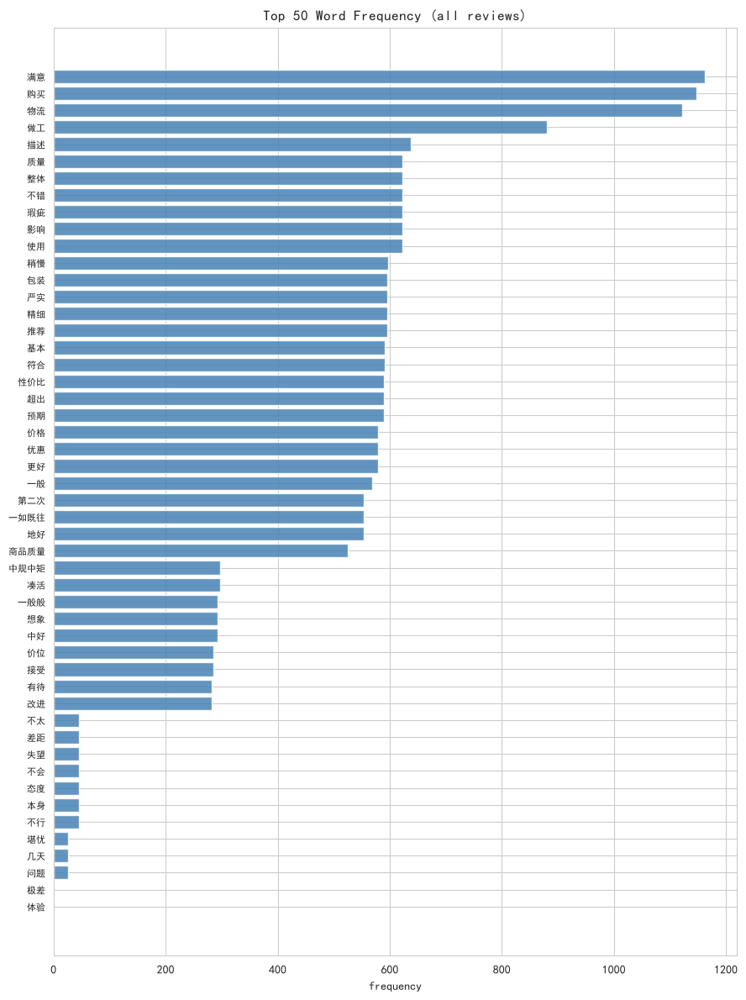
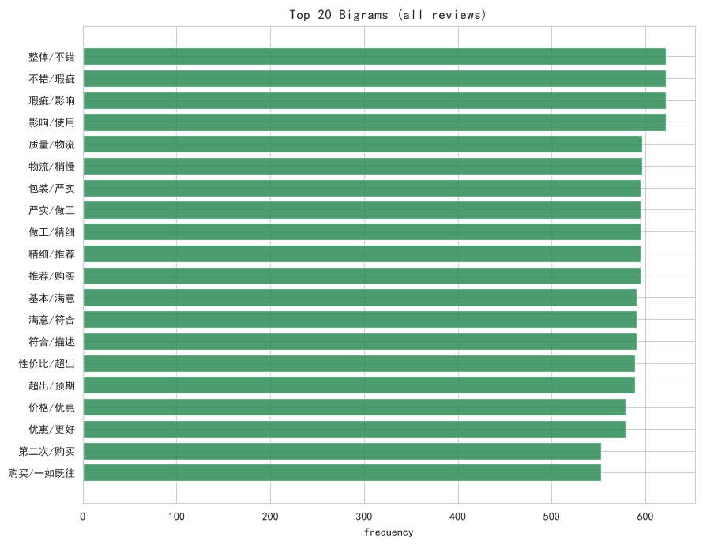
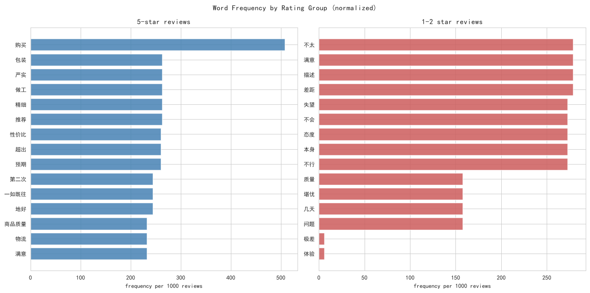

# L1 文本数据描述报告

- **数据来源**：`data/ecommerce/ecommerce.db` 的 `reviews` 表（SQLite，只读连接）
- **对应主题**：文本数据描述
- **分词**：jieba 0.42.1；**词云**：已生成（wordcloud）

## 目录

- 1 语料概况
- 2 分词与停用词
- 3 总词频 Top 50
- 4 Bigram Top 20
- 5 分组词频对比：5 星 vs 1-2 星
- 6 词云（可选增强）
- 7 小结

---
# 1. 语料概况

文本是描述性分析里最容易被跳过的一类数据——它不能求均值，但分词后的**词频**就是文本世界的“频率分布”，分析套路与分类变量完全一致。本报告语料为 `reviews.review_content`（5976 条已签收订单评价），星级 `rating` 是天然的情绪标签。

**星级分布：**

|   星级 |     评价数 |   占比% |
|-----:|--------:|------:|
| 1.00 |    3.00 |  0.10 |
| 2.00 |  162.00 |  2.70 |
| 3.00 | 1160.00 | 19.40 |
| 4.00 | 2389.00 | 40.00 |
| 5.00 | 2262.00 | 37.90 |

**文本长度（字符数）：** 均值 15.2，中位数 16，最短 11，最长 18。

星级分布明显左偏（好评多）：5 星 + 4 星占绝大多数，1-2 星合计仅 165 条。差评样本少是电商文本的常态，后文分组对比会专门说明其对词频稳定性的影响。

# 2. 分词与停用词

**Python 代码：**

```python
import jieba
def tokenize(text):
    words = jieba.lcut(str(text))
    return [w.strip() for w in words
            if len(w.strip()) >= 2           # 去单字（“很/不/了”噪声大）
            and CJK_RE.search(w)             # 去标点与纯数字
            and w.strip() not in STOPWORDS]  # 去停用词
```

三条过滤规则的理由：
1. **去单字**：中文单字大多无语义信息量（的/了/很），留着会淹没词频榜；
2. **只留含中文的词**：标点、数字、型号串不进入词频统计；
3. **停用词**：虚词 + 语料特有无信息词（“这件商品”“卖家”在每条评价中都出现，留着会让 Top 榜失去区分度）。停用词表应根据语料迭代，这里是小型内置表。

分词后共得到 22116 个有效词，去重后 57 个。

# 3. 总词频 Top 50

| 词    |   频次 |
|:-----|-----:|
| 满意   | 1162 |
| 购买   | 1148 |
| 物流   | 1122 |
| 做工   |  881 |
| 描述   |  637 |
| 质量   |  623 |
| 整体   |  622 |
| 不错   |  622 |
| 瑕疵   |  622 |
| 影响   |  622 |
| 使用   |  622 |
| 稍慢   |  597 |
| 包装   |  595 |
| 严实   |  595 |
| 精细   |  595 |
| 推荐   |  595 |
| 基本   |  591 |
| 符合   |  591 |
| 性价比  |  589 |
| 超出   |  589 |
| 预期   |  589 |
| 价格   |  579 |
| 优惠   |  579 |
| 更好   |  579 |
| 一般   |  569 |
| 第二次  |  553 |
| 一如既往 |  553 |
| 地好   |  553 |
| 商品质量 |  525 |
| 中规中矩 |  298 |
| 凑活   |  298 |
| 一般般  |  293 |
| 想象   |  293 |
| 中好   |  293 |
| 价位   |  286 |
| 接受   |  286 |
| 有待   |  283 |
| 改进   |  283 |
| 不太   |   46 |
| 差距   |   46 |
| 失望   |   45 |
| 不会   |   45 |
| 态度   |   45 |
| 本身   |   45 |
| 不行   |   45 |
| 堪忧   |   26 |
| 几天   |   26 |
| 问题   |   26 |
| 极差   |    1 |
| 体验   |    1 |



**解释：** 词频榜就是文本的“一维频率分布”，读法与分类变量频率表相同。头部词（质量/物流/性价比/满意一类）刻画了评价语料的整体基调——以满意向词汇为主，与星级左偏相互印证。词频呈长尾分布：Top 10 之后的词衰减很快，符合齐夫定律（Zipf's law）的典型形态。

# 4. Bigram Top 20

单个词会丢失搭配信息（“物流”+“快”和“物流”+“慢”是两种评价）。bigram（相邻二元词组）保留局部语序，是关键词向短语迈出的最小一步。

**Python 代码：**

```python
bigrams = list(zip(tokens[:-1], tokens[1:]))
Counter(bigrams).most_common(20)
```

| bigram   |   频次 |
|:---------|-----:|
| 整体 不错    |  622 |
| 不错 瑕疵    |  622 |
| 瑕疵 影响    |  622 |
| 影响 使用    |  622 |
| 质量 物流    |  597 |
| 物流 稍慢    |  597 |
| 包装 严实    |  595 |
| 严实 做工    |  595 |
| 做工 精细    |  595 |
| 精细 推荐    |  595 |
| 推荐 购买    |  595 |
| 基本 满意    |  591 |
| 满意 符合    |  591 |
| 符合 描述    |  591 |
| 性价比 超出   |  589 |
| 超出 预期    |  589 |
| 价格 优惠    |  579 |
| 优惠 更好    |  579 |
| 第二次 购买   |  553 |
| 购买 一如既往  |  553 |



**解释：** bigram 榜比单词榜更接近“观点”：能看到「质量 + 不错」这类属性-评价搭配。频次天然低于单词榜（搭配更稀疏），所以只看 Top 20。再往上是 trigram / 依存分析，收益递减，L1 层到 bigram 为止。

# 5. 分组词频对比：5 星 vs 1-2 星

词频按星级分组后才能回答“好评在夸什么、差评在骂什么”。两组样本量悬殊（5 星 2262 条 vs 1-2 星 165 条），直接比原始频次不公平，统一换算为**每千条评价的归一化频次**再对比。



**5 星 Top 15：** 购买(508)、包装(263)、严实(263)、做工(263)、精细(263)、推荐(263)、性价比(260)、超出(260)、预期(260)、第二次(244)、一如既往(244)、地好(244)、商品质量(232)、物流(232)、满意(232)

**1-2 星 Top 15：** 不太(279)、满意(279)、描述(279)、差距(279)、失望(273)、不会(273)、态度(273)、本身(273)、不行(273)、质量(158)、堪忧(158)、几天(158)、问题(158)、极差(6)、体验(6)

**解释：** 好评高频词围绕“质量/性价比/物流/满意”，差评高频词围绕“失望/色差/尺码/退货”一类。方法要点有二：
1. **归一化**：样本量差一个数量级时，原始频次的对比毫无意义，按每千条折算后量级才可比；
2. **小样本抖动**：1-2 星只有 165 条，Top 榜尾部几个词的排名对随机波动敏感，解读时关注头部稳定词，不要过度解读 10 名之后的差异。
这种做法就是最简单的“文本分组画像”，再进一步就是 TF-IDF 加权与情感模型（L2/L5 内容）。

# 6. 词云（可选增强）

**5 星评价词云：**


**1-2 星评价词云：**


**解释：** 词云与词频条形图承载完全相同的信息（词 → 频次），只是用字号换通道、牺牲精确性换取一眼可见的“氛围感”，适合放在汇报首页。注意词云必须用中文字体文件渲染（本报告复用脚本检测到的 `simhei.ttf`），否则中文全部变成方框。

# 7. 小结

- 文本描述的主线是「分词 → 词频 → 分组对比」，与分类变量频率分析同构；
- 过滤规则（去单字/停用词/非中文）决定词频榜质量，应按语料迭代；
- bigram 用最小成本补上搭配信息；
- 分组对比务必归一化，并警惕小样本组（差评）的排名抖动；
- 词云是呈现层增强，信息量不超词频表。
