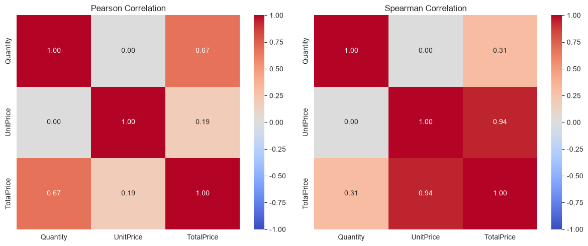
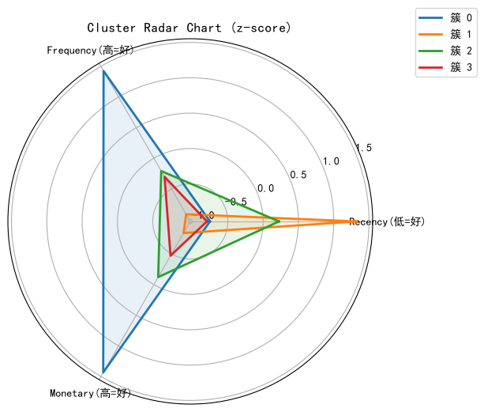

# L2 诊断性分析：找到“为什么”

> **一句话**：描述性告诉你发生了什么，诊断性告诉你**为什么发生、证据有多强**。
> 数据源统一为 `../ecommerce/ecommerce.db`，方法论总览见 [../README.md](../README.md)。

---

## 1. 这层解决什么问题

“销量下滑是因为渠道变化还是价格？”、“发券真的有用吗？”、“这批异常订单是脏数据还是真实业务？”——这些问题需要的是**原因与证据**，不是更多的指标。

L2 的核心纪律：**不把相关当因果**。每一个结论都要写清楚证据来自哪种方法、有哪些假设、还缺什么验证。

## 2. 方法地图

| 方法 | 回答的问题 | 电商示例 | 关键前提 |
|---|---|---|---|
| 相关分析 | 两个变量是否同向变化 | 单价与销量、活跃度与消费额 | 相关不等于因果；线性相关看不到非线性 |
| 关联规则 | 买了 A 的人是否也买 B | 购物篮：品类连带关系 | 支持度、置信度、提升度要一起看 |
| 聚类 | 客户/商品能否分群 | RFM 三维客户分群 | 标准化、K 的选择、业务可解释 |
| 异常检测 | 哪些记录偏离常态 | 批发大单、价格虚高订单 | 区分数据错误与业务异常 |
| 因果推断 | 某个动作是否真的带来效果 | 优惠券对订单金额的净效应 | 选择偏差、混淆变量、平衡性 |
| Granger 因果 | 一个序列是否领先另一个 | 活跃客户数 → GMV | 只说明预测领先，不等于机制因果 |
| 序列模式 | 行为是否有稳定先后顺序 | 品类购买路径 | 最小支持度决定模式数量 |

## 3. 关键成果

**相关与关联。** 单价与销量、活跃度与消费额的相关方向明确；购物篮分析给出可解释的品类连带规则，但报告中反复强调“支持度低的长尾规则不要直接上线”。

**券的因果效应。** 朴素对比与因果估计的差距说明**选择偏差真实存在**：高价值客户本来就更常拿到券。倾向得分匹配（ATT）、IPW（ATE）与后门回归三种方法的结果在同一数量级、方向一致——券对订单金额的净效应是**有限的**，远小于“用券订单比不用券订单多花多少”的表面差值。更重要的业务含义是：券的价值可能主要在促活，而非抬升单笔金额。

**异常订单。** 数据中埋入两类异常：批发型大单（件数 30~200）与价格异常单（单价约常态 10 倍）。它们在特征空间中的形态完全不同——前者靠件数特征捕获，后者靠价格特征捕获。IsolationForest 与 LOF 互补，生产上可二者取并集提高召回。**结论：特征工程比算法选择更关键。**

**客户分群。** log-RFM 上 K-Means 得到 4 个可运营的客群：高价值活跃、高价值沉睡、普通低频等，各群给出了对应的运营动作。三种聚类算法的轮廓系数接近，说明客户价值结构较平滑，工程上推荐简单可复现的 K-Means。

**序列模式。** 在 2,161 条客户序列上以 5% 最小支持度挖出 2,617 个频繁模式；品类转移矩阵与序列模式互相印证，高自转品类适合复购型营销，高跨品类转移对适合搭配推荐。







## 4. 专题索引

| 报告 | 内容 | 适合谁 |
|---|---|---|
| [diagnostic_report.md](diagnostic_report.md) | 主报告：相关矩阵、Apriori 关联规则、RFM 聚类、DBSCAN 对比 | 做经营归因的人 |
| [causal_report.md](causal_report.md) | 优惠券因果效应：PSM、IPW、DoWhy 后门调整 | 做营销评估的人 |
| [granger_report.md](granger_report.md) | Granger 因果：领先指标、脉冲响应、大促期间方向变化 | 做预测指标筛选的人 |
| [anomaly_report.md](anomaly_report.md) | 异常订单：IsolationForest、LOF、特征对比 | 做风控与数据质量的人 |
| [clustering_report.md](clustering_report.md) | 层次聚类、谱聚类与 K-Means 对比、分群画像 | 做用户运营的人 |
| [sequence_report.md](sequence_report.md) | PrefixSpan 序列模式与品类转移 | 做推荐与路径分析的人 |

## 5. 方法提醒

1. **先问“还有没有别的解释”**：任何相关结论都要列 2~3 个替代解释，再设计验证。
2. **因果结论要带假设**：PSM/IPW 都依赖“可观测混杂充分”，强决策前用 A/B 实验复核。
3. **异常要分类处理**：数据错误修正或剔除，业务异常单独分层分析。
4. **聚类的价值在可解释**：分群结果必须能翻译成运营动作，否则只是数学分组。

## 6. 如何运行

```powershell
python src/data/L2/generate_diagnostic_report.py
python src/data/L2/l2_causal.py
python src/data/L2/l2_granger.py
python src/data/L2/l2_anomaly.py
python src/data/L2/l2_clustering.py
python src/data/L2/l2_sequence.py
```

完整环境与执行顺序见 [../run.md](../run.md)。
