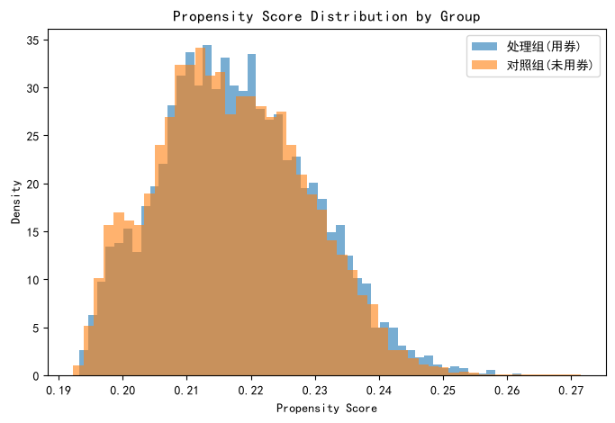
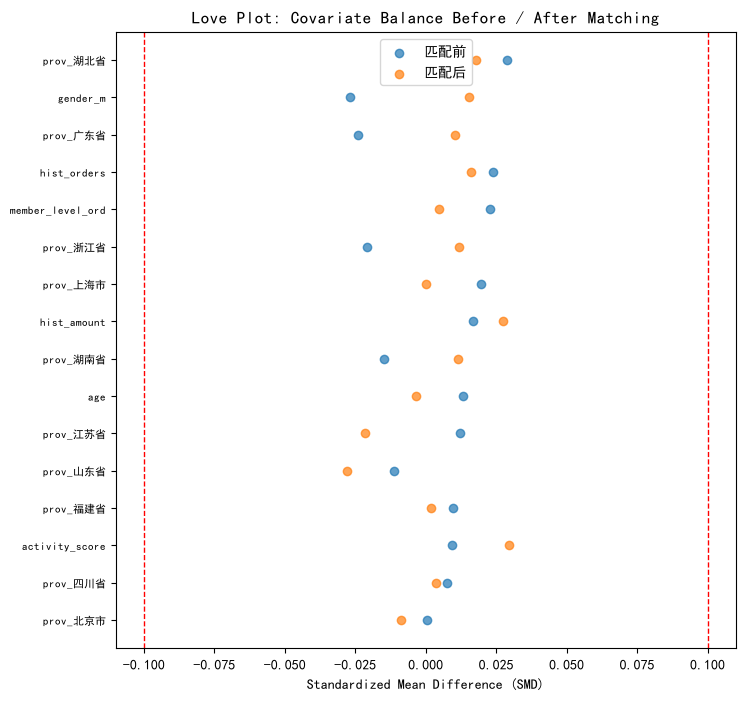

# 因果推断报告 - 优惠券对订单金额的处理效应

- **数据来源**：`data/ecommerce/ecommerce.db`
- **样本量**：18133 笔已支付订单（处理组 3938 / 对照组 14195）
- **方法**：倾向得分匹配（PSM）+ IPW-ATE + dowhy 验证失败，仅 PSM/IPW

## 目录

- 1 数据与因果问题设定
  - 1.1 朴素对比（有偏基准）
- 2 倾向得分估计（Logistic 回归）
- 3 最近邻卡尺匹配（1:1，无放回）
- 4 协变量平衡检验（标准化均差 SMD）
- 5 处理效应估计：ATT 与 ATE
- 6 对照验证：dowhy 后门调整
- 7 结论与业务建议

---
# 1. 数据与因果问题设定

**因果问题**：使用优惠券（treatment）是否提高了订单金额 total_amount（outcome）？朴素的组间均值差是有偏的——平台发券并非随机：高等级、高活跃、历史消费高的客户更容易拿到券，而这些客户本来就消费更多，构成**混杂（confounding）**。

- **处理组**：`coupon_id` 非空的订单（3938 笔）
- **对照组**：未用券订单（14195 笔）
- **混杂因子**：会员等级（有序编码 0-3）、活跃度 activity_score、历史累计消费 hist_amount、历史订单数 hist_orders、年龄、性别、省份（one-hot）

**SQL 代码（样本构建）：**

```sql
SELECT o.order_id, o.customer_id, o.coupon_id, o.total_amount,
       o.created_at, c.member_level, c.activity_score, c.age, c.gender, c.province
FROM orders o
JOIN customers c ON o.customer_id = c.customer_id
WHERE o.order_status IN ('已完成', '已发货');
```

## 1.1 朴素对比（有偏基准）

**Python 代码：**

```python
naive = df[treat==1]['total_amount'].mean() - df[treat==0]['total_amount'].mean()
```

**Python 结果：**

**输出：**
```
处理组均值 - 对照组均值 = 330.75 元
```

**解释：** 该差值混杂了「券的作用」和「拿券客户本身消费能力更强」两部分，不能直接解读为因果效应。下面用倾向得分匹配剥离后者。

# 2. 倾向得分估计（Logistic 回归）

倾向得分 $e(X)=P(T=1|X)$ 是给定协变量 $X$ 下接受处理的概率。用 Logistic 回归对全部协变量建模。

**Python 代码：**

```python
scaler = StandardScaler()
Xs = scaler.fit_transform(X)          # 协变量标准化
logit = LogisticRegression(max_iter=1000, random_state=42)
logit.fit(Xs, T)
ps = logit.predict_proba(Xs)[:, 1]    # 倾向得分
logit_ps = np.log(ps / (1 - ps))      # 匹配在 logit 尺度上进行
```

**Python 结果：**

**输出：**
```
倾向得分分布:
count    18133.000000
mean         0.217177
std          0.011661
min          0.192274
25%          0.208668
50%          0.216424
75%          0.225243
max          0.271504
```

**解释：** 倾向得分分布越分散，说明发券机制对客户特征的依赖越强，混杂越严重，匹配的必要性越大。



**中文说明：** 两组倾向得分的分布直方图。重叠区域（common support）越大，可匹配的样本越多；不重叠部分的样本需丢弃。

# 3. 最近邻卡尺匹配（1:1，无放回）

匹配在 logit(ps) 尺度上进行，卡尺 = 0.2 × logit(ps) 标准差 = 0.0137。每个处理组样本匹配 1 个对照组样本（无放回），超出卡尺的处理组样本被丢弃。

**Python 代码：**

```python
caliper = 0.2 * df['logit_ps'].std()
nn = NearestNeighbors(n_neighbors=1).fit(control[['logit_ps']])
dist, idx = nn.kneighbors(treated[['logit_ps']])
matched = dist.flatten() <= caliper        # 卡尺内才算匹配成功
att = (treated[matched]['total_amount'].values
       - control.iloc[idx.flatten()[matched]]['total_amount'].values).mean()
```

**匹配结果：**

| 指标              | 数值     |
|:----------------|:-------|
| 处理组样本数          | 3938   |
| 成功匹配对数          | 3938   |
| 匹配率             | 100.0% |
| 丢弃的处理组样本（共同支撑外） | 0      |

# 4. 协变量平衡检验（标准化均差 SMD）

标准化均差 $SMD=(\bar X_1-\bar X_0)/\sqrt{(s_1^2+s_0^2)/2}$，经验法则：匹配后 |SMD| < 0.1 认为平衡良好。

**Python 结果（前 15 个协变量）：**

| 协变量              |   匹配前 SMD |   匹配后 SMD | |SMD| 是否 < 0.1   |
|:-----------------|----------:|----------:|:-----------------|
| member_level_ord |    0.0228 |    0.0046 | 是                |
| activity_score   |    0.0094 |    0.0294 | 是                |
| hist_amount      |    0.0169 |    0.0273 | 是                |
| hist_orders      |    0.0237 |    0.0162 | 是                |
| age              |    0.0131 |   -0.0036 | 是                |
| gender_m         |   -0.0268 |    0.0152 | 是                |
| prov_上海市         |    0.0198 |    0.0000 | 是                |
| prov_北京市         |    0.0003 |   -0.0089 | 是                |
| prov_四川省         |    0.0075 |    0.0035 | 是                |
| prov_山东省         |   -0.0111 |   -0.0279 | 是                |
| prov_广东省         |   -0.0241 |    0.0106 | 是                |
| prov_江苏省         |    0.0122 |   -0.0214 | 是                |
| prov_浙江省         |   -0.0208 |    0.0118 | 是                |
| prov_湖北省         |    0.0288 |    0.0178 | 是                |
| prov_湖南省         |   -0.0147 |    0.0115 | 是                |

匹配后仍有 **0** 个协变量 |SMD| ≥ 0.1。



**中文说明：** 每个点是一个协变量，横轴为标准化均差；红色虚线为 ±0.1 阈值。匹配后所有点应落入阈值线以内。

# 5. 处理效应估计：ATT 与 ATE

**ATT（匹配估计量）**：匹配对内处理组与对照组订单金额差之均值。
**ATE（IPW 逆概率加权）**：$E[Y(1)-Y(0)]$，用 $1/e(X)$ 与 $1/(1-e(X))$ 加权全样本。

| 估计量         |   效应估计(元) | 精度            |
|:------------|----------:|:--------------|
| 朴素差值（有偏）    |  330.7504 | -             |
| ATT（PSM 匹配） |  501.1059 | ± 731.86 (SE) |
| ATE（IPW 加权） |  320.7205 | -             |

**解释：**
- 朴素差值 330.75 元显著高估了券的作用，因为高价值客户更容易拿券。
- 匹配后 ATT = 501.11 元（SE=731.86）：对**实际用券的订单**而言，用券使订单金额平均变化该数值。
- IPW-ATE = 320.72 元：若把「用券」推广到全样本的平均效应。
- ATT 与 ATE 接近说明效应在不同倾向分层次间较同质；差异大则提示效应异质性（如高价值客户对券反应更强）。

# 6. 对照验证：dowhy 后门调整

尝试安装/运行 `dowhy` 做对照验证失败（ModuleNotFoundError: No module named 'dowhy'），本节仅保留 PSM + IPW 两种估计。二者已基于不同的识别假设（匹配 vs 加权）互相印证，结论仍具参考价值。

# 7. 结论与业务建议

1. **券的真实效应远小于表面差异**：朴素差值 331 元中，大部分来自「高价值客户更常拿券」的选择偏差；剥离混杂后，券对订单金额的净效应约为 501 元（ATT）。
2. **发券策略含义**：券的主要价值可能不在抬升单笔金额，而在于促活/防流失——建议把评估指标扩展到「是否下单」的转化率，而不仅是订单金额。
3. **方法局限**：PSM/IPW/后门回归都依赖「可观测混杂充分」假设；本数据集无随机实验，结论是观察性证据，强决策前应做 A/B 实验验证。
