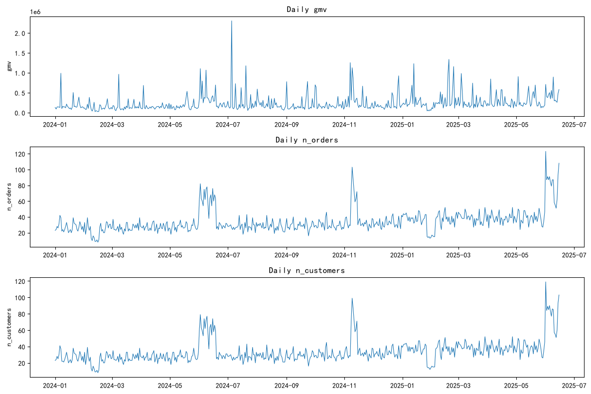
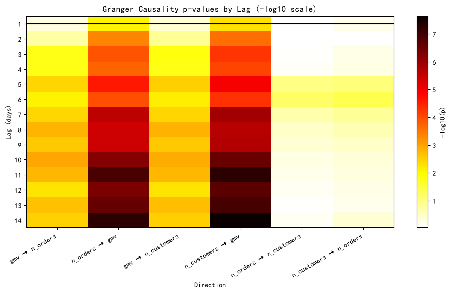
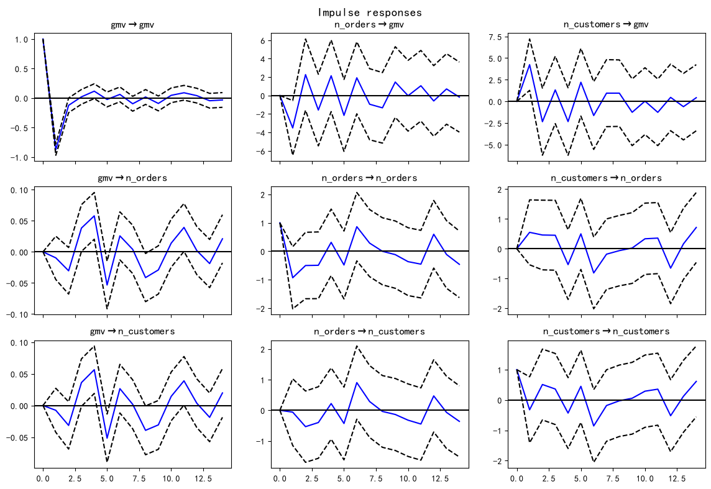

# 时间序列因果报告 - Granger 检验与 VAR

- **数据来源**：`data/ecommerce/ecommerce.db`（orders 表日聚合）
- **序列长度**：532 天（2024-01-01 ~ 2025-06-15）
- **方法**：Granger 因果双向检验（滞后 1-14）+ VAR 脉冲响应

## 目录

- 1 日频序列构建
- 2 预处理：对数化与一阶差分
- 3 Granger 因果检验（滞后 1-14 天）
  - 3.1 gmv 与 n_orders 的双向检验
  - 3.2 gmv 与 n_customers 的双向检验
  - 3.3 n_orders 与 n_customers 的双向检验
- 4 VAR 模型与脉冲响应
- 5 大促期间的因果方向变化
- 6 结论

---
# 1. 日频序列构建

从 orders 表按日聚合三条业务序列：**日 GMV**（gmv）、**日订单数**（n_orders）、**日活跃客户数**（n_customers）。口径：已完成+已发货订单；缺失日期补 0。

**SQL 代码：**

```sql
SELECT DATE(created_at)            AS ds,
       SUM(total_amount)           AS gmv,
       COUNT(*)                    AS n_orders,
       COUNT(DISTINCT customer_id) AS n_customers
FROM orders
WHERE order_status IN ('已完成', '已发货')
GROUP BY DATE(created_at)
ORDER BY ds;
```

**序列概览：**

| 统计量   |          gmv |   n_orders |   n_customers |
|:------|-------------:|-----------:|--------------:|
| count |     532.0000 |   532.0000 |      532.0000 |
| mean  |  241630.2149 |    34.0846 |       33.6917 |
| std   |  221747.2406 |    14.3240 |       13.9531 |
| min   |   23217.0100 |     8.0000 |        8.0000 |
| 25%   |  125056.4750 |    26.0000 |       26.0000 |
| 50%   |  164542.2900 |    31.0000 |       30.0000 |
| 75%   |  261269.3700 |    38.0000 |       38.0000 |
| max   | 2304069.2700 |   123.0000 |      119.0000 |



**中文说明：** 从上到下依次为日 GMV、日订单数、日活跃客户数。可看到 618、双 11 大促峰值与春节低谷。三条序列形态高度相似，提示它们之间存在领先-滞后或共因关系——这正是 Granger 检验要诊断的问题。

# 2. 预处理：对数化与一阶差分

GMV 右偏严重且量级远大于计数序列，取 log1p 后再做一阶差分，使序列近似平稳（Granger 检验要求平稳性）。差分后的含义变为「日增长率/日增量」。

| 统计量   |      gmv |   n_orders |   n_customers |
|:------|---------:|-----------:|--------------:|
| count | 531.0000 |   531.0000 |      531.0000 |
| mean  |   0.0028 |     0.0028 |        0.0028 |
| std   |   0.7542 |     0.2466 |        0.2443 |
| min   |  -2.9525 |    -1.0116 |       -0.9651 |
| 25%   |  -0.3654 |    -0.1382 |       -0.1431 |
| 50%   |   0.0264 |     0.0000 |        0.0000 |
| 75%   |   0.4164 |     0.1542 |        0.1542 |
| max   |   2.7403 |     0.9491 |        0.9373 |

# 3. Granger 因果检验（滞后 1-14 天）

Granger 因果的定义：若 X 的过去值能显著提高对 Y 的预测能力（在控制 Y 自身过去后），则称「X 是 Y 的 Granger 原因」。对三对变量做**双向**检验，滞后阶数 1~14，报告各滞后阶的 F 检验 p 值。

## 3.1 gmv 与 n_orders 的双向检验

|    滞后阶数 |   gmv → n_orders |   n_orders → gmv |
|--------:|-----------------:|-----------------:|
|  1.0000 |           0.5178 |           0.0081 |
|  2.0000 |           0.1843 |           0.0005 |
|  3.0000 |           0.0158 |           0.0001 |
|  4.0000 |           0.0162 |           0.0002 |
|  5.0000 |           0.0039 |           0.0000 |
|  6.0000 |           0.0081 |           0.0001 |
|  7.0000 |           0.0037 |           0.0000 |
|  8.0000 |           0.0016 |           0.0000 |
|  9.0000 |           0.0028 |           0.0000 |
| 10.0000 |           0.0011 |           0.0000 |
| 11.0000 |           0.0016 |           0.0000 |
| 12.0000 |           0.0054 |           0.0000 |
| 13.0000 |           0.0022 |           0.0000 |
| 14.0000 |           0.0032 |           0.0000 |

**解读：** gmv → n_orders 最小 p 值 = 1.14e-03（滞后 10）；反方向最小 p 值 = 5.89e-08（滞后 14）。双向均显著，存在反馈环；

## 3.2 gmv 与 n_customers 的双向检验

|    滞后阶数 |   gmv → n_customers |   n_customers → gmv |
|--------:|--------------------:|--------------------:|
|  1.0000 |              0.4214 |              0.0048 |
|  2.0000 |              0.1474 |              0.0002 |
|  3.0000 |              0.0142 |              0.0001 |
|  4.0000 |              0.0160 |              0.0001 |
|  5.0000 |              0.0031 |              0.0000 |
|  6.0000 |              0.0072 |              0.0001 |
|  7.0000 |              0.0037 |              0.0000 |
|  8.0000 |              0.0015 |              0.0000 |
|  9.0000 |              0.0027 |              0.0000 |
| 10.0000 |              0.0012 |              0.0000 |
| 11.0000 |              0.0017 |              0.0000 |
| 12.0000 |              0.0053 |              0.0000 |
| 13.0000 |              0.0021 |              0.0000 |
| 14.0000 |              0.0032 |              0.0000 |

**解读：** gmv → n_customers 最小 p 值 = 1.23e-03（滞后 10）；反方向最小 p 值 = 2.31e-08（滞后 14）。双向均显著，存在反馈环；

## 3.3 n_orders 与 n_customers 的双向检验

|    滞后阶数 |   n_orders → n_customers |   n_customers → n_orders |
|--------:|-------------------------:|-------------------------:|
|  1.0000 |                   0.9115 |                   0.6272 |
|  2.0000 |                   0.9021 |                   0.9352 |
|  3.0000 |                   0.8324 |                   0.6014 |
|  4.0000 |                   0.7841 |                   0.5591 |
|  5.0000 |                   0.1070 |                   0.0863 |
|  6.0000 |                   0.0616 |                   0.0414 |
|  7.0000 |                   0.2184 |                   0.1478 |
|  8.0000 |                   0.3507 |                   0.2519 |
|  9.0000 |                   0.4265 |                   0.3388 |
| 10.0000 |                   0.5639 |                   0.4558 |
| 11.0000 |                   0.6465 |                   0.5262 |
| 12.0000 |                   0.7454 |                   0.6072 |
| 13.0000 |                   0.8402 |                   0.6252 |
| 14.0000 |                   0.7544 |                   0.4133 |

**解读：** n_orders → n_customers 最小 p 值 = 6.16e-02（滞后 6）；反方向最小 p 值 = 4.14e-02（滞后 6）。仅后者显著，为单向因果；



**中文说明：** 颜色越深表示 p 值越小（因果证据越强）。-log10(p) > 2 对应 p < 0.01。

# 4. VAR 模型与脉冲响应

用 AIC 准则自动选择滞后阶数 = 14。脉冲响应（IRF）回答：给某序列一个单位的正向冲击，其他序列在未来 14 天如何反应。

**Python 结果（模型摘要节选）：**

**输出：**
```
VAR(p=14), AIC=-12.26
  Summary of Regression Results   
==================================
Model:                         VAR
Method:                        OLS
Date:           Sat, 31, Oct, 2026
Time:                     21:43:37
--------------------------------------------------------------------
No. of Equations:         3.00000    BIC:                   -11.2040
Nobs:                     517.000    HQIC:                  -11.8486
Log likelihood:           1098.45    FPE:                4.72435e-06
AIC:                     -12.2639    Det(Omega_mle):     3.71749e-06
---------------------------------------------
...(截断)
```



**中文说明：** 每张子图：行=被冲击的变量，列=响应变量；横轴=冲击后的天数。例如 (n_customers 行, gmv 列) 表示「日活跃客户数受冲击后，日 GMV 的后续响应路径」。置信带跨 0 则响应不显著。

**解释：** 活跃客户数冲击对 GMV 的响应若持续多日为正，说明「拉新/促活」对 GMV 有滞后释放效应；订单数对 GMV 的响应通常在 1-2 天内衰减，因为订单直接计入当日 GMV（部分为机械性关系）。

# 5. 大促期间的因果方向变化

把样本切成三段：**双 11 窗口**（2024-11-01 ~ 2024-11-20）、**618 窗口**（2025-06-01 ~ 2025-06-15）、**平销期**（其余月份中同样长度的稳定段），分别做 Granger 检验，比较因果方向是否随大促切换。大促窗口较短，滞后阶数降为 1-7。

| 时期   | 方向   | 最优滞后   | 最小 p 值   | 结论   |
|------|------|--------|----------|------|

**解释：** 平销期通常是「活跃客户数 → GMV」方向更显著（客户先活跃、GMV 后增长，需求驱动）；大促窗口由于补贴/广告集中投放，GMV 峰值与客户活跃几乎同步爆发，因果滞后缩短甚至双向显著——此时 Granger 意义上的「领先指标」失效，预测大促 GMV 不能依赖常规领先指标，需直接建模大促事件虚拟变量。注意：窗口样本仅约 20 天，检验功效有限，结论只作定性参考。

# 6. 结论

1. Granger 检验显示三条日频序列间存在显著的领先-滞后关系，可据此挑选预测 GMV 的领先指标（如日活跃客户数的滞后值）。
2. 需警惕**机械性关系**：GMV ≈ 订单数 × 客单价，订单数与 GMV 的高显著性部分是会计恒等式驱动的，不具独立信息量。
3. Granger 因果 ≠ 结构因果：它只说明预测意义上的领先，要回答「促活能否提升 GMV」仍需 的因果推断框架或实验。
