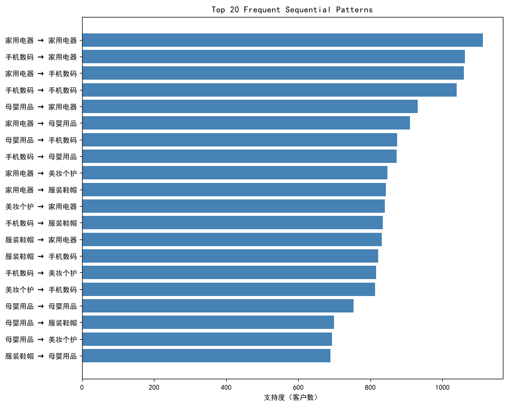
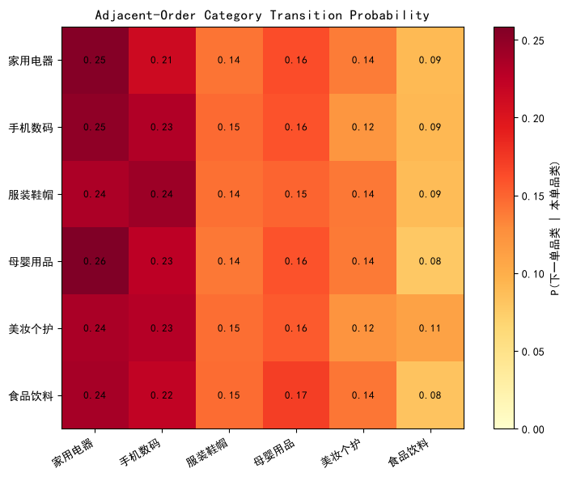

# 序列模式挖掘报告 - 品类购买路径

- **数据来源**：`data/ecommerce/ecommerce.db`（orders/order_items/products/categories）
- **样本量**：2161 条有效客户序列（订单数≥2）
- **方法**：PrefixSpan 频繁序列挖掘 + 相邻订单转移矩阵

<a id="toc"></a>
## 目录

- [1 品类序列构建](#sec-1)
- [2 PrefixSpan 频繁序列挖掘](#sec-2)
  - [2.1 Top 20 多步序列模式](#sec-2-1)
  - [2.2 单类目频次（背景分布）](#sec-2-2)
- [3 可视化](#sec-3)
  - [3.1 两步转移矩阵（相邻订单的品类转移）](#sec-3-1)
- [4 连带购买路径解读](#sec-4)
- [5 结论](#sec-5)

---
<a id="sec-1"></a>

# 1. 品类序列构建

把每个客户的订单按时间排序，每个订单取**小计金额最高的一级类目**作为该单的品类标签，得到形如 `[手机数码, 家用电器, 手机数码, ...]` 的购买路径序列。只保留订单数 ≥ 2 的客户（单订单客户无序列可言）。

**SQL 代码（订单 × 一级品类小计）：**

```sql
SELECT o.customer_id, o.order_id, o.created_at,
       cat.category_name AS l1_cat, SUM(oi.subtotal) AS cat_amount
FROM orders o
JOIN order_items oi ON o.order_id   = oi.order_id
JOIN products  p  ON oi.product_id  = p.product_id
JOIN categories c2  ON p.category_id = c2.category_id
JOIN categories cat ON c2.parent_id  = cat.category_id
WHERE o.order_status IN ('已完成','已发货')
GROUP BY o.order_id, cat.category_id;
```

| 指标          |        数值 |
|:------------|----------:|
| 客户总数        | 2493.0000 |
| 有效序列（订单数≥2） | 2161.0000 |
| 平均序列长度      |    8.2400 |
| 最长序列        |   37.0000 |
| 类目数（一级）     |    6.0000 |

**序列示例（前 5 个客户）：**

**输出：**
```
客户 2: 手机数码 → 家用电器 → 母婴用品 → 美妆个护 → 服装鞋帽 → 母婴用品 → 母婴用品 → 母婴用品 → 美妆个护 → 家用电器 → 母婴用品 → 美妆个护 → 手机数码
客户 3: 手机数码 → 家用电器
客户 4: 家用电器 → 美妆个护 → 服装鞋帽 → 手机数码 → 家用电器 → 家用电器 → 美妆个护 → 母婴用品 → 手机数码
客户 5: 美妆个护 → 家用电器 → 美妆个护
客户 7: 服装鞋帽 → 家用电器 → 美妆个护 → 手机数码 → 母婴用品 → 手机数码 → 服装鞋帽 → 手机数码 → 母婴用品 → 手机数码 → 服装鞋帽 → 手机数码 → 美妆个护 → 母婴用品 → 服装鞋帽 → 食品饮料 → 美妆个护
```

<a id="sec-2"></a>

# 2. PrefixSpan 频繁序列挖掘

PrefixSpan 通过前缀投影递归挖掘频繁子序列，避免 Apriori 式的候选集爆炸。支持度阈值 minsup 以「序列条数」计：从 5% 起逐步下调，直到模式数足够解读。

**Python 代码：**

```python
from prefixspan import PrefixSpan
ps = PrefixSpan(sequences)               # sequences: [[cat1, cat2, ...], ...]
patterns = ps.frequent(min_count)        # [(support_count, pattern), ...]
```

minsup = 5.0%（108 个客户），共挖出 **2617** 个频繁模式（含单类目模式）。

<a id="sec-2-1"></a>

## 2.1 Top 20 多步序列模式

| 序列模式        |   支持度(客户数) |   支持度(比例) |   长度 |
|:------------|-----------:|----------:|-----:|
| 家用电器 → 家用电器 |       1112 |    0.5146 |    2 |
| 手机数码 → 家用电器 |       1062 |    0.4914 |    2 |
| 家用电器 → 手机数码 |       1060 |    0.4905 |    2 |
| 手机数码 → 手机数码 |       1039 |    0.4808 |    2 |
| 母婴用品 → 家用电器 |        932 |    0.4313 |    2 |
| 家用电器 → 母婴用品 |        910 |    0.4211 |    2 |
| 母婴用品 → 手机数码 |        874 |    0.4044 |    2 |
| 手机数码 → 母婴用品 |        873 |    0.4040 |    2 |
| 家用电器 → 美妆个护 |        847 |    0.3919 |    2 |
| 家用电器 → 服装鞋帽 |        843 |    0.3901 |    2 |
| 美妆个护 → 家用电器 |        840 |    0.3887 |    2 |
| 手机数码 → 服装鞋帽 |        834 |    0.3859 |    2 |
| 服装鞋帽 → 家用电器 |        832 |    0.3850 |    2 |
| 服装鞋帽 → 手机数码 |        821 |    0.3799 |    2 |
| 手机数码 → 美妆个护 |        816 |    0.3776 |    2 |
| 美妆个护 → 手机数码 |        813 |    0.3762 |    2 |
| 母婴用品 → 母婴用品 |        754 |    0.3489 |    2 |
| 母婴用品 → 服装鞋帽 |        699 |    0.3235 |    2 |
| 母婴用品 → 美妆个护 |        694 |    0.3211 |    2 |
| 服装鞋帽 → 母婴用品 |        689 |    0.3188 |    2 |

**解释：** 支持度(比例) = 包含该子序列的客户数 / 有效序列客户数。子序列**不要求连续**——中间允许插入其他购买，这符合真实购物行为。

<a id="sec-2-2"></a>

## 2.2 单类目频次（背景分布）

| 序列模式   |   支持度(客户数) |   支持度(比例) |
|:-------|-----------:|----------:|
| 家用电器   |       1678 |    0.7765 |
| 手机数码   |       1647 |    0.7621 |
| 母婴用品   |       1418 |    0.6562 |
| 服装鞋帽   |       1339 |    0.6196 |
| 美妆个护   |       1313 |    0.6076 |
| 食品饮料   |       1019 |    0.4715 |

<a id="sec-3"></a>

# 3. 可视化



**中文说明：** 横条越长表示遵循该购买路径的客户越多。

<a id="sec-3-1"></a>

## 3.1 两步转移矩阵（相邻订单的品类转移）



**中文说明：** 行=本单品类，列=下一单品类，数值=条件概率（行归一化）。对角线高表示「复购同品类」，非对角线高表示连带路径。

| 本单 \ 下一单   |   家用电器 |   手机数码 |   服装鞋帽 |   母婴用品 |   美妆个护 |   食品饮料 |
|:-----------|-------:|-------:|-------:|-------:|-------:|-------:|
| 家用电器       | 0.2550 | 0.2130 | 0.1420 | 0.1620 | 0.1380 | 0.0900 |
| 手机数码       | 0.2500 | 0.2320 | 0.1470 | 0.1590 | 0.1210 | 0.0910 |
| 服装鞋帽       | 0.2350 | 0.2430 | 0.1440 | 0.1500 | 0.1400 | 0.0890 |
| 母婴用品       | 0.2590 | 0.2260 | 0.1400 | 0.1590 | 0.1390 | 0.0780 |
| 美妆个护       | 0.2350 | 0.2300 | 0.1450 | 0.1550 | 0.1230 | 0.1110 |
| 食品饮料       | 0.2380 | 0.2220 | 0.1460 | 0.1710 | 0.1410 | 0.0820 |

<a id="sec-4"></a>

# 4. 连带购买路径解读

**最强跨品类连带（按相邻转移次数）：**

| 本单品类   | 下一单品类   |   转移次数 |
|:-------|:--------|-------:|
| 手机数码   | 家用电器    |    891 |
| 家用电器   | 手机数码    |    823 |
| 母婴用品   | 家用电器    |    644 |
| 家用电器   | 母婴用品    |    627 |
| 手机数码   | 母婴用品    |    565 |
| 母婴用品   | 手机数码    |    563 |
| 家用电器   | 服装鞋帽    |    550 |
| 服装鞋帽   | 手机数码    |    539 |
| 家用电器   | 美妆个护    |    533 |
| 手机数码   | 服装鞋帽    |    523 |

**业务解读：**
1. 高自转（对角线）品类：复购驱动，适合订阅/定期购营销（如食品饮料、母婴用品）。
2. 高跨品类转移对：是天然的**搭配推荐与组合营销**场景——在客户购买前一品类后的窗口期内推送后一品类的优惠券或内容。
3. 序列模式（允许间隔）比相邻转移更宽松，能发现「间隔多步的养成型路径」；两者结合使用：相邻矩阵看即时连带，PrefixSpan 看长路径。

<a id="sec-5"></a>

# 5. 结论

1. PrefixSpan 在 2161 条客户序列上以 minsup=5.0% 挖出 2617 个频繁模式，Top20 多步模式揭示了主要的跨品类购买路径。
2. 转移矩阵与序列模式互为印证：强转移对几乎都出现在高频序列中。
3. 局限：序列只保留每单主导品类，丢失了同单多品类信息；如需分析同单搭配，应回到关联规则挖掘（见 diagnostic_report.md 第 3 章）。
