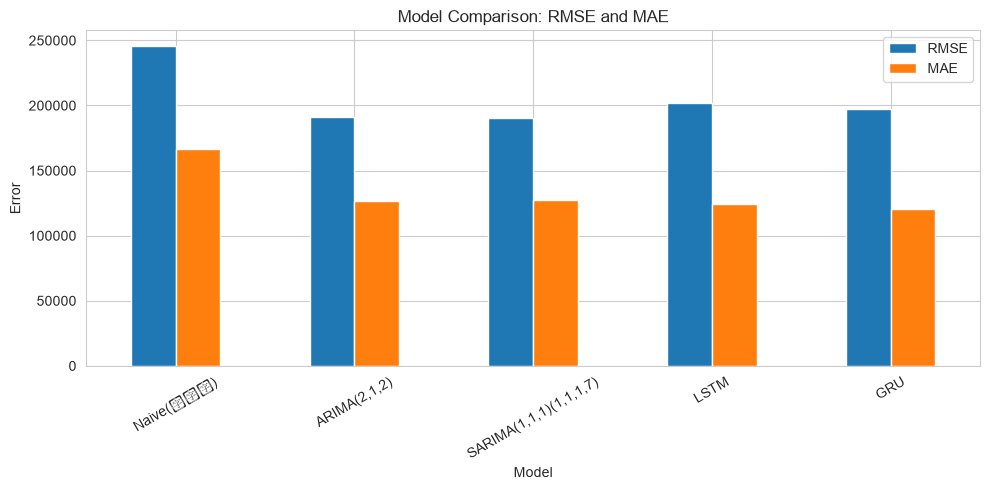
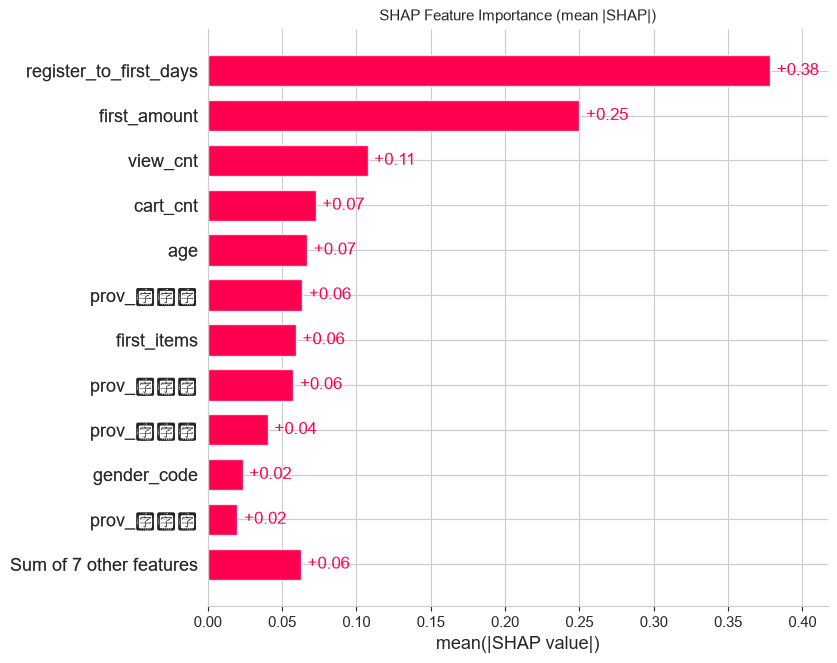

# L3 预测性分析：把未来变成区间

> **一句话**：预测的价值不在“算得准”，而在**误差可控、区间可信、峰值可解释**。
> 数据源统一为 `../ecommerce/ecommerce.db`，方法论总览见 [../README.md](../README.md)。

---

## 1. 这层解决什么问题

“明天大概卖多少？”、“这个客户会不会复购？”、“618 需要备多少货？”——L3 用历史规律给出未来的估计。

关键心态：**先问“误差多大、最坏情况多少”，再问“预测值是多少”。** 一个没有区间的点预测，无法支撑任何真实决策。

## 2. 方法地图

| 方法 | 用途 | 电商示例 | 关键注意点 |
|---|---|---|---|
| 统计时序 | ARIMA / SARIMA | 日 GMV 预测 | 平稳性、定阶、季节性 |
| 深度学习时序 | LSTM / GRU / Seq2Seq | 日 GMV、多步预测 | 窗口、归一化、大促尖峰 |
| 集成学习 | XGBoost / LightGBM | 复购分类、峰值日识别 | 特征工程、时间切分、不平衡 |
| 分位数预测 | 预测区间 | 备货上下界 | 覆盖率检验，不只看点误差 |
| 多步预测 | 未来 N 天 | 大促备货窗口 | 误差随步长累积 |
| 可解释性 | SHAP | 复购驱动因素 | 弱模型上的解释不可外推 |
| 迁移学习 | 跨品类预训练 + 微调 | 新品类冷启动 | 源域与目标域差异 |

## 3. 关键成果

**日 GMV 预测。** 对 log1p 变换后的日 GMV 做滚动一步预测，比较 ARIMA、SARIMA、LSTM、GRU。所有模型都能学到趋势与周周期，**大促峰值是共同的主要误差源**——峰值超出历史范围时，模型系统性低估。

**峰值日识别。** 把“是否高 GMV 日”作为分类任务，整体准确率 83%，但峰值类的 Precision/Recall 为 0：模型学会了“永远预测不是峰值”。这是一个典型的**类别不平衡陷阱**——准确率高不代表有用。正确做法是看 PR 曲线、调整类别权重，或加入促销日历特征。

**复购预测的信息瓶颈。** 在规定特征集合（首单 RFM + 行为计数 + 客户属性）下，XGBoost/LightGBM 的测试 AUC 都在 0.5 附近，与线性基线相当；加入生成参数后 AUC 跳到 0.77。结论是：**瓶颈在特征而不是算法**。弱信号场景下，与其调参换模型，不如拉长行为观察窗口、加入首单类目与用券信息。

**区间预测。** 线性分位数回归的名义 80% 区间实际覆盖 88%（偏保守），LightGBM 覆盖 72%（过度自信）。中位数 MAPE 分别为 31.6% 与 32.4%。业务用法：备货用 q0.9，预算用 q0.1~q0.5，峰值窗口人工加宽区间。

**多步预测。** 直接多输出（MAPE 37.2%）与 Seq2Seq（38.1%）在 532 天小样本上精度接近；直接多输出结构简单、训练快、避免了递归式误差级联。

**迁移学习。** 跨品类预训练的收益主要体现在**起点**：初始验证损失 0.1256 对 0.2061，省掉冷启动摸索；最终精度差异（MAPE 43.5% vs 44.7%）落在单种子噪声范围内，不应过度解读。

**SHAP 的诚实边界。** 在 AUC≈0.5 的弱模型上，SHAP 图只描述“模型为何这么判”，不能外推为客户行为规律。解释只在强模型上才有业务价值。







## 4. 专题索引

| 报告 | 内容 | 适合谁 |
|---|---|---|
| [predictive_report.md](predictive_report.md) | 主报告：STL、ADF、ARIMA/SARIMA、LSTM/GRU、模型对比、峰值分类 | 做销量预测的人 |
| [ensemble_report.md](ensemble_report.md) | XGBoost/LightGBM 复购预测、时间切分、特征瓶颈实验 | 做用户增长的人 |
| [multistep_report.md](multistep_report.md) | 直接多输出与 Seq2Seq 多步预测 | 做备货计划的人 |
| [quantile_report.md](quantile_report.md) | 分位数回归与区间覆盖率 | 做预算与风控的人 |
| [transfer_report.md](transfer_report.md) | 跨品类迁移、零样本与微调对比 | 做多品类预测的人 |
| [shap_report.md](shap_report.md) | SHAP 全局与单样本解释、方法局限 | 做模型解释的人 |

## 5. 方法提醒

1. **必须按时间切分**：随机切分会让数据泄漏进训练集，评估数字偏乐观。
2. **不平衡任务别只看准确率**：峰值识别要看 PR 曲线与召回。
3. **区间要检验覆盖率**：名义 80% 不代表实际 80%。
4. **峰值单独建模**：大促与日常的生成机制不同，混在一起会两头不讨好。
5. **先补特征再换模型**：弱信号下换模型通常无效。

## 6. 如何运行

```powershell
python src/data/L3/generate_predictive_report.py
python src/data/L3/l3_ensemble.py
python src/data/L3/l3_multistep.py
python src/data/L3/l3_quantile.py
python src/data/L3/l3_transfer.py
python src/data/L3/l3_shap.py
```

深度学习脚本首次运行需要加载 TensorFlow，耗时较长。完整环境与执行顺序见 [../run.md](../run.md)。
