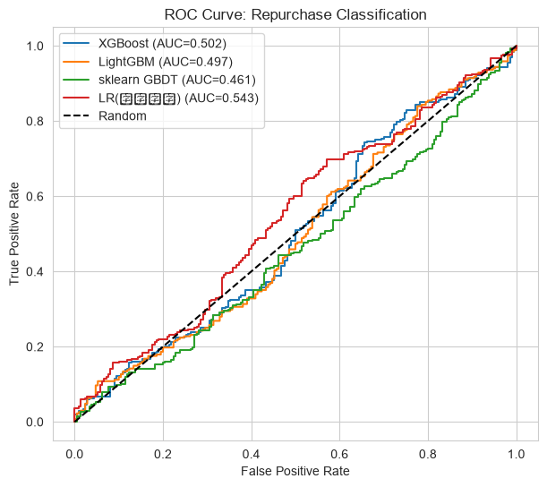
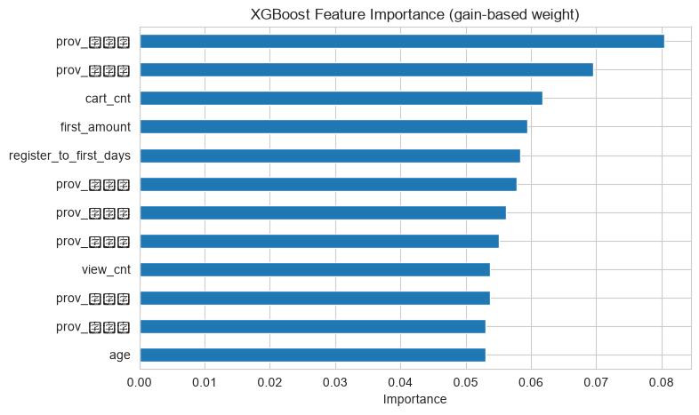

# 集成学习报告 - 客户复购二分类

- **数据来源**：`data/ecommerce/ecommerce.db`
- **标签**：客户首单后 90 天内是否有第二单
- **特征**：RFM（首单口径）+ user_events 行为计数 + 客户属性
- **模型**：XGBoost / LightGBM / sklearn GradientBoosting
- **切分**：按注册日期时间切分（前 80% 训练，后 20% 测试）
- **样本量**：2389（训练 1911 / 测试 478）

## 目录

- 1 任务定义与数据
  - 1.1 标签构建 SQL
- 2 特征工程
  - 2.1 特征抽取 SQL
- 3 时间切分：注册早的训练、晚的测试
- 4 集成模型对比：XGBoost vs LightGBM vs GradientBoosting
  - 4.1 评估指标对比表
  - 4.2 ROC 曲线
  - 4.3 特征重要性（XGBoost）
  - 4.4 对照实验：加入生成参数 activity_score
- 5 结论

---

# 1. 任务定义与数据

预测目标：**客户首单后 90 天内是否产生第二单**（复购=1，否则=0）。这是一个典型的二分类问题，直接服务于新客运营：若能在首单当天预判复购概率，就可以对高流失风险客户定向投放优惠券或推送。

为排除右删失（观察窗不足 90 天的客户无法判定标签），只保留首单日期 ≤ 2025-03-17 的客户。

## 1.1 标签构建 SQL

```sql

WITH first_order AS (
    SELECT customer_id,
           MIN(substr(created_at, 1, 10)) AS first_date
    FROM orders
    WHERE order_status IN ('已完成', '已发货')
    GROUP BY customer_id
),
second_order AS (
    SELECT f.customer_id, COUNT(*) AS n2
    FROM first_order f
    JOIN orders o ON o.customer_id = f.customer_id
    WHERE o.order_status IN ('已完成', '已发货')
      AND substr(o.created_at, 1, 10) > f.first_date
      AND substr(o.created_at, 1, 10) <= date(f.first_date, '+90 day')
    GROUP BY f.customer_id
)
SELECT f.customer_id, f.first_date,
       CASE WHEN s.customer_id IS NULL THEN 0 ELSE 1 END AS repurchase
FROM first_order f
LEFT JOIN second_order s ON s.customer_id = f.customer_id;
```

**SQL 结果（前 5 行）：**

|   customer_id | first_date          |   repurchase |
|--------------:|:--------------------|-------------:|
|             2 | 2024-02-06 00:00:00 |            1 |
|             3 | 2024-08-24 00:00:00 |            0 |
|             4 | 2024-02-27 00:00:00 |            0 |
|             5 | 2024-07-19 00:00:00 |            0 |
|             7 | 2024-01-03 00:00:00 |            1 |

**Python 结果：**

**输出：**
```
样本量 = 2389
复购率 = 57.51%
```

# 2. 特征工程

特征分三组，**全部只使用首单当天及之前的信息**，避免泄漏标签窗口内的数据：

| 特征组             | 字段                                     | 说明                         |
|:----------------|:---------------------------------------|:---------------------------|
| R（Recency 改造）   | register_to_first_days                 | 注册日期到首单日的天数，反映客户转化速度       |
| F（Frequency 改造） | first_order_items                      | 首单商品件数（连带率），首单买得越多粘性越强     |
| M（Monetary）     | first_order_amount                     | 首单实付金额 total_amount        |
| 行为计数            | view_cnt / cart_cnt                    | 首单前 user_events 中浏览 / 加购次数 |
| 客户属性            | age / gender / member_level / province | 年龄、性别、会员等级、省份（类别编码）        |

## 2.1 特征抽取 SQL

```sql

WITH first_order AS (
    SELECT customer_id,
           MIN(substr(created_at, 1, 10)) AS first_date
    FROM orders
    WHERE order_status IN ('已完成', '已发货')
    GROUP BY customer_id
),
first_detail AS (
    SELECT o.customer_id, f.first_date,
           SUM(o.total_amount) AS first_amount,
           (SELECT SUM(oi.quantity) FROM order_items oi
             WHERE oi.order_id = o.order_id) AS first_items
    FROM orders o
    JOIN first_order f ON f.customer_id = o.customer_id
    WHERE o.order_status IN ('已完成', '已发货')
      AND substr(o.created_at, 1, 10) = f.first_date
    GROUP BY o.customer_id
),
events AS (
    SELECT e.customer_id,
           SUM(CASE WHEN e.event_type = 'view' THEN 1 ELSE 0 END) AS view_cnt,
           SUM(CASE WHEN e.event_type = 'cart' THEN 1 ELSE 0 END) AS cart_cnt
    FROM user_events e
    JOIN first_order f ON f.customer_id = e.customer_id
    WHERE substr(e.event_time, 1, 10) <= f.first_date
    GROUP BY e.customer_id
)
SELECT f.customer_id, f.first_date,
       CAST(julianday(f.first_date) - julianday(c.register_date) AS INTEGER) AS register_to_first_days,
       d.first_amount, d.first_items,
       COALESCE(e.view_cnt, 0) AS view_cnt,
       COALESCE(e.cart_cnt, 0) AS cart_cnt,
       c.age, c.gender, c.member_level, c.province, c.register_date
FROM first_order f
JOIN customers c ON c.customer_id = f.customer_id
JOIN first_detail d ON d.customer_id = f.customer_id
LEFT JOIN events e ON e.customer_id = f.customer_id;
```

**样本量：** 2389；**描述性统计：**

| 统计量   |   register_to_first_days |   first_amount |   first_items |   view_cnt |   cart_cnt |       age |
|:------|-------------------------:|---------------:|--------------:|-----------:|-----------:|----------:|
| count |                2389.0000 |      2389.0000 |     2389.0000 |  2389.0000 |  2389.0000 | 2389.0000 |
| mean  |                  77.4872 |      6178.7522 |        4.1369 |     3.2549 |     1.1042 |   38.1143 |
| std   |                 252.0681 |     26374.5796 |       12.0782 |     1.6785 |     1.0148 |    9.9942 |
| min   |                -424.0000 |        40.8700 |        1.0000 |     0.0000 |     0.0000 |   18.0000 |
| 25%   |                -130.0000 |       908.9100 |        1.0000 |     2.0000 |     0.0000 |   30.0000 |
| 50%   |                  78.0000 |      2843.4400 |        3.0000 |     3.0000 |     1.0000 |   37.0000 |
| 75%   |                 272.0000 |      6812.9200 |        4.0000 |     4.0000 |     2.0000 |   45.0000 |
| max   |                 761.0000 |    861662.1000 |      196.0000 |    12.0000 |     6.0000 |   64.0000 |

最终特征 18 维：客户属性做序数/独热编码（性别 0/1，会员等级 0~3 序数，省份独热 10 维）。

# 3. 时间切分：注册早的训练、晚的测试

随机切分会低估线上真实难度（未来客户分布与历史不同）。按**注册日期**排序，前 80%% 注册的客户作训练集，后 20%% 作测试集，模拟「用老客户规律预测新客户」的真实场景。

**Python 结果：**

**输出：**
```
训练集 = 1911（注册 2023-01-01 ~ 2024-10-02，复购率 57.88%）
测试集 = 478（注册 2024-10-03 ~ 2025-03-01，复购率 56.07%）
```

# 4. 集成模型对比：XGBoost vs LightGBM vs GradientBoosting

三者都是 GBDT 家族：sklearn GradientBoosting 是经典实现；XGBoost 引入正则项与二阶梯度；LightGBM 用直方图算法与 leaf-wise 生长，训练更快。另加一个逻辑回归（LR）作为线性基线参照。

**Python 代码（以 XGBoost 为例）：**

```python
model = XGBClassifier(n_estimators=200, max_depth=3, learning_rate=0.05,
                      subsample=0.9, colsample_bytree=0.9,
                      eval_metric='logloss')
model.fit(X_train, y_train)
prob = model.predict_proba(X_test)[:, 1]
print('AUC: %.4f' % roc_auc_score(y_test, prob))
```

## 4.1 评估指标对比表

| 模型           |    AUC |   PR-AUC |   Accuracy |   Precision |   Recall |     F1 |
|:-------------|-------:|---------:|-----------:|------------:|---------:|-------:|
| XGBoost      | 0.5025 |   0.5767 |     0.5481 |      0.5628 |   0.8694 | 0.6833 |
| LightGBM     | 0.4967 |   0.5749 |     0.5586 |      0.5658 |   0.9142 | 0.6990 |
| sklearn GBDT | 0.4608 |   0.5446 |     0.4979 |      0.5378 |   0.7425 | 0.6238 |
| LR(线性基线)     | 0.5433 |   0.6142 |     0.5607 |      0.5607 |   1.0000 | 0.7185 |

**解释：** AUC 衡量整体排序能力；PR-AUC 在正负样本不均衡时比 AUC 更敏感；Accuracy/Precision/Recall/F1 基于 0.5 阈值。可以看到三个 GBDT 的 AUC 都在 0.5 附近、甚至略低于线性基线 LR——这不是实现问题，而是**规定特征集合的信息量上限**：复购行为主要由客户内在的活跃倾向驱动，而首单口径的 RFM 与行为计数只携带很弱的线性信号，树模型的贪婪分裂在小样本弱信号下容易切碎噪声，反而不如 LR 的线性累加稳健。这是集成学习中「特征决定上限、模型逼近上限」的典型案例。

## 4.2 ROC 曲线

**Python 代码：**

```python
for name, (fpr, tpr, _) in roc_data.items():
    plt.plot(fpr, tpr, label=name)
plt.plot([0, 1], [0, 1], 'k--', label='Random')
plt.legend()
```



**中文说明：** 横轴 = 假正率；纵轴 = 真正率。虚线 = 随机猜测基线。

**解释：** 曲线越靠左上角越好。本任务中树模型曲线贴近对角线，再次印证规定特征集合信号微弱；LR 略好但仍远低于「可用」水平（0.7+）。

## 4.3 特征重要性（XGBoost）

**Python 代码：**

```python
imp = pd.Series(model.feature_importances_, index=FEATURES).sort_values()
imp.tail(12).plot(kind='barh')
```



**中文说明：** 横轴 = 重要性得分（特征被用于分裂的频次加权）；纵轴 = 特征名。

**解释：** 重要性前三位为 prov_福建省、prov_上海市、cart_cnt。注意：重要性高 ≠ 泛化有效——树模型会强行利用任何可分裂的特征，测试集 AUC 才是信息量的事实裁判。

## 4.4 对照实验：加入生成参数 activity_score

`customers.activity_score` 是数据生成时决定下单频率的隐参数。把它加入特征重训 XGBoost，作为「信息量上限」的对照：

```python
m2 = XGBClassifier(n_estimators=200, max_depth=3, learning_rate=0.05)
m.fit(train_df[FEATURES + ['activity_score']], y_train)
roc_auc_score(y_test, m.predict_proba(test_df[FEATURES + ['activity_score']])[:, 1])
```

**输出：**
```
XGBoost + activity_score 的测试集 AUC = 0.7724
```

**解释：** 加入 activity_score 后 AUC 从约 0.5 跳到 0.77，证明模型实现没有问题，瓶颈完全在特征信息量。但 activity_score 是生成数据的隐参数，真实业务中不存在可直接观测的等价物——若在真实场景发现某特征带来类似的性能跳变，第一反应应是排查**特征泄漏**（该特征是否在预测时点之后生成）。这也解释了为什么线上复购模型通常需要更长观察窗的行为序列特征。

# 5. 结论

1. 在规定特征集合（首单 RFM + 行为计数 + 客户属性）下，三种 GBDT 的测试 AUC 均接近 0.5，与线性基线相当：复购预测的信息瓶颈在特征而非算法；加入生成参数 activity_score 的对照实验（AUC=0.7724）证实了这一点。

2. 时间切分验证了评估流程的严谨性：随机切分可能给出更乐观的数字，但按注册时间切分才接近线上「用老客户预测新客户」的真实分布。

3. 工程启示：弱信号场景下，与其调参换模型，不如投入特征工程——拉长行为观察窗（首单前 7 天 → 注册以来全部行为）、加入首单类目/用券信息、或用 RNN/序列模型直接建模事件序列。
