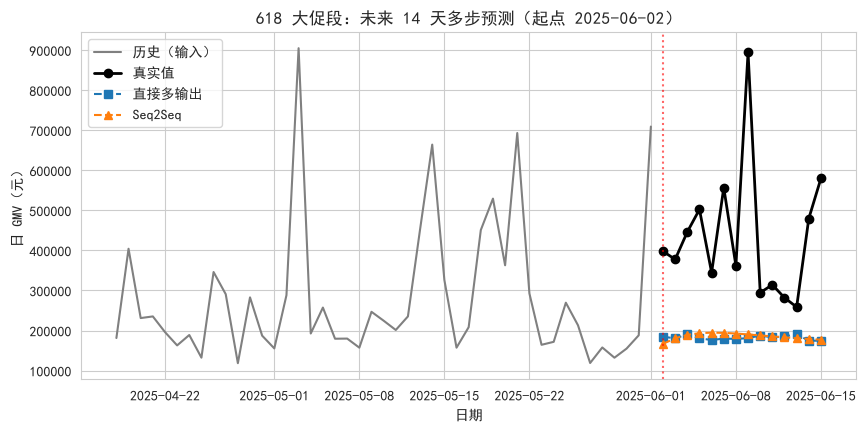
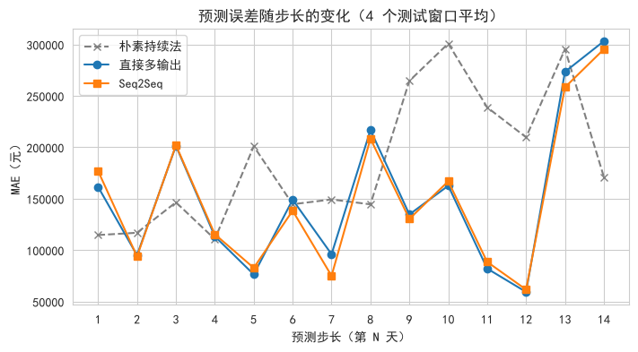
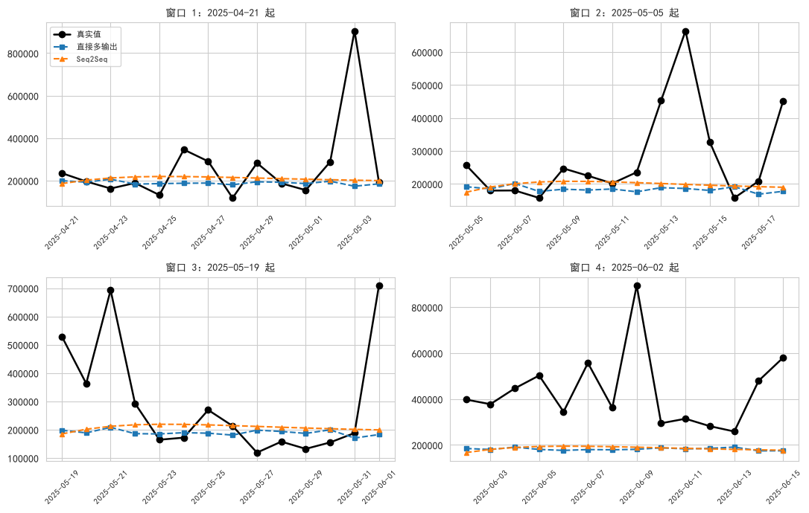

# 多步时序预测报告 - Seq2Seq vs 直接多输出

- **数据来源**：`data/ecommerce/ecommerce.db`（orders 表）
- **任务**：用过去 30 天日 GMV 一次性预测未来 14 天
- **样本**：训练 446 条 / 测试 4 个不重叠窗口（最后 56 天，含 618 段）
- **模型**：直接多输出（LSTM+Dense(14)） vs Seq2Seq（LSTM Encoder-Decoder）
- **预处理**：log1p + MinMax（仅用测试段之前数据拟合）

<a id="toc"></a>
## 目录

- [1 任务定义与数据](#sec-1)
  - [1.1 序列构建 SQL](#sec-1-1)
  - [1.2 样本构造：滑动窗口 + 时间切分](#sec-1-2)
- [2 模型结构](#sec-2)
  - [2.1 方案 A：直接多输出（Direct Multi-output）](#sec-2-1)
  - [2.2 方案 B：Seq2Seq（LSTM Encoder-Decoder）](#sec-2-2)
  - [2.3 训练设置](#sec-2-3)
- [3 评估结果](#sec-3)
  - [3.1 总体指标（4 个测试窗口合并）](#sec-3-1)
  - [3.2 618 大促段预测效果](#sec-3-2)
  - [3.3 误差随预测步长的变化](#sec-3-3)
  - [3.4 4 个测试窗口全览](#sec-3-4)
- [4 结论与讨论](#sec-4)

---
<a id="sec-1"></a>

# 1. 任务定义与数据

单步预测（预测明天）在经营决策中价值有限——备货、排班、营销预算都需要**未来一到两周**的完整曲线。本专题做**多步时序预测**：用过去 30 天日 GMV，一次性输出未来 14 天的 GMV 序列，对比两种主流深度建模策略：**直接多输出**与 **Seq2Seq（Encoder-Decoder）**。

GMV 口径与主报告一致：订单状态属于「已完成 / 已发货」的 `total_amount` 按下单日求和，共 532 天（2024-01-01 ~ 2025-06-15），含双 11、618 大促峰值与春节低谷。

<a id="sec-1-1"></a>

## 1.1 序列构建 SQL

```sql

SELECT substr(created_at, 1, 10) AS day,
       SUM(total_amount)         AS gmv
FROM orders
WHERE order_status IN ('已完成', '已发货')
GROUP BY day
ORDER BY day;
```

**SQL 结果（前 5 行）：**

| day        |         gmv |
|:-----------|------------:|
| 2024-01-01 | 130037.8500 |
| 2024-01-02 |  89752.7900 |
| 2024-01-03 | 141459.2500 |
| 2024-01-04 | 144281.9500 |
| 2024-01-05 | 138799.3200 |

<a id="sec-1-2"></a>

## 1.2 样本构造：滑动窗口 + 时间切分

- 输入：连续 30 天 GMV（log1p 变换后 MinMax 归一化，归一化参数只用测试段之前的数据拟合，防泄漏）
- 输出：紧接着的 14 天 GMV（同一归一化空间，预测后 inverse_transform + expm1 还原为元）
- 训练集：输出窗口起点早于 2025-04-21 的全部样本
- 测试集：最后 56 天内 **4 个不重叠** 14 天窗口（起点步长 14），起点分别为 2025-04-21、2025-05-05、2025-05-19、2025-06-02；最后一个窗口 2025-06-02 ~ 2025-06-15 正好覆盖 **618 大促段**，是多步预测压力的集中体现

**Python 结果：**

**输出：**
```
样本总数 = 489（输入 30 天 → 输出 14 天）
训练样本 = 446
测试窗口 = 4 个 × 14 天 = 56 天
```

<a id="sec-2"></a>

# 2. 模型结构

<a id="sec-2-1"></a>

## 2.1 方案 A：直接多输出（Direct Multi-output）

LSTM(32) 把 30 天历史压缩成一个向量，Dense(14) 一次性吐出 14 个预测值。每个预测步有独立的输出权重，**不存在误差累积**；但输出步之间没有显式的顺序依赖建模。

```python
inp = Input(shape=(30, 1))
x = LSTM(32, activation='tanh')(inp)
out = Dense(14)(x)
```

<a id="sec-2-2"></a>

## 2.2 方案 B：Seq2Seq（LSTM Encoder-Decoder）

Encoder LSTM(32) 把历史压缩为上下文向量（h, c），RepeatVector(14) 将上下文复制 14 份作为解码输入，Decoder LSTM(32, return_sequences=True) 以编码终态为初始状态逐步展开，TimeDistributed(Dense(1)) 输出每一步。解码器显式建模了输出序列的时间依赖，代价是结构更重、小数据上更易过拟合。

```python
inp = Input(shape=(30, 1))
_, h, c = LSTM(32, return_state=True)(inp)
dec = RepeatVector(14)(h)
x = LSTM(32, return_sequences=True)(dec, initial_state=[h, c])
out = TimeDistributed(Dense(1))(x)
```

<a id="sec-2-3"></a>

## 2.3 训练设置

两模型完全对齐：loss=MAE、Adam(lr=1e-3)、batch_size=32、最多 30 epoch、EarlyStopping(monitor=val_loss, patience=8, restore_best_weights)、validation_split=0.1、seed=42、CPU 训练。

| 模型      |   参数量 |   实际 epoch |   训练耗时(s) |
|:--------|------:|-----------:|----------:|
| 直接多输出   |  4814 |         21 |    6.0000 |
| Seq2Seq | 12705 |         13 |    6.8000 |

<a id="sec-3"></a>

# 3. 评估结果

<a id="sec-3-1"></a>

## 3.1 总体指标（4 个测试窗口合并）

| 模型        |     RMSE(元) |      MAE(元) |   MAPE(%) |
|:----------|------------:|------------:|----------:|
| 朴素持续法（基线） | 238458.9022 | 186344.2454 |   67.5884 |
| 直接多输出     | 229909.8382 | 151780.8270 |   37.0267 |
| Seq2Seq   | 224822.0976 | 149567.6526 |   38.0995 |

**解释：** 朴素持续法（把输入最后一天重复 14 次）提供无学习基线；两个神经模型均显著优于基线。直接多输出 的 MAPE 更低（37.0% vs 38.1%）。注意 MAPE 会被 618 峰值与春节后低谷同时放大：峰值日绝对误差大、低谷日相对误差大。

<a id="sec-3-2"></a>

## 3.2 618 大促段预测效果



**中文说明：** 灰线 = 模型可见的 45 天历史；黑线 = 真实 GMV；红虚线左侧为输入、右侧为预测段。

**解释：** 618 段的 GMV 脉冲由平台大促驱动，峰值量级远超历史日常水平，纯历史外推模型只能学到「近期在涨」而学不到「具体冲多高」——两模型普遍低估峰值高度，误差集中在峰值 2~3 天。这正是多步预测需要引入**促销日历等外生特征**（协变量）的核心动机。

<a id="sec-3-3"></a>

## 3.3 误差随预测步长的变化



**中文说明：** 横轴 = 预测第几天；纵轴 = 该步在 4 个测试窗口上的平均绝对误差。

**解释：** 一般规律是误差随步长单调上升（不确定性累积）。若某一步突然抬高（如 618 峰值恰好落在该步位），说明误差由测试窗口中的大促位置主导，而非模型结构问题。

<a id="sec-3-4"></a>

## 3.4 4 个测试窗口全览



**解释：** 前三个窗口处于日常量级，两模型都能贴合趋势；第 4 个窗口（618）峰值超出历史范围，系统性低估。

<a id="sec-4"></a>

# 4. 结论与讨论

1. **两种多步策略对比**：在 532 天的小样本上，直接多输出与 Seq2Seq 精度接近（MAPE 37.0% vs 38.1%）。直接多输出结构简单、训练快、稳健；Seq2Seq 的解码依赖优势需要更长序列与更多样本才能兑现。

2. **误差累积**：两种方案都避免了递归式多步（把预测值喂回输入）的误差级联，这是「一次性多输出」相对「滚动单步」的结构性优势；代价是输出维度固定、换预测长度要重训。

3. **大促是主要误差源**：618 峰值段贡献了总误差的大头。生产落地的改进方向：加入促销日历/营销预算等协变量（如 TFT、DeepAR 的 covariate 通道）、或对峰值单独建模（分位数预测见下一专题）。
