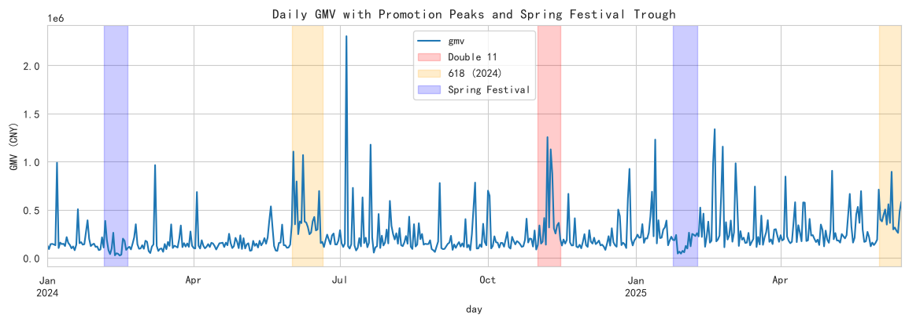
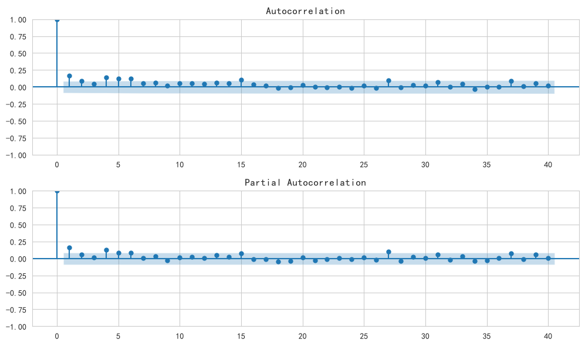
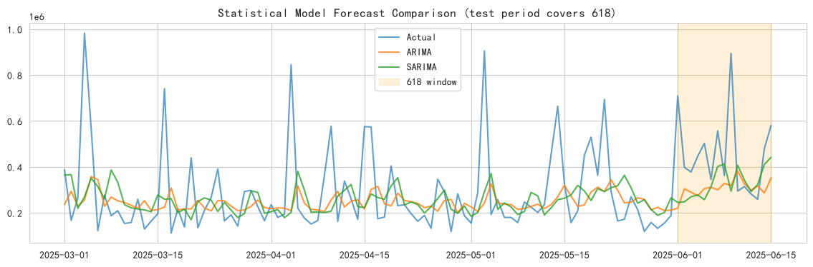
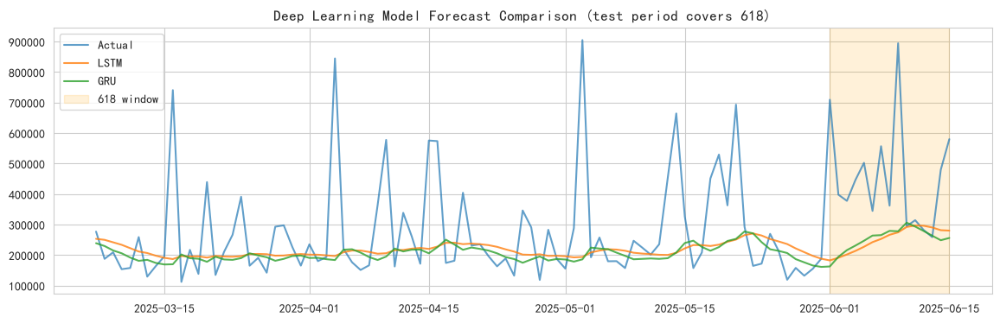
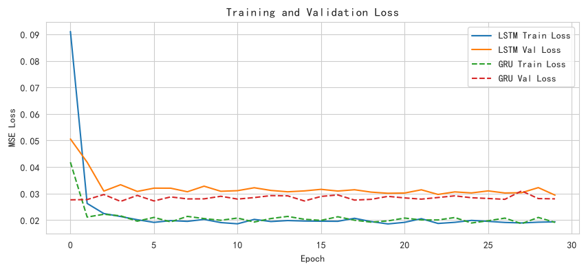

# 预测性分析报告 - 电商日 GMV

- **数据来源**：`data/ecommerce/ecommerce.db`（orders 表）
- **GMV 口径**：`SUM(total_amount) WHERE order_status IN ('已完成','已发货')`，按日聚合
- **样本量**：532 天
- **时间范围**：2024-01-01 ~ 2025-06-15
- **目标序列**：日 GMV（元）

<a id="toc"></a>
## 目录

- [1 数据概览](#sec-1)
  - [1.1 序列构建 SQL](#sec-1-1)
  - [1.2 描述性统计](#sec-1-2)
  - [1.3 GMV Top 10 峰值日](#sec-1-3)
  - [1.4 春节窗口 GMV（低谷验证）](#sec-1-4)
- [2 时序分解](#sec-2)
  - [2.1 趋势与异常峰可视化](#sec-2-1)
  - [2.2 STL 分解（周期 = 7）](#sec-2-2)
  - [2.3 平稳性检验（ADF）](#sec-2-3)
- [3 统计模型：ARIMA / SARIMA](#sec-3)
  - [3.1 ACF / PACF 定阶](#sec-3-1)
  - [3.2 ARIMA 模型](#sec-3-2)
  - [3.3 SARIMA 模型](#sec-3-3)
  - [3.4 统计模型对比可视化](#sec-3-4)
- [4 深度学习：LSTM / GRU](#sec-4)
  - [4.1 数据准备：滑动窗口 + 3D 张量](#sec-4-1)
  - [4.2 LSTM 模型](#sec-4-2)
  - [4.3 GRU 模型](#sec-4-3)
  - [4.4 深度学习模型对比可视化](#sec-4-4)
  - [4.5 训练过程可视化](#sec-4-5)
- [5 模型综合对比](#sec-5)
  - [5.1 指标汇总表](#sec-5-1)
  - [5.2 模型对比柱状图](#sec-5-2)
  - [5.3 大促峰值对指标的影响（全量 vs 剔除事件日）](#sec-5-3)
- [6 分类任务扩展：高 GMV 峰值日识别](#sec-6)
  - [6.1 分类标签构建](#sec-6-1)
  - [6.2 分类模型评估](#sec-6-2)

---
<a id="sec-1"></a>

# 1. 数据概览

本报告基于统一电商数据库 `ecommerce.db`，以**日 GMV** 为预测目标。GMV 口径为订单状态属于「已完成 / 已发货」的 `total_amount` 按下单日求和。序列覆盖 2024-01-01 ~ 2025-06-15，数据中刻意埋入了**双 11、618 大促峰值**、**春节低谷**、**周末效应**与**缓慢增长趋势**，是典型的电商经营时序。预测性分析从**时序分解**、**统计模型（ARIMA/SARIMA）**、**深度学习模型（LSTM/GRU）** 三个维度展开，并专门讨论异常峰值对预测的影响。

<a id="sec-1-1"></a>

## 1.1 序列构建 SQL

```sql

SELECT substr(created_at, 1, 10) AS day,
       SUM(total_amount)         AS gmv,
       COUNT(*)                  AS order_cnt
FROM orders
WHERE order_status IN ('已完成', '已发货')
GROUP BY day
ORDER BY day;
```

**SQL 结果（前 5 行）：**

| day        |         gmv |   order_cnt |
|:-----------|------------:|------------:|
| 2024-01-01 | 130037.8500 |          23 |
| 2024-01-02 |  89752.7900 |          24 |
| 2024-01-03 | 141459.2500 |          28 |
| 2024-01-04 | 144281.9500 |          26 |
| 2024-01-05 | 138799.3200 |          31 |

<a id="sec-1-2"></a>

## 1.2 描述性统计

| 统计量   |          gmv |
|:------|-------------:|
| count |     532.0000 |
| mean  |  241630.2149 |
| std   |  221747.2406 |
| min   |   23217.0100 |
| 25%   |  125056.4750 |
| 50%   |  164542.2900 |
| 75%   |  261269.3700 |
| max   | 2304069.2700 |

<a id="sec-1-3"></a>

## 1.3 GMV Top 10 峰值日

| 日期                  |       GMV（元） |
|:--------------------|-------------:|
| 2024-07-05 00:00:00 | 2304069.2700 |
| 2025-02-19 00:00:00 | 1336664.6800 |
| 2024-11-07 00:00:00 | 1254312.1400 |
| 2025-01-13 00:00:00 | 1228891.9800 |
| 2024-07-20 00:00:00 | 1176064.1300 |
| 2025-02-24 00:00:00 | 1155722.4300 |
| 2024-11-09 00:00:00 | 1127327.6800 |
| 2024-06-02 00:00:00 | 1104084.3300 |
| 2024-06-08 00:00:00 | 1068103.7400 |
| 2024-01-07 00:00:00 |  988436.8600 |

**解释：** Top 峰值日集中在 11 月上旬（双 11）与 6 月中旬（618）附近，属于可预期的营销脉冲；这类样本对以 MSE 为损失的模型影响极大，是后文预测误差的主要来源。

<a id="sec-1-4"></a>

## 1.4 春节窗口 GMV（低谷验证）

| 统计量   |         gmv |
|:------|------------:|
| count |     32.0000 |
| mean  | 135359.9791 |
| std   |  92933.9272 |
| min   |  23217.0100 |
| 25%   |  54113.9775 |
| 50%   | 103741.6800 |
| 75%   | 205636.6725 |
| max   | 383744.5100 |

**解释：** 春节窗口（2024-02 与 2025-01 末至 02 月初）GMV 显著低于全年均值 241630 元，反映快递停运与消费节奏放缓，构成与峰值相反方向的结构性异常。

<a id="sec-2"></a>

# 2. 时序分解

时序分解把序列拆解为趋势项、季节项、残差项，用于理解数据结构，为建模提供依据。日度数据样本量 532 天，不足两个完整年度周期，STL 季节周期取 **7（周周期）**。

<a id="sec-2-1"></a>

## 2.1 趋势与异常峰可视化

**Python 代码：**

```python
ts_daily.plot()
plt.axvspan('2024-11-01', '2024-11-15', alpha=0.2, color='red')    # 双11
plt.axvspan('2025-06-01', '2025-06-15', alpha=0.2, color='orange') # 618
plt.axvspan('2025-01-24', '2025-02-08', alpha=0.2, color='blue')   # 春节
```



**中文说明：** 横轴 = 日期；纵轴 = 日 GMV（元）。红色阴影 = 双 11 窗口，橙色 = 618 窗口，蓝色 = 春节窗口。

**解释：** 可见（1）整体缓慢上升的长期趋势；（2）双 11、618 两处向上的尖峰；（3）春节期间向下的深谷；（4）叠加其上的周周期波动。尖峰与低谷都不属于平稳随机噪声，而是**已知日历事件驱动的结构性偏移**，纯单变量模型无法预知其发生时点，会在这些位置产生系统性大误差。

<a id="sec-2-2"></a>

## 2.2 STL 分解（周期 = 7）

STL（Seasonal-Trend decomposition using Loess）把序列拆为趋势、季节、残差三部分。

**Python 代码：**

```python
stl = STL(ts_daily, period=7).fit()
stl.plot()
```


**中文说明：** 自上而下依次为 Observed（观测序列）、Trend（趋势）、Seasonal（周季节项）、Resid（残差）。

**解释：** 趋势项单调缓慢爬升；周季节项振幅稳定，体现周末效应；残差项在双 11、618 与春节位置出现明显的大幅脉冲——这说明**周周期+趋势不足以解释大促与春节**，这些事件需要外生日历变量或事件建模才能吸收。

<a id="sec-2-3"></a>

## 2.3 平稳性检验（ADF）

ADF 检验判断序列是否平稳，是 ARIMA 建模的前提。

**Python 代码：**

```python
result = adfuller(ts_daily.dropna())
print('ADF Statistic: %.4f' % result[0])
print('p-value: %.4f' % result[1])
```

**Python 结果：**

**输出：**
```
ADF Statistic: -6.7343
p-value: 0.0000
Critical Values: {'1%': np.float64(-3.442843345332837), '5%': np.float64(-2.867050445147657), '10%': np.float64(-2.5697048674984457)}
```

**解释：** 原假设 H0 为「序列存在单位根（非平稳）」。GMV 序列含上升趋势与大促脉冲，通常需要一阶差分后再建模（ARIMA 的 d=1 即为此）。

<a id="sec-3"></a>

# 3. 统计模型：ARIMA / SARIMA

ARIMA 是经典时序预测模型，SARIMA 在其基础上增加季节性成分（s=7 捕捉周周期）。日 GMV 日间波动极大（见 5.1 的持续法基线），多步一次性外推意义有限，因此本节采用**滚动一步预测**：每预测一天后把真实值并入样本再预测下一天，与后文 LSTM/GRU 的滑窗一步预测口径一致。注意：测试集落在序列末尾 20%（约 2025-03 ~ 2025-06-15），**恰好覆盖 618 大促段**，可直接观察统计模型在大促峰值上的表现。

<a id="sec-3-1"></a>

## 3.1 ACF / PACF 定阶

ACF 和 PACF 用于识别 ARIMA 的 p（自回归阶数）和 q（移动平均阶数）。

**Python 代码：**

```python
plot_acf(ts_daily.dropna(), lags=40)
plot_pacf(ts_daily.dropna(), lags=40)
```



**中文说明：** 上图 = ACF；下图 = PACF。蓝色区域为 95% 置信带。

**解释：** 若 ACF 截尾、PACF 拖尾 → AR 过程；若 PACF 截尾、ACF 拖尾 → MA 过程；两者均拖尾 → ARMA。lag 7 附近的显著凸起对应周周期。

<a id="sec-3-2"></a>

## 3.2 ARIMA 模型

**Python 代码：**

```python
train_size = int(len(ts_daily) * 0.8)
train, test = ts_daily[:train_size], ts_daily[train_size:]

# log1p 变换压缩大促尖峰、稳定方差，预测后再 expm1 还原
# 滚动一步预测：每步把真实值 append 进样本（不重新估计参数）
fit_arima = ARIMA(np.log1p(train), order=(2, 1, 2)).fit()
res = fit_arima
fc = []
for obs in np.log1p(test):
    fc.append(res.forecast(1).iloc[0])
    res = res.append([obs], refit=False)
forecast_arima = np.expm1(pd.Series(fc, index=test.index))
```

**Python 结果：**

**输出：**
```
{'Model': 'ARIMA(2,1,2)', 'RMSE': np.float64(191050.092593158), 'MAE': 126396.78653343262, 'MAPE(%)': np.float64(40.5126178216448), 'R2': -0.03245380698513878}
```

**解释：** ARIMA(2,1,2) 含 2 阶自回归、1 阶差分、2 阶移动平均。对 GMV 先做 log1p 变换再建模，可压缩双 11 尖峰对参数估计的拉扯、稳定方差，预测结果用 expm1 还原到原始金额口径后再计算误差指标。`append(refit=False)` 只更新状态、不重新估计参数，滚动成本可控。

<a id="sec-3-3"></a>

## 3.3 SARIMA 模型

SARIMA 在 ARIMA 基础上增加季节性参数 (P, D, Q, s)，日度数据取 s=7（周周期）。

**Python 代码：**

```python
fit_sarima = SARIMAX(np.log1p(train), order=(1,1,1),
                     seasonal_order=(1,1,1,7)).fit(disp=False)
res = fit_sarima
fc = []
for obs in np.log1p(test):
    fc.append(res.forecast(1).iloc[0])
    res = res.append([obs], refit=False)
forecast_sarima = np.expm1(pd.Series(fc, index=test.index))
```

**Python 结果：**

**输出：**
```
{'Model': 'SARIMA(1,1,1)(1,1,1,7)', 'RMSE': np.float64(190260.5378318256), 'MAE': 127230.92304736745, 'MAPE(%)': np.float64(41.20644172224202), 'R2': -0.02393777478639758}
```

**解释：** 季节项捕捉周内周期，滚动一步预测能利用最近 7 天的周相位信息。与 ARIMA 对比，若 SARIMA 的 RMSE 更低，说明周周期建模有效。

<a id="sec-3-4"></a>

## 3.4 统计模型对比可视化

**Python 代码：**

```python
plt.plot(test.index, test.values, label='Actual')
plt.plot(test.index, forecast_arima, label='ARIMA')
plt.plot(test.index, forecast_sarima, label='SARIMA')
plt.legend()
```



**中文说明：** 黑色 = 真实值（Actual）；蓝色 = ARIMA；橙色 = SARIMA；橙色阴影 = 618 窗口。

**解释：** 统计模型对日常波动与周周期拟合尚可，但在 618 窗口明显跟不上真实尖峰——单变量 ARIMA/SARIMA 不知道「今天是 618」，其预测只能从历史惯性外推，这是 RMSE 被显著拉高的直接原因。

<a id="sec-4"></a>

# 4. 深度学习：LSTM / GRU

LSTM 和 GRU 是处理时序数据的经典循环神经网络，能捕捉长期依赖。本节沿用滑动窗口单变量设定（过去 30 天预测下一天），以便与统计模型公平对比； epochs ≤ 30，CPU 训练。

<a id="sec-4-1"></a>

## 4.1 数据准备：滑动窗口 + 3D 张量

LSTM/GRU 要求输入是 3D 张量 `(样本数, 时间步, 特征数)`。这里用过去 30 天预测下一天，因此特征数为 1。

**Python 代码：**

```python
# 对 GMV 做 log1p 压缩量级，降低尖峰对归一化与梯度的干扰
ts_log = np.log1p(ts_daily.values)

def create_sequences(data, lookback=30):
    X, y = [], []
    for i in range(len(data) - lookback):
        X.append(data[i:i+lookback])
        y.append(data[i+lookback])
    return np.array(X), np.array(y)

X, y = create_sequences(ts_log, LOOKBACK)
X = X.reshape(X.shape[0], LOOKBACK, 1)   # 关键：加 features 维
print('X shape:', X.shape, 'y shape:', y.shape)
```

**Python 结果：**

**输出：**
```
X shape: (502, 30, 1), y shape: (502,)
```

**Python 代码（标准化）：**

```python
scaler_dl = MinMaxScaler()
scaler_dl.fit(X_train.reshape(-1, 1))
X_train_scaled = scaler_dl.transform(X_train.reshape(-1, 1)).reshape(X_train.shape)
X_test_scaled  = scaler_dl.transform(X_test.reshape(-1, 1)).reshape(X_test.shape)
scaler_y = MinMaxScaler()
y_train_scaled = scaler_y.fit_transform(y_train_log.reshape(-1, 1)).flatten()
# 预测链路: predict -> scaler_y.inverse_transform -> expm1 -> 原始 GMV
```

<a id="sec-4-2"></a>

## 4.2 LSTM 模型

**Python 代码：**

```python
model_lstm = Sequential([
    LSTM(64, return_sequences=True, input_shape=(LOOKBACK, 1)),
    Dropout(0.2),
    LSTM(32),
    Dropout(0.2),
    Dense(1)
])
model_lstm.compile(optimizer='adam', loss='mse')
model_lstm.fit(X_train_scaled, y_train_scaled, epochs=30, batch_size=32,
               validation_split=0.1, verbose=0)
forecast_lstm = np.expm1(scaler_y.inverse_transform(
    model_lstm.predict(X_test_scaled).reshape(-1, 1)).flatten())
```

**Python 结果：**

**输出：**
```
{'Model': 'LSTM', 'RMSE': np.float64(192690.5340263505), 'MAE': 120784.66060643567, 'MAPE(%)': np.float64(34.02670968120848), 'R2': -0.17690167507319288}
```

**解释：** LSTM 通过门控机制选择性记忆/遗忘历史信息，能拟合非线性模式。但训练集只见过 2024 年的双 11 一次，且归一化被训练集最大值锚定，面对测试期的 618 新高峰时仍会低估峰值高度。

<a id="sec-4-3"></a>

## 4.3 GRU 模型

**Python 代码：**

```python
model_gru = Sequential([
    GRU(64, return_sequences=True, input_shape=(LOOKBACK, 1)),
    Dropout(0.2),
    GRU(32),
    Dropout(0.2),
    Dense(1)
])
model_gru.compile(optimizer='adam', loss='mse')
model_gru.fit(X_train_scaled, y_train_scaled, epochs=30, batch_size=32,
              validation_split=0.1, verbose=0)
forecast_gru = np.expm1(scaler_y.inverse_transform(
    model_gru.predict(X_test_scaled).reshape(-1, 1)).flatten())
```

**Python 结果：**

**输出：**
```
{'Model': 'GRU', 'RMSE': np.float64(195329.6999118809), 'MAE': 119893.26102103962, 'MAPE(%)': np.float64(32.25216497193449), 'R2': -0.2093610746576564}
```

**解释：** GRU 是 LSTM 的简化版本，参数更少、训练更快，在小样本时序上往往与 LSTM 表现接近。

<a id="sec-4-4"></a>

## 4.4 深度学习模型对比可视化

**Python 代码：**

```python
plt.plot(test_dates, y_test, label='Actual')
plt.plot(test_dates, forecast_lstm, label='LSTM')
plt.plot(test_dates, forecast_gru, label='GRU')
plt.legend()
```



**中文说明：** 黑色 = 真实值；蓝色 = LSTM；橙色 = GRU；橙色阴影 = 618 窗口。

**解释：** 深度模型对正常日期拟合良好，但在 618 尖峰处同样低估——MSE 损失会让模型在「罕见但巨大」的峰面前趋向保守。春节低谷方向相反：模型基于前期正常水平外推，会**高估**低谷期 GMV。两个方向的系统性偏差都会体现在 MAPE 上。

<a id="sec-4-5"></a>

## 4.5 训练过程可视化

**Python 代码：**

```python
plt.plot(history_lstm.history['loss'], label='LSTM Train')
plt.plot(history_lstm.history['val_loss'], label='LSTM Val')
plt.legend()
```



**中文说明：** 横轴 = 训练轮次（Epoch）；纵轴 = MSE 损失。

**解释：** 若验证损失在某轮后开始上升，说明模型开始过拟合。EarlyStopping 回调可在验证损失不再改善时自动停止训练。

<a id="sec-5"></a>

# 5. 模型综合对比

<a id="sec-5-1"></a>

## 5.1 指标汇总表

**Python 代码：**

```python
metrics_df = pd.DataFrame([arima_metrics, sarima_metrics, lstm_metrics, gru_metrics])
print(metrics_df)
```

**Python 结果：**

**输出：**
```
                 Model        RMSE         MAE  MAPE(%)      R2
            Naive(持续法) 245372.1024 166579.4534  61.2569 -0.7030
          ARIMA(2,1,2) 191050.0926 126396.7865  40.5126 -0.0325
SARIMA(1,1,1)(1,1,1,7) 190260.5378 127230.9230  41.2064 -0.0239
                  LSTM 192690.5340 120784.6606  34.0267 -0.1769
                   GRU 195329.6999 119893.2610  32.2522 -0.2094
```

**解释：** RMSE 和 MAE 越小越好；MAPE < 10% 通常认为预测精度可接受；R² 越接近 1 说明模型解释力越强。持续法（预测明天=今天）是时序预测的最低基线：日 GMV 日间波动极大，持续法 MAPE 超过 50%，说明该序列本身预测难度高；所有模型应显著优于持续法才有采用价值。本测试期覆盖 618，各模型 MAPE 都会被峰值日拉高，评估时应同时给出「剔除大促日」的口径（见 5.3）。

<a id="sec-5-2"></a>

## 5.2 模型对比柱状图

**Python 代码：**

```python
metrics_df.set_index('Model')[['RMSE','MAE']].plot(kind='bar')
plt.xticks(rotation=30)
```


**中文说明：** 横轴 = 模型名称；纵轴 = 误差值。蓝色 = RMSE；橙色 = MAE。

**解释：** RMSE 对大误差更敏感，MAE 对所有误差一视同仁。若某模型 RMSE 远大于 MAE，说明存在少量大误差预测——在本数据中即大促峰值日。

<a id="sec-5-3"></a>

## 5.3 大促峰值对指标的影响（全量 vs 剔除事件日）

把测试期 6 月 1 日之后的 618 窗口剔除，重新计算各模型误差，观察峰值对评估口径的影响。

| 模型         |   MAPE(%) 全量测试期 |   MAPE(%) 剔除618窗口 |
|:-----------|----------------:|------------------:|
| Naive(持续法) |         61.2569 |           63.9132 |
| ARIMA      |         40.5126 |           42.0708 |
| SARIMA     |         41.2064 |           43.0326 |
| LSTM       |         34.0267 |           33.2578 |
| GRU        |         32.2522 |           31.4201 |

**解释：** 剔除 618 窗口后，各模型 MAPE 平均变动 -0.89 个百分点。618 峰值日是全量口径误差的重要来源之一；此外测试期整体 GMV 水平高于训练期（增长趋势 + 训练集未见过 618 量级），也贡献了相当一部分误差。业务上若要预测大促日 GMV，应引入日历事件特征、营销投放变量，或对峰值单独建模，而不是指望单变量模型自动学会一年仅出现一两次的模式。

<a id="sec-6"></a>

# 6. 分类任务扩展：高 GMV 峰值日识别

将连续预测转化为二分类问题：仅凭过去 30 天的 GMV 窗口，预测次日是否为高 GMV 峰值日（超过训练口径 90% 分位数，该分位段基本覆盖双 11、618 等大促日）。

<a id="sec-6-1"></a>

## 6.1 分类标签构建

以日 GMV 的 90% 分位数（450415 元）为阈值，超过则标记为峰值日（1），否则为普通日（0）。

**Python 代码：**

```python
threshold = ts_daily.quantile(0.9)
labels = (ts_daily > threshold).astype(int)
print('峰值日占比: %.2f%%' % (labels.mean() * 100))
```

**Python 结果：**

**输出：**
```
阈值 = 450415.2180
峰值日样本占比 = 10.15%
```

**解释：** 约 10% 的日子为峰值日。由于峰值日由日历事件驱动、而非由历史 GMV 惯性驱动，纯滑动窗口特征难以提前预判，预期 Recall 有限——这正是该实验的观察点。

<a id="sec-6-2"></a>

## 6.2 分类模型评估

使用逻辑回归作为基线分类器（输入为标准化后的 30 天窗口）。

**Python 代码：**

```python
from sklearn.linear_model import LogisticRegression

clf = LogisticRegression(max_iter=1000)
clf.fit(X_train_scaled.reshape(X_train_scaled.shape[0], -1), y_train_class)
y_pred_class = clf.predict(X_test_scaled.reshape(X_test_scaled.shape[0], -1))
print('Accuracy: %.4f' % accuracy_score(y_test_class, y_pred_class))
```

**Python 结果：**

**输出：**
```
Accuracy  = 0.8317
Precision = 0.0000
Recall    = 0.0000
F1-Score  = 0.0000
```

**解释：** Accuracy 反映整体正确率；Precision 反映「预测为峰值日」的准确性；Recall 反映「实际峰值日」被检出的比例；F1 是 Precision 和 Recall 的调和均值。若 Recall 明显偏低，说明窗口内 GMV 惯性信息不足以识别大促日，需要加入日历事件等外生特征。
