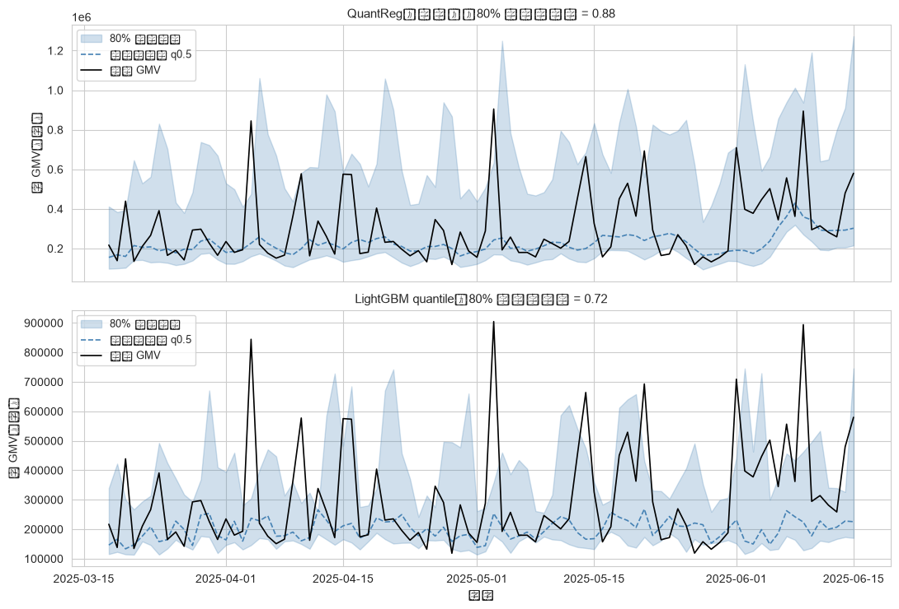
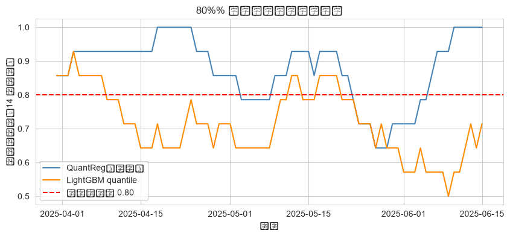

# 概率预测报告 - 条件分位数与预测区间

- **数据来源**：`data/ecommerce/ecommerce.db`（orders 表）
- **任务**：预测日 GMV 的条件分位数 q0.1 / q0.5 / q0.9，构造 80% 预测区间
- **模型**：statsmodels QuantReg vs LightGBM(objective='quantile')
- **样本**：训练 428 天 / 测试 90 天（含 618 段）
- **预处理**：log1p 变换建模，expm1 还原评估

<a id="toc"></a>
## 目录

- [1 任务定义与方法](#sec-1)
- [2 数据与特征工程](#sec-2)
  - [2.1 序列构建 SQL](#sec-2-1)
  - [2.2 特征清单](#sec-2-2)
- [3 模型训练](#sec-3)
  - [3.1 statsmodels QuantReg（线性分位数回归）](#sec-3-1)
  - [3.2 LightGBM quantile](#sec-3-2)
- [4 评估结果](#sec-4)
  - [4.1 Pinball 损失（测试集，原始元尺度）](#sec-4-1)
  - [4.2 80% 预测区间质量](#sec-4-2)
  - [4.3 80% 预测区间带（测试期）](#sec-4-3)
  - [4.4 覆盖率的时间稳定性（14 天滚动）](#sec-4-4)
- [5 结论与讨论](#sec-5)

---
<a id="sec-1"></a>

# 1. 任务定义与方法

点预测只给出一个「最可能」的值，但经营决策关心的是**不确定性范围**：备货要看 90 分位（别断货），现金流预算要看 10 分位（别按乐观估计花钱）。**分位数回归**直接建模条件分布的某个分位点：给定特征 x，预测 y 的 α-条件分位数 q_α(x)，使得 P(y ≤ q_α(x)) = α。取 α = 0.1 / 0.5 / 0.9 三个分位点，[q0.1, q0.9] 即构成 **80% 预测区间**。

分位数回归不使用 MSE，而是最小化 **pinball 损失**（也叫 check loss）：

```text
L_α(y, q) = α·(y−q)        当 y ≥ q（低估，按 α 罚）
          = (1−α)·(q−y)     当 y < q（高估，按 1−α 罚）
α=0.9 时低估的代价是高估的 9 倍 → 模型被迫往高报
```

对比两条技术路线：
- **statsmodels QuantReg**：线性分位数回归，q_α(x) = x·β_α，可解释、无调参，但分位函数被限制为线性；
- **LightGBM quantile**：`objective='quantile'` 的梯度提升树，分位函数可以是任意非线性分段函数，表达力强，但不同 α 独立训练，可能出现**分位数交叉**。

<a id="sec-2"></a>

# 2. 数据与特征工程

目标变量为日 GMV（log1p 变换后建模，预测后 expm1 还原，与主报告一致——log 空间把乘法型波动变成加法型，分位数更稳定）。特征全部来自**预测日前一日及之前**的可得信息：

<a id="sec-2-1"></a>

## 2.1 序列构建 SQL

```sql

SELECT substr(created_at, 1, 10) AS day,
       SUM(total_amount)         AS gmv
FROM orders
WHERE order_status IN ('已完成', '已发货')
GROUP BY day
ORDER BY day;
```

<a id="sec-2-2"></a>

## 2.2 特征清单

| 特征                         | 含义                                 |
|:---------------------------|:-----------------------------------|
| lag1 / lag7 / lag14        | 前 1 / 7 / 14 天的 log(GMV)，自相关与周周期   |
| roll_mean_7 / roll_mean_14 | 前 7 / 14 天滑动均值（shift(1)，不含当天），平滑趋势 |
| roll_std_7                 | 前 7 天滑动标准差，近期波动水平（异方差信号）           |
| dow_sin / dow_cos          | 星期周期的正余弦编码（周末效应）                   |
| t_norm                     | 归一化时间序号（0~1），长期趋势                  |

**Python 结果：**

**输出：**
```
总样本 = 518（构造滞后特征丢弃前 14 天）
训练集 = 428（2024-01-15 ~ 2025-03-17）
测试集 = 90（2025-03-18 ~ 2025-06-15，含 618 段）
```

<a id="sec-3"></a>

# 3. 模型训练

<a id="sec-3-1"></a>

## 3.1 statsmodels QuantReg（线性分位数回归）

```python
import statsmodels.api as sm
model = sm.QuantReg(y_train, sm.add_constant(X_train))
res = model.fit(q=0.1)   # 对 alpha = 0.1 / 0.5 / 0.9 各训一次
```

<a id="sec-3-2"></a>

## 3.2 LightGBM quantile

```python
from lightgbm import LGBMRegressor
model = LGBMRegressor(objective='quantile', alpha=0.1,
                      n_estimators=400, learning_rate=0.05, num_leaves=15)
model.fit(X_train, y_train)   # 对 alpha = 0.1 / 0.5 / 0.9 各训一次
```

<a id="sec-4"></a>

# 4. 评估结果

<a id="sec-4-1"></a>

## 4.1 Pinball 损失（测试集，原始元尺度）

| 模型                |   pinball@0.1 |   pinball@0.5 |   pinball@0.9 |
|:------------------|--------------:|--------------:|--------------:|
| QuantReg（线性）      |    16589.5443 |    59031.5252 |    46869.5066 |
| LightGBM quantile |    16925.1930 |    64111.2676 |    49866.7548 |

**解释：** pinball 损失是该分位点预测质量的原生度量（α=0.5 时退化为 MAE/2），越小越好。

<a id="sec-4-2"></a>

## 4.2 80% 预测区间质量

| 模型                |   80%区间覆盖率 |   区间平均宽度(元) |   中位数MAE(元) |   中位数MAPE(%) |   分位数交叉次数 |
|:------------------|-----------:|------------:|------------:|-------------:|----------:|
| QuantReg（线性）      |     0.8778 | 528428.7044 | 118063.0503 |      31.5924 |         0 |
| LightGBM quantile |     0.7222 | 268267.2283 | 128222.5353 |      32.3948 |         1 |

**解释：** 名义覆盖率 0.80——覆盖率低于 0.80 说明区间偏窄（过度自信），高于 0.80 说明区间偏保守。分位数交叉（q0.1 > q0.5 或 q0.5 > q0.9）是各分位独立训练的常见副作用，线性 QuantReg 在本特征集上未出现交叉，LightGBM 出现少量交叉属预期现象（可后处理排序修正）。

<a id="sec-4-3"></a>

## 4.3 80% 预测区间带（测试期）



**中文说明：** 蓝色阴影 = [q0.1, q0.9] 预测区间；虚线 = 中位数预测；黑线 = 真实值。真实值落在阴影内的天数占比即覆盖率。

**解释：** 测试期后段（6 月）是 618 大促，真实 GMV 冲出区间上界——区间只能覆盖「正常波动」，覆盖不了「营销脉冲」。线性 QuantReg 的区间宽度大致恒定（同方差假设的烙印），LightGBM 的宽度随近期波动（roll_std_7）自适应伸缩。

<a id="sec-4-4"></a>

## 4.4 覆盖率的时间稳定性（14 天滚动）



**解释：** 覆盖率曲线在大促段（6 月上旬）明显下坠——峰值日连续冲出上界。这提示生产使用时应：大促窗口人工加宽区间（或叠加促销日历特征重训），日常窗口可直接采用模型区间。

<a id="sec-5"></a>

# 5. 结论与讨论

1. **覆盖率**：QuantReg 0.88、LightGBM 0.72（名义 0.80）。线性 QuantReg 区间偏宽、偏保守（宁宽勿漏）；LightGBM 区间更窄但覆盖率不足，呈过度自信——树模型在训练集上学到的波动水平，低估了测试期 618 段的峰值幅度，大促段的区间击穿是两者偏离名义值的主要原因。

2. **线性 vs 非线性**：QuantReg 可解释（每个分位点的系数可直接解读为边际影响）、零调参，本数据上中位数 MAPE 反而略优（31.6% vs 32.4%）——特征与 log(GMV) 已近似线性时，非线性模型在小样本上占不到便宜；LightGBM 的差异化价值在于区间宽度能随近期波动（roll_std_7）自适应伸缩，代价是分位交叉与调参成本。

3. **业务用法**：备货/库存用 q0.9（高估代价低、断货代价高），现金流与利润预算用 q0.1~q0.5；区间预测与点预测（主报告 LSTM）互补，共同构成「期望值 + 风险边界」的完整预测交付物。
