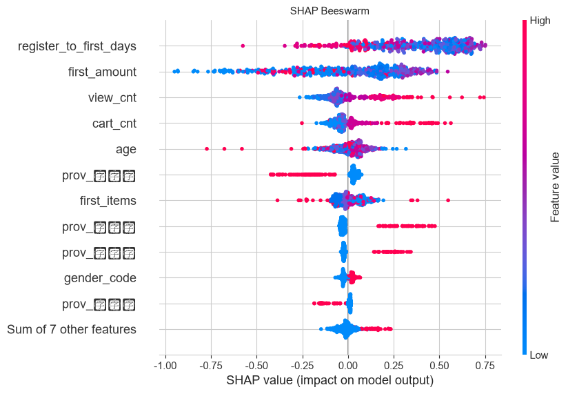
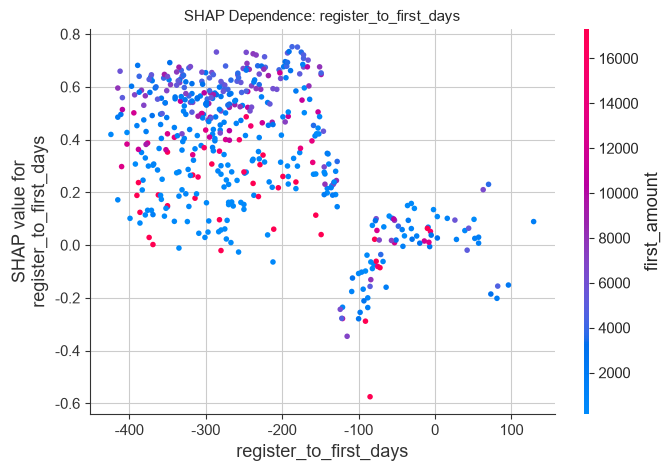
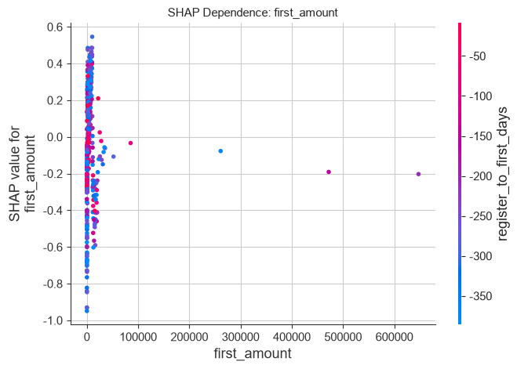
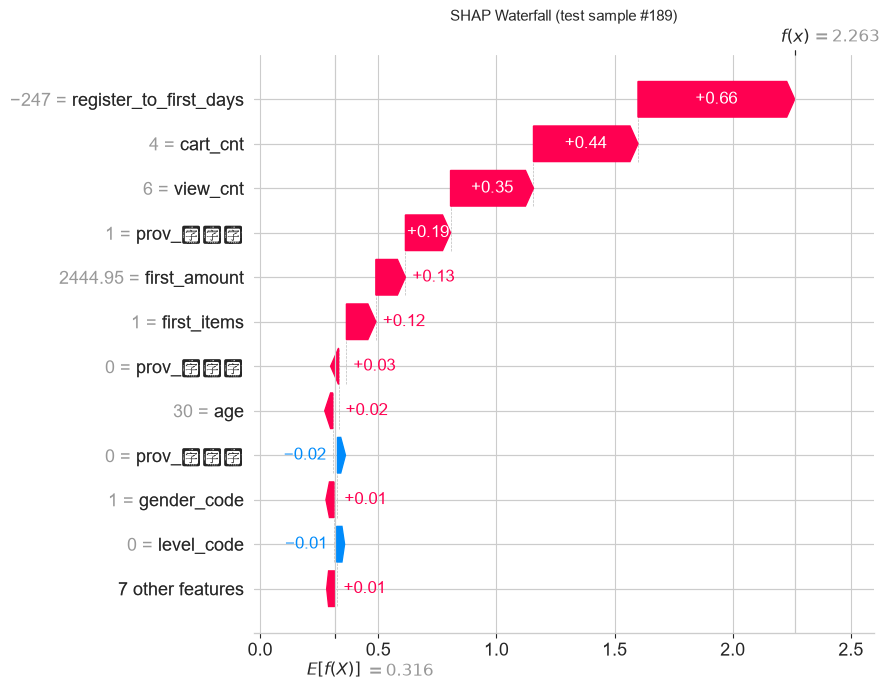

# 可解释性报告 - SHAP 解读 XGBoost 复购模型

- **数据来源**：`data/ecommerce/ecommerce.db`（管线复用 l3_ensemble.py）
- **解释对象**：XGBoost 复购二分类模型（测试 AUC = 0.502）
- **方法**：shap.TreeExplainer（TreeSHAP 精确解，log-odds 空间）
- **样本**：训练 1911 / 测试 478（按注册日期时间切分）
- **图件**：bar / beeswarm / dependence ×2 / waterfall ×1

<a id="toc"></a>
## 目录

- [1 任务与模型（复用 管线）](#sec-1)
  - [1.1 特征清单与切分](#sec-1-1)
- [2 SHAP 计算方法](#sec-2)
- [3 全局解释：模型整体在靠什么做判断](#sec-3)
  - [3.1 特征重要性（mean |SHAP|，bar）](#sec-3-1)
  - [3.2 Beeswarm 摘要图（方向 + 分布）](#sec-3-2)
  - [3.3 Top 特征的方向解读（数字支撑）](#sec-3-3)
- [4 局部解释：单个特征与单个样本](#sec-4)
  - [4.1 Dependence Plot（Top 2 特征）](#sec-4-1)
  - [4.2 单样本 Waterfall（一次预测的完整分解）](#sec-4-2)
- [5 讨论与局限（诚实声明）](#sec-5)

---
<a id="sec-1"></a>

# 1. 任务与模型（复用 管线）

本专题不训练新模型，而是回答：**的 XGBoost 复购模型到底在依据什么做判断？**数据管线（标签 SQL、特征 SQL、类别编码、register_date 时间切分）与模型超参均原样复用 `l3_ensemble.py`，保证解释对象与 ensemble_report.md 中的模型完全一致。标签 = 客户首单后 90 天内是否有第二单；特征 = 首单 RFM + user_events 行为计数 + 客户属性。

<a id="sec-1-1"></a>

## 1.1 特征清单与切分

| 特征                     | 含义            |
|:-----------------------|:--------------|
| register_to_first_days | 注册到首单天数（转化速度） |
| first_amount           | 首单实付金额        |
| first_items            | 首单商品件数        |
| view_cnt               | 首单前浏览次数       |
| cart_cnt               | 首单前加购次数       |
| age                    | 年龄            |
| gender_code            | 性别（0男/1女）     |
| level_code             | 会员等级（0~3）     |
| prov_上海市               | 省份独热（上海市）     |
| prov_北京市               | 省份独热（北京市）     |
| prov_四川省               | 省份独热（四川省）     |
| prov_山东省               | 省份独热（山东省）     |
| prov_广东省               | 省份独热（广东省）     |
| prov_江苏省               | 省份独热（江苏省）     |
| prov_浙江省               | 省份独热（浙江省）     |
| prov_湖北省               | 省份独热（湖北省）     |
| prov_湖南省               | 省份独热（湖南省）     |
| prov_福建省               | 省份独热（福建省）     |

**Python 结果：**

**输出：**
```
样本 = 2389（训练 1911 / 测试 478，按注册日期前 80%/后 20% 切分）
复购率：训练 57.88% / 测试 56.07%
重训 XGBoost 测试 AUC = 0.5025（与 ensemble_report.md 一致）
```

<a id="sec-2"></a>

# 2. SHAP 计算方法

SHAP（SHapley Additive exPlanations）把每个预测值分解为各特征的加性贡献：f(x) = base_value + Σ φ_i(x)，其中 φ_i 是特征 i 的 SHAP 值（Shapley 值）。对树模型，**TreeExplainer（TreeSHAP）** 利用树结构在多项式时间内算出精确 Shapley 值，无需扰动采样。二分类下 SHAP 值位于 **log-odds（margin）空间**：φ_i > 0 表示该特征把预测推向「复购」，φ_i < 0 推向「不复购」。

```python
explainer = shap.TreeExplainer(model)
exp = explainer(X_test)            # Explanation 对象（含 values / base_values / data）
sv = exp.values                    # shape = (n_test, n_features)，log-odds 空间
```

**输出：**
```
测试集 = 478 条 × 18 维 SHAP 值
base_value（全体样本 log-odds 基线）= 0.3156
```

<a id="sec-3"></a>

# 3. 全局解释：模型整体在靠什么做判断

<a id="sec-3-1"></a>

## 3.1 特征重要性（mean |SHAP|，bar）


**中文说明：** 横轴 = 测试集上 |SHAP 值| 的均值（对预测的平均影响幅度，log-odds）；与 XGBoost 自带 importance（分裂频次加权）相比，mean|SHAP| 同时考虑分裂收益的方向与幅度，是更可靠的特征贡献度量。

<a id="sec-3-2"></a>

## 3.2 Beeswarm 摘要图（方向 + 分布）



**中文说明：** 每行一个特征，每个点一个测试样本；横轴 = SHAP 值（右 = 推向复购），颜色 = 特征值大小（红高蓝低）。读法：若红点集中在右侧，说明该特征「值越大越倾向复购」。

<a id="sec-3-3"></a>

## 3.3 Top 特征的方向解读（数字支撑）

|   排名 | 特征                     | 含义            |   mean|SHAP| |   特征值-SHAP 秩相关 | 方向           |
|-----:|:-----------------------|:--------------|-------------:|---------------:|:-------------|
|    1 | register_to_first_days | 注册到首单天数（转化速度） |       0.3783 |        -0.3841 | 值越大 → 越倾向不复购 |
|    2 | first_amount           | 首单实付金额        |       0.2500 |         0.3536 | 值越大 → 越倾向复购  |
|    3 | view_cnt               | 首单前浏览次数       |       0.1076 |         0.8597 | 值越大 → 越倾向复购  |
|    4 | cart_cnt               | 首单前加购次数       |       0.0726 |         0.8079 | 值越大 → 越倾向复购  |
|    5 | age                    | 年龄            |       0.0669 |         0.1549 | 值越大 → 越倾向复购  |

**解释：** 秩相关（Spearman ρ）量化「特征值越大，SHAP 值是否越大」。但**必须诚实声明**：本模型测试 AUC = 0.502 ≈ 随机水平，SHAP 解释的是模型从训练集学到的（大概率是噪声性的）分裂模式，而非可泛化的业务规律——弱模型上的「Top 特征方向」只能当假设线索，不能当决策依据。详见最后一节讨论。

<a id="sec-4"></a>

# 4. 局部解释：单个特征与单个样本

<a id="sec-4-1"></a>

## 4.1 Dependence Plot（Top 2 特征）





**中文说明：** 横轴 = 特征取值，纵轴 = 该特征的 SHAP 值，颜色 = 交互最强特征的取值。读法：点的整体走向给出主效应（单调/阈值/分段），同一横坐标上点的纵向离散程度反映与其他特征的交互强度。

**解释：** Top 1 特征 **register_to_first_days**（注册到首单天数（转化速度））与 Top 2 特征 **first_amount**（首单实付金额）。若 dependence 呈明显趋势，说明模型确实系统性使用了该特征；若只是围绕 0 的弥散云，说明该特征的「重要性」来自少数样本的偶然分裂。

<a id="sec-4-2"></a>

## 4.2 单样本 Waterfall（一次预测的完整分解）

选样逻辑：测试集中**真实复购 = 1 且模型预测概率最高**的样本（预测概率 0.906）——看模型「最有把握的一次正确判断」由哪些特征拼成。



**中文说明：** 从底部 base_value（全体客户平均 log-odds）出发，红色条把预测推向复购、蓝色条推向不复购，逐级累加到顶部最终 f(x)。

**解释：** 该样本贡献最大的三个特征为 register_to_first_days、cart_cnt、view_cnt。对应特征值：register_to_first_days=-247.0、cart_cnt=4.0、view_cnt=6.0。单样本分解的价值在于运营可解释性——对高复购概率客户可以回答「系统看中了 TA 的什么」。

<a id="sec-5"></a>

# 5. 讨论与局限（诚实声明）

1. **SHAP 解释的是模型，不是世界**：SHAP 忠实回答「模型为何这么判」，但模型 AUC = 0.502 ≈ 随机——它从训练集学到的分裂模式大概率在拟合噪声，此时 beeswarm 的方向、dependence 的趋势都只是「模型的偏见画像」，不可外推为客户行为规律。对照实验（ensemble_report.md 3.5 节）已证明：加入生成参数 activity_score 后同管线 AUC 跳到 0.77，说明瓶颈在特征信息量，**SHAP 只有在强模型上才能作为业务洞察的依据**。

2. **相关 ≠ 因果**：即使在强模型上，SHAP 反映的也是相关性结构。例如「首单金额高 → 复购贡献为正」不意味着「提高首单金额能提升复购」——两者可能共同由客户购买力驱动。干预类决策需实验（AB test）验证。

3. **方法学备注**：TreeSHAP 对树模型是精确解、计算快（本例 478×18 秒级完成），是树模型的首选解释器；对深度模型（如 LSTM）需用 DeepExplainer/GradientExplainer 或扰动类方法（KernelSHAP），成本与方差都显著更高。弱信号场景下，解释稳定性本身也应作为模型质量指标监控。
