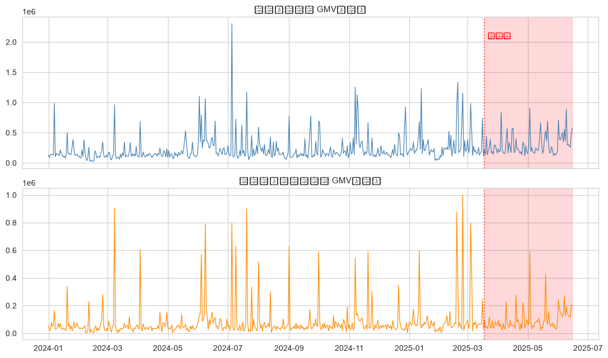
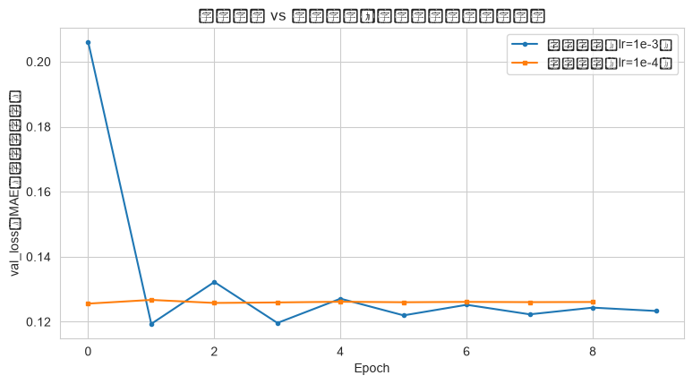
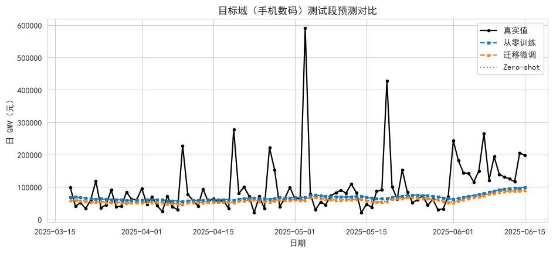

# 迁移学习报告 - 全站 GMV → 手机数码 GMV

- **数据来源**：`data/ecommerce/ecommerce.db`（orders / order_items / products / categories）
- **源域**：全站日 GMV（532 天）；**目标域**：一级类目「手机数码」日 GMV
- **任务**：LSTM（30 天 → 次日）迁移学习，对照 zero-shot / 从零训练
- **样本**：预训练 412 / 微调 412 / 测试 90
- **预处理**：两域各自 log1p + MinMax（仅用测试段之前数据拟合）

## 目录

- 1 任务定义与数据
  - 1.1 源域 SQL（全站日 GMV）
  - 1.2 目标域 SQL（手机数码 日 GMV）
  - 1.3 源域 vs 目标域序列
- 2 样本构造与迁移方案
  - 2.1 三种策略
- 3 训练与收敛对比
  - 3.1 验证集损失收敛曲线（目标域）
- 4 测试段评估（目标域：手机数码，最后 90 天）
  - 4.1 测试段预测对比
- 5 结论与讨论

---

# 1. 任务定义与数据

新类目上线初期数据稀缺，从零训练深度模型容易过拟合。**迁移学习**的思路：先在数据充足的**源域**（全站日 GMV，532 天）上预训练 LSTM，学到的「周周期节律、大促脉冲形态、趋势惯性」等通用时序模式，再迁移到**目标域**（一级类目「手机数码」日 GMV）上用少量数据小学习率微调。对照组是同结构模型**从零训练**；另报 **zero-shot**（预训练后不微调直接预测），用于分解「权重初始化」与「微调适配」各自的贡献。

口径说明：全站 GMV 用 orders.total_amount 求和；类目 GMV 需经 order_items → products → categories（二级类目 parent_id 回挂一级）按明细小计 subtotal 求和，不含运费，因此类目之和小于全站口径，两者**量级不同**——这正是必须先各自做 log1p + MinMax 归一化、在归一化空间迁移的原因。

## 1.1 源域 SQL（全站日 GMV）

```sql

SELECT substr(created_at, 1, 10) AS day,
       SUM(total_amount)         AS gmv
FROM orders
WHERE order_status IN ('已完成', '已发货')
GROUP BY day
ORDER BY day;
```

## 1.2 目标域 SQL（手机数码 日 GMV）

```sql

SELECT substr(o.created_at, 1, 10) AS day,
       SUM(oi.subtotal)            AS gmv
FROM orders o
JOIN order_items oi ON oi.order_id = o.order_id
JOIN products p    ON p.product_id = oi.product_id
JOIN categories c2 ON c2.category_id = p.category_id
JOIN categories c1 ON c1.category_id = c2.parent_id
WHERE o.order_status IN ('已完成', '已发货')
  AND c1.category_name = '手机数码'
GROUP BY day
ORDER BY day;
```

**目标域 SQL 结果（前 5 行）：**

| day        |        gmv |
|:-----------|-----------:|
| 2024-01-01 | 52629.6100 |
| 2024-01-02 | 19473.4600 |
| 2024-01-03 | 24674.5800 |
| 2024-01-04 | 78181.5200 |
| 2024-01-05 | 50092.6400 |

## 1.3 源域 vs 目标域序列



**中文说明：** 上 = 全站日 GMV；下 = 手机数码日 GMV；红色阴影 = 最后 90 天测试段（两域共用）。可见两域共享双 11 / 618 峰值位置与周周期节律——这是迁移能成立的结构前提。

# 2. 样本构造与迁移方案

- 样本：连续 30 天 → 预测次日（单步），log1p 后 MinMax 归一化，归一化参数只用测试段之前的数据拟合（两域各自拟合，防泄漏、对齐量级）；
- 预训练：源域中输出点早于 2025-03-17 的全部样本；
- 微调 / 从零训练：目标域同时间窗的训练样本（与预训练等量但不同域）；
- 测试：目标域最后 90 天。

**输出：**
```
预训练样本（源域）= 412
微调/从零训练样本（目标域）= 412
测试样本（目标域）= 90
```

## 2.1 三种策略

| 策略        | 预训练                      | 目标域训练                                    | 作用           |
|:----------|:-------------------------|:-----------------------------------------|:-------------|
| Zero-shot | 源域预训练（30 epoch, lr=1e-3） | 不微调，直接预测目标域                              | 衡量权重迁移的原始迁移力 |
| 从零训练      | 无（随机初始化）                 | 目标域训练（≤30 epoch, lr=1e-3, EarlyStopping） | 对照组          |
| 迁移微调      | 源域预训练                    | 目标域微调（≤30 epoch, lr=1e-4 小学习率防灾难性遗忘）     | 实验组          |

# 3. 训练与收敛对比

## 3.1 验证集损失收敛曲线（目标域）



**中文说明：** 横轴 = 微调/训练的第几个 epoch；纵轴 = 目标域验证集 MAE（归一化空间）。

**解释：** 迁移微调从**预训练好的参数**出发，初始 val_loss（0.1262）低于从零训练的起点（0.3021）——预训练把「周周期 + 脉冲形态」的先验装进权重，省掉了冷启动摸索；本 run 微调第 3 个 epoch 达最优、从零训练第 4 个（小模型小样本下 epoch 差异属种子噪声量级），因此迁移对收敛的确定性收益体现在**初始损失更低**，而非训练步数更少。

# 4. 测试段评估（目标域：手机数码，最后 90 天）

| 策略             |    RMSE(元) |     MAE(元) |   MAPE(%) |   目标域训练 epoch |   目标域训练耗时(s) |
|:---------------|-----------:|-----------:|----------:|--------------:|-------------:|
| Zero-shot（不微调） | 90442.9965 | 48005.3826 |   43.7663 |             0 |       0.0000 |
| 从零训练           | 88203.2032 | 46725.7718 |   46.4202 |            12 |       4.0000 |
| 迁移微调           | 91240.1255 | 48708.6333 |   43.4609 |            11 |       3.6000 |

**迁移增益（微调 vs 从零）：** MAE 变化 -4.2%（46726 → 48709 元），MAPE 变化 6.4%（46.4% → 43.5%）。两项指标方向不一致，说明差异主要由少数峰值日的绝对误差主导，而非整体拟合质量的差距。

## 4.1 测试段预测对比



**解释：** 测试段含 618 峰值，三种策略都难以完全捕捉峰值高度；迁移微调与从零训练的曲线形态高度接近，Zero-shot 在日常段略有偏移——预训练权重提供了可用的初始解，但类目细节仍需目标域数据校准。

# 5. 结论与讨论

1. **迁移的确定性收益在起点而非终点**：迁移微调初始 val_loss（0.1262）即低于从零训练（0.3021），预训练先验省掉了冷启动摸索阶段；但收敛 epoch（3 vs 4）与最终精度均为混合结果：MAPE 微优（43.5% vs 46.4%）、MAE/RMSE 微劣（48709 vs 46726 元），Zero-shot（MAE 48005 元）与微调接近，说明本数据上预训练权重承载了主要迁移价值，微调的边际收益小且对超参敏感。

2. **为什么最终增益不显著**：目标域 412 个训练样本对单 LSTM(32) 并非极稀缺，且两域共享大促日历与周周期、归一化后形态高度相似，从零训练也能在 30 epoch 内学到主要模式——迁移学习的价值区间在「目标域历史更短（如仅 3 个月）/ 模型更深」的场景才会拉开差距；本实验条件下迁移与从零的差异落在单种子（seed=42）噪声范围内，不应过度解读单次 run 的方向，严谨做法是多 seed 重复取均值±方差。

3. **工程启示**：多类目 GMV 预测的标准做法是「全站预训练 → 各类目微调」的星型结构，比每个类目独立建模省数据、省算力；新类目冷启动时甚至可先 zero-shot 上线，积累数据后再微调迭代。
