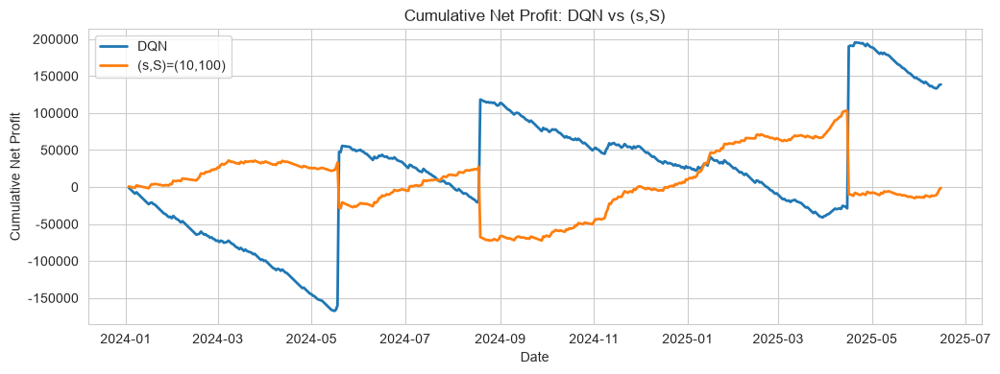
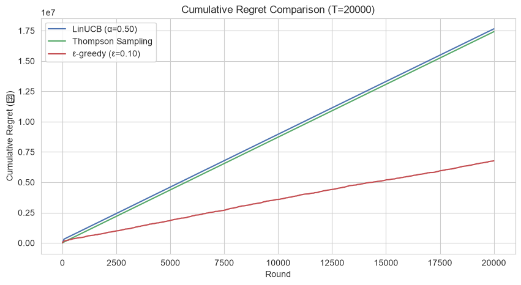

# L4 规范性分析：从预测到决策

> **一句话**：预测告诉你“会发生什么”，规范性分析告诉你**该做什么**，并在收益、成本与风险之间做取舍。
> 数据源统一为 `../ecommerce/ecommerce.db`，方法论总览见 [../README.md](../README.md)。

---

## 1. 这层解决什么问题

“给这个客户推荐什么？”、“这张券发给谁？”、“库存补多少？”、“折扣打多深？”——这些都是**决策问题**，目标不是预测得准，而是决策后整体收益更好。

L4 的难点在于：决策会改变未来（推荐影响曝光、价格影响需求），所以不能只用静态误差评估。

## 2. 方法地图

| 方法 | 决策场景 | 关键概念 | 主要风险 |
|---|---|---|---|
| 协同过滤 | 推荐商品 | UserCF / ItemCF | 冷启动、稀疏性 |
| 矩阵分解 | 补全偏好 | SVD、潜在因子 | 隐式反馈与显式评分差异 |
| 序列推荐 | 下一个买什么 | 行为顺序、相似度 | 重复购买干扰 |
| 上下文赌博机 | 发券、定价 | 探索-利用、累积遗憾 | 探索过度或不足 |
| 强化学习 | 库存、长期收益 | 状态/动作/奖励、Q 学习 | 离线评估难、仿真偏差 |
| 多目标优化 | GMV vs 毛利 | 帕累托前沿 | 单点最优牺牲其他目标 |
| 因果推荐 | 去曝光偏差 | IPS / SNIPS | 倾向分估计不准导致方差爆炸 |

## 3. 关键成果

**推荐基座。** 用成交订单构造用户-商品隐式评分：31,377 个交互、2,483 个用户、376 个商品，评分取购买订单数并 cap 5。绝大多数用户-商品对只买过 1 次，复购长尾是推荐要挖掘的信号。

**协同过滤与矩阵分解。** UserCF 与 ItemCF 的相似度矩阵可直接用于近邻推荐；SVD 取 50 个潜在因子，解释方差约 37.5%，隐式评分重建的 RMSE 约 1.03、MAE 约 1.01。隐式矩阵比显式评分更稀疏，解释方差偏低属正常现象。

**序列推荐。** 用物品相似度按用户最后购买商品推荐下一个，Recall@10 约 0.080、HitRate@10 约 0.226、NDCG@10 约 0.057。指标绝对值不高，但揭示了“重复购买 + 关联购买”并存的真实结构。

**库存补货（DQN）。** 把补货建模为马尔可夫决策过程，DQN 学到“低库存、高需求时补满”的分层策略。累计净利润口径下 DQN 为 13.86 万元，(s,S) 基准为 -0.13 万元——差距来自基准在大促日频繁缺货，而 DQN 能借助近 7 日销量趋势提前补货。

**优惠券发放（上下文赌博机）。** 21,000 次投放的模拟中，ε-greedy 的累积遗憾最低（约 677 万元），Thompson Sampling 与 LinUCB 反而更高。原因不是“自适应探索一定更好”，而是探索超参（α、σ²）按困难场景校准后在本问题上**探索过度**。实践含义：探索参数必须与真实奖励噪声匹配。

**多目标折扣（帕累托）。** 在 GMV、毛利率、优惠成本三个目标上给出一组前沿方案。推荐方案日 GMV 24.66 万元（较原价基线 +1.8%）、日毛利 9.07 万元、优惠成本占 GMV 3.36%。高弹性品类给深折扣换放量，刚需品类保持接近原价。

**因果推荐去偏。** 曝光日志中热销商品几乎必然被看到，长尾商品极少被看到，naive 指标被热销档支配。SNIPS 用自归一化 IPS 把各档拉回均匀曝光口径，长尾商品被低估的真实转化能力得以还原（0.0845 vs 0.0817）。







## 4. 专题索引

| 报告 | 内容 | 适合谁 |
|---|---|---|
| [prescriptive_report.md](prescriptive_report.md) | 主报告：协同过滤、SVD、序列推荐、Q-Learning 策略对比 | 做推荐系统的人 |
| [dqn_report.md](dqn_report.md) | DQN 库存补货：环境建模、训练、策略可视化 | 做供应链决策的人 |
| [bandit_report.md](bandit_report.md) | 上下文赌博机选券：ε-greedy、Thompson、LinUCB | 做营销投放的人 |
| [multiobjective_report.md](multiobjective_report.md) | 品类折扣的多目标帕累托前沿 | 做定价策略的人 |
| [causal_rec_report.md](causal_rec_report.md) | IPS/SNIPS 推荐去偏评估 | 做推荐评估的人 |

## 5. 方法提醒

1. **离线评估不能只看点击率**：曝光偏差会让热门商品永远赢。
2. **强化学习要有可信仿真**：仿真错了，策略上线就会翻车。
3. **多目标要展示前沿**：不要替业务选点，给出可选方案与代价。
4. **探索参数要匹配噪声**：ε、α、σ² 不是越大越好。
5. **决策目标与业务口径一致**：优化 GMV 还是毛利，结果完全不同。

## 6. 如何运行

```powershell
python src/data/L4/generate_prescriptive_report.py
python src/data/L4/l4_dqn.py
python src/data/L4/l4_bandit.py
python src/data/L4/l4_multiobjective.py
python src/data/L4/l4_causal_rec.py
```

完整环境与执行顺序见 [../run.md](../run.md)。
