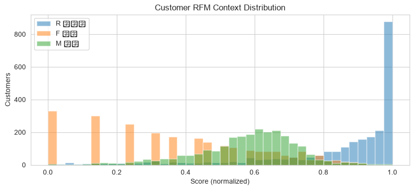

# 上下文赌博机：优惠券发放决策

- **数据来源**：`data/ecommerce/ecommerce.db`（orders + coupons + order_items）
- **上下文**：客户 RFM（快照日 2025-06-15，2493 客户）
- **仿真轮数**：20000，随机种子 42

## 目录

- 1 问题定义：优惠券发放的上下文赌博机
  - 1.1 上下文分布
- 2 合成奖励函数（数据校准）
  - 2.1 券参数估计表
- 3 算法实现
  - 3.1 累积遗憾曲线
  - 3.2 最终结果

---

# 1. 问题定义：优惠券发放的上下文赌博机

每来一位客户（上下文），系统从 9 个动作中选择其一：发放 8 种优惠券之一或不发券，目标是最大化长期累计利润。与多臂老虎机不同，上下文赌博机假设奖励依赖客户特征，需要在“利用当前最优券”与“探索客户-券匹配”之间权衡。

- **上下文 x**：客户 RFM 三维得分（R 回流度、F 频次、M 金额，均归一化到 [0,1]），快照日 2025-06-15，客户数 2493；

- **动作臂**：8 种券 + 不发券；

- **奖励**：该客户用此券带来的期望利润提升（合成函数，见下节）+ 高斯噪声。

## 1.1 上下文分布



**中文说明：** 三个 RFM 维度的客户分布。F/M 取 log 后归一化，仍右偏，说明高价值客户是少数派——券的投放精度比覆盖面更重要。

# 2. 合成奖励函数（数据校准）

真实业务中“发券的因果 uplift”需要 A/B 实验估计。本示例用历史数据校准参数，构造文档化的合成 reward 函数，公式如下：

```text
E[reward_a(x)] = uplift_a(x) * avg_profit_a - coupon_cost_a
  uplift_a(x)    = base_a * (1 + seg_a · x)
    base_a       : 券 a 历史使用次数 / 最常用券使用次数（数据估计）
    seg_a        : 分群敏感度方向，按券类型设定
                   满减→(0.1,0.2,0.7) 偏好高 M；折扣→(0.1,0.7,0.2) 偏好高 F；
                   无门槛→(0.7,0.2,0.1) 偏好高 R
  avg_profit_a   : 券 a 历史订单平均成交额 × 全库毛利率 0.3890
  coupon_cost_a  : 满减/无门槛=减免额；折扣=(1-折扣率)×历史平均成交额
观测奖励 = E[reward] + N(0, 30)；不发券期望恒为 0
```

## 2.1 券参数估计表

|   ID | 券名       | 类型   |       门槛 |    减免/折扣 |   历史使用次数 |    历史平均成交额 |   base_a |      券成本 |      平均毛利 |
|-----:|:---------|:-----|---------:|---------:|---------:|-----------:|---------:|---------:|----------:|
|    1 | 满99减10   | 满减   |  99.0000 |  10.0000 |     1093 |  6182.6054 |   1.0000 |  10.0000 | 2405.3000 |
|    2 | 满199减20  | 满减   | 199.0000 |  20.0000 |      942 |  8848.0760 |   0.8620 |  20.0000 | 3442.2800 |
|    3 | 满399减50  | 满减   | 399.0000 |  50.0000 |      874 |  8508.6143 |   0.8000 |  50.0000 | 3310.2100 |
|    4 | 满999减150 | 满减   | 999.0000 | 150.0000 |       23 |  4705.3617 |   0.0210 | 150.0000 | 1830.5900 |
|    5 | 满299打9折  | 折扣   | 299.0000 |   0.9000 |      848 |  5967.8065 |   0.7760 | 596.7800 | 2321.7300 |
|    6 | 无门槛减10   | 无门槛  |   0.0000 |  10.0000 |       66 |  3185.0320 |   0.0600 |  10.0000 | 1239.1100 |
|    7 | 全场95折    | 折扣   |   0.0000 |   0.9500 |       46 | 17428.6830 |   0.0420 | 871.4300 | 6780.5000 |
|    8 | 满599减80  | 满减   | 599.0000 |  80.0000 |       46 |  4930.0089 |   0.0420 |  80.0000 | 1917.9800 |

**解释：** base_a 反映券的通用吸引力；券成本与分群敏感度共同决定“对谁发哪张券”才是利润最优。例如高门槛满减券成本高，只有高 M 客户的uplift 才能覆盖其成本。

# 3. 算法实现

三个算法共享同一上下文线性假设（E[r|x,a] = θ_a·x），区别在探索机制：

1. **LinUCB**：按 `θ_a·x + α·√(xᵀA_a⁻¹x)` 取上置信界，不确定性越大探索越多；

2. **Thompson Sampling**：对每臂后验 `N(θ̂_a, σ²A_a⁻¹)` 采样，选采样值最大的臂；

3. **ε-greedy**：以 ε=0.1 概率随机选臂，否则选岭回归估计的最优臂。

**仿真设置：** T=20000 轮，每轮随机抽取一位客户的 RFM 上下文，所有算法使用同一随机种子（42）面对相同的上下文序列与噪声。

## 3.1 累积遗憾曲线


**中文说明：** 横轴 = 交互轮次；纵轴 = 累积遗憾（相对每轮 oracle 最优臂的利润差，元）。曲线斜率越平，说明算法越快收敛到最优发券策略。

## 3.2 最终结果

| 算法                |     最终累积遗憾(元) |   平均每轮遗憾(元) | 被拉次数最多的臂   |
|:------------------|--------------:|------------:|:-----------|
| ε-greedy (ε=0.10) |  6768052.6264 |    338.4026 | 满199减20    |
| Thompson Sampling | 17416489.5411 |    870.8245 | 满99减10     |
| LinUCB (α=0.50)   | 17651349.0610 |    882.5675 | 满99减10     |

**解释：** 本场景下 ε-greedy 的累积遗憾反而最低，Thompson Sampling 与 LinUCB 更高。这并不违背“不确定性引导探索更高效”的一般结论，而是由奖励结构与超参校准共同决定：本合成奖励中各臂期望由上下文的线性结构主导、臂间差距明显，岭回归用全部样本即可快速收敛，ε-greedy 随即进入以利用为主的阶段；而 LinUCB 的置信界宽度（α=0.50）与 Thompson 的采样方差（σ²=100）是按“噪声大、臂间差距小”的困难场景校准的，在本问题中表现为探索过度——持续拉动次优臂，遗憾线性积累。

**实践含义：** 探索超参（α、σ²、ε）必须与真实奖励噪声水平匹配，并非自适应探索恒优于固定 ε；累积遗憾终值差异即三种策略在 20000 次投放中少赚的利润。
