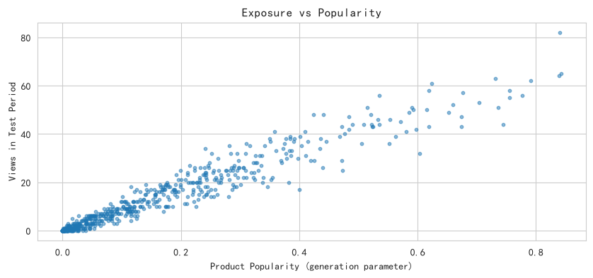
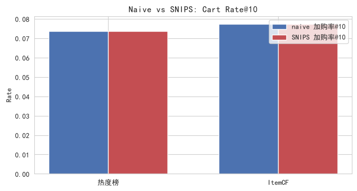
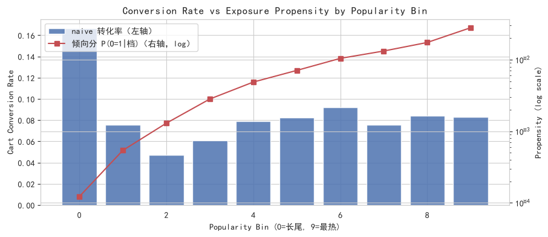

# 因果推荐去偏：曝光流行度偏差的 IPS 校正

- **数据来源**：`data/ecommerce/ecommerce.db`（user_events + orders + products）
- **测试期**：2025-04-01 之后；训练期：之前的购买交互
- **倾向分**：popularity 分 10 档估计曝光概率，clip 下限 1e-4
- **IPS 变体**：自归一化 SNIPS（分母为权重和），抑制小倾向分导致的方差爆炸

## 目录

- 1 问题定义：曝光流行度偏差
  - 1.1 偏差验证：popularity 越高曝光越多
- 2 IPS 去偏原理
- 3 naive vs SNIPS：推荐评估对比
- 4 分档转化率与倾向分
- 5 实践要点

---

# 1. 问题定义：曝光流行度偏差

推荐系统的日志数据是 **MNAR**（Missing Not At Random）的：只有被曝光的商品才可能被加购/购买，而平台流量天然向热销品倾斜。直接用日志统计的转化率会系统性高估热销品、低估长尾品，进而训练出“越推越热”的反馈回路。

## 1.1 偏差验证：popularity 越高曝光越多

**SQL 代码（分档曝光量）：**

```sql
SELECT NTILE(10) OVER (ORDER BY popularity) AS pop_bin,
       AVG(popularity) AS avg_pop, COUNT(DISTINCT e.product_id) AS items,
       COUNT(*) AS views
FROM products p JOIN user_events e ON p.product_id = e.product_id
WHERE e.event_type = 'view' AND e.event_time >= '2025-04-01'
GROUP BY p.product_id;
```

|   popularity 分档 |   平均 popularity |     商品数 |      曝光次数 |   档内平均倾向分 |
|----------------:|----------------:|--------:|----------:|----------:|
|          0.0000 |          0.0020 | 60.0000 |   12.0000 |    0.0001 |
|          1.0000 |          0.0113 | 60.0000 |   53.0000 |    0.0005 |
|          2.0000 |          0.0287 | 60.0000 |  127.0000 |    0.0013 |
|          3.0000 |          0.0544 | 61.0000 |  281.0000 |    0.0028 |
|          4.0000 |          0.0921 | 59.0000 |  469.0000 |    0.0049 |
|          5.0000 |          0.1338 | 60.0000 |  694.0000 |    0.0071 |
|          6.0000 |          0.1920 | 60.0000 | 1022.0000 |    0.0104 |
|          7.0000 |          0.2534 | 60.0000 | 1295.0000 |    0.0132 |
|          8.0000 |          0.3389 | 60.0000 | 1704.0000 |    0.0174 |
|          9.0000 |          0.5710 | 60.0000 | 2741.0000 |    0.0280 |



**中文说明：** 横轴 = 商品受欢迎度生成参数；纵轴 = 测试期（2025-04-01 之后）曝光次数。

**解释：** 曝光量随 popularity 单调上升，证实曝光机制存在流行度偏差。倾向分按 popularity 分 10 档估计：P(O=1|档) = 档内总曝光 / (档内商品数 × 活跃用户数 1631)。

# 2. IPS 去偏原理

逆倾向得分（Inverse Propensity Scoring）用曝光概率的倒数给观测样本加权，把“有偏曝光下观测到的分布”还原回“均匀曝光下的期望”。原始 IPS 的权重 1/P 在小倾向分上会爆炸（本例最小倾向分 1e-4，权重上万），因此实际使用其自归一化变体 **SNIPS**（Self-Normalized IPS），以牺牲微量偏差换取方差剧降：

```text
支撑集 E_u: 用户 u 的推荐列表中实际被曝光的条目（MNAR 下唯一可观测部分）
naive 转化率@K = (1/|E_u|) Σ_{i∈E_u} 1[转化_i]
SNIPS 转化率@K = Σ_{i∈E_u} w_i·1[转化_i] / Σ_{i∈E_u} w_i,  w_i = 1/P(O=1|item_i)
无偏性: E_O[ 1(O)·Y / P(O) ] = E[Y]，其中 Y 为曝光后的真实转化
```

**Python 代码：**

```python
w = 1.0 / propensity[item]            # 逆倾向权重（按 popularity 分档估计）
snips = sum(conv * w) / sum(w)        # 自归一化 IPS：结果有界、方差可控
naive = mean(conv)                    # 直接平均（有偏）
```

# 3. naive vs SNIPS：推荐评估对比

在 2025-04-01 之前的订单上训练 ItemCF 与热度榜两个推荐器，对测试期有曝光行为的 400 个用户评估 加购率@10 / 购买率@10（naive 与 SNIPS 的分母均为该用户实际被曝光的推荐位）：

| 推荐器          |   naive 加购率@K |   SNIPS 加购率@K |   naive 购买率@K |   SNIPS 购买率@K |   可观测推荐位数 |
|:-------------|--------------:|--------------:|--------------:|--------------:|----------:|
| 热度榜 Top10    |        0.0736 |        0.0736 |        0.4935 |        0.4935 |       161 |
| ItemCF Top10 |        0.0773 |        0.0773 |        0.4570 |        0.4570 |       117 |

**解释：** 两个推荐器的 naive 与 SNIPS 指标几乎完全重合——这不是加权失效，而是曝光稀疏的直接后果：用户的 view 行为极端偏向热销品，能被观测到转化的推荐位几乎全部落在最热档（热度榜 161 个可观测位中 161 个在 bin 9，ItemCF 117 个中 116 个在 bin 9）。档内权重相同使 SNIPS 退化为 naive。这一现象本身正是重要结论：**离线日志对中长尾推荐策略根本缺乏评估支撑**——IPS 只能还原“曾被曝光过”的样本，无法凭空评估从未被观测的推荐位；要区分推荐器在长尾商品上的优劣，必须引入探索流量（随机曝光）或在线 A/B 实验。



**中文说明：** 同组内蓝柱为 naive 指标，红柱为 SNIPS 去偏指标。

# 4. 分档转化率与倾向分

注意：倾向分按档估计意味着**同一档内权重相同**，因此“档内 SNIPS 转化率”与naive 恒等——去偏的作用体现在**跨档汇总与推荐列表加权**上。下表/图展示各档的naive 转化率与倾向分量级，可直观看到偏差来源：

|   popularity 分档 |   naive 转化率 |   平均倾向分 |   IPS 权重(1/P) |     曝光样本数 |
|----------------:|------------:|--------:|--------------:|----------:|
|          0.0000 |      0.1667 |  0.0001 |     8155.0000 |   12.0000 |
|          1.0000 |      0.0755 |  0.0005 |     1846.4151 |   53.0000 |
|          2.0000 |      0.0472 |  0.0013 |      770.5512 |  127.0000 |
|          3.0000 |      0.0605 |  0.0028 |      354.0605 |  281.0000 |
|          4.0000 |      0.0789 |  0.0049 |      205.1791 |  469.0000 |
|          5.0000 |      0.0821 |  0.0071 |      141.0086 |  694.0000 |
|          6.0000 |      0.0920 |  0.0104 |       95.7534 | 1022.0000 |
|          7.0000 |      0.0757 |  0.0132 |       75.5676 | 1295.0000 |
|          8.0000 |      0.0839 |  0.0174 |       57.4296 | 1704.0000 |
|          9.0000 |      0.0832 |  0.0280 |       35.7023 | 2741.0000 |



**中文说明：** 横轴 = popularity 分档（0 最长尾，9 最热销）；蓝柱（左轴）= 该档曝光后的加购转化率；红线（右轴，对数刻度）= 该档的曝光倾向分。

**解释：** 各档真实转化率相差不大（长尾档甚至不逊于热销档），但倾向分相差两个数量级——热销档几乎必然被观测，长尾档极少被观测。naive 总体指标因此被热销档支配，SNIPS 通过 1/P 加权把各档拉回可比的“均匀曝光”口径。业务含义：长尾商品的真实转化能力被曝光不足掩盖，值得增加曝光配额。

**全量曝光的 pooled 口径对比：** 对测试期全部 8398 条曝光记录，naive 加购转化率 = 0.0817（被 bin 9 的 2741 条样本支配）；SNIPS 加购转化率 = 0.0845（各档按 1/P 还原，近似各档等权平均）。SNIPS 略高于 naive，说明长尾档（bin 0 转化率 0.167）的真实转化能力在 naive 口径下被低估。

# 5. 实践要点

1. **倾向分估计决定成败**：本例用 popularity 分档估计，生产环境可用曝光模型的预测概率（如 logistic 回归）；分档过粗会残留偏差，过细则倾向分过小、方差爆炸；

2. **方差控制**：IPS 权重 1/P 在倾向分很小时极大，需做截断（clip）或使用自归一化 IPS（SNIPS，本例采用）——以 sum(w) 代替样本数做归一化，估计量有界；

3. **与 Doubly Robust 结合**：IPS 可再叠加结果回归模型（DR 估计量），在倾向分或结果模型之一正确时保持无偏。
