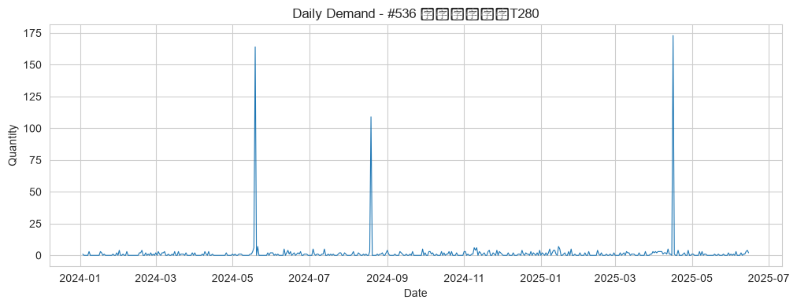
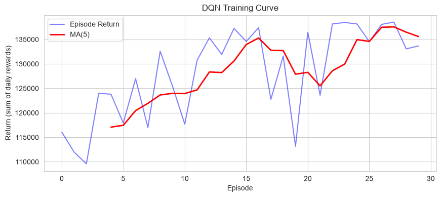
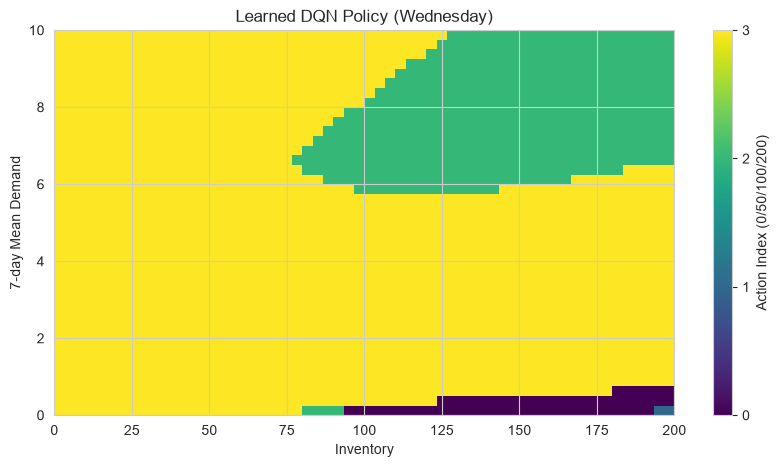

# 深度强化学习（DQN）：库存补货决策

- **数据来源**：`data/ecommerce/ecommerce.db`（order_items + orders + products）
- **场景商品**：#536 好孩子纸尿裤T280（销量 Top1，530 天日销量序列）
- **框架**：TensorFlow 2.21.0（CPU），随机种子 42

## 目录

- [1 问题定义：库存补货 MDP](#sec-1)
  - [1.1 日销量序列](#sec-1-1)
  - [1.2 成本参数](#sec-1-2)
- [2 DQN 实现与训练](#sec-2)
  - [2.1 训练曲线（回合回报）](#sec-2-1)
- [3 策略对比：DQN vs (s,S) 基准](#sec-3)
  - [3.1 学到的补货策略可视化](#sec-3-1)

---

# 1. 问题定义：库存补货 MDP

选取全库销量最高的商品 **#536 好孩子纸尿裤T280**（标价 2553.78 元，成本 1286.44 元，单件毛利 1267.34 元），以其 530 天真实日销量序列为需求环境，学习每日补货决策。

- **状态 s**：(当前库存, 近 7 日销量均值, 星期几)，归一化后输入网络；

- **动作 a**：补货量档位 {0, 50, 100, 200} 件，当日补货当日到达，先收货后销售；

- **奖励 r**：当日毛利 − 积压成本 − 缺货损失。

## 1.1 日销量序列

**中文说明：** 横轴 = 日期；纵轴 = 日销量（件）。可见双 11、618 大促峰值与周末波动，需求非平稳是补货决策的主要难点。

## 1.2 成本参数

| 参数   | 取值          | 说明                                      |
|:-----|:------------|:----------------------------------------|
| 单件毛利 | 1267.34 元   | 标价 - 成本                                 |
| 积压成本 | 10.14 元/件/天 | 按单件毛利的 0.8%/天估算（资金占用+仓储，约 125 天吃光单件毛利）  |
| 缺货损失 | 1267.34 元/件 | 丢失毛利之外的客户流失惩罚，按毛利 100% 估算（行业常见 1-3 倍毛利） |
| 仓库容量 | 200 件       | 库存上限                                    |

# 2. DQN 实现与训练

DQN 用深度网络逼近动作价值函数 Q(s,a)，两个关键技术：

1. **经验回放（Experience Replay）**：转移样本存入回放缓冲区（容量 10000），随机采样批量训练，打破时序相关性；

2. **目标网络（Target Network）**：每 200 步将主网络参数同步到目标网络，稳定 TD 目标 `r + γ·max_a' Q_target(s',a')`。

**超参数：**

| 超参数    | 取值                                         |
|:-------|:-------------------------------------------|
| 网络结构   | 3 → 64 → 64 → 4 (ReLU/MLP)                 |
| 折扣因子 γ | 0.99                                       |
| 学习率    | 0.001                                      |
| 批大小    | 64                                         |
| 训练频率   | 每 2 个环境步一次梯度更新                             |
| 训练回合数  | 30                                         |
| ε 衰减   | 1.0 → 0.02（指数衰减）                           |
| 奖励缩放   | reward / 1000 后入缓冲区（仅缩放 Q 值量级，argmax 策略不变） |
| 随机种子   | 42                                         |

## 2.1 训练曲线（回合回报）

**中文说明：** 横轴 = 训练回合；纵轴 = 回合总回报（530 天奖励之和，奖励口径为净利润），红线为 5 回合滑动平均。

**解释：** 前期 ε 接近 1，动作近乎随机——频繁补 200 件导致积压成本失控，回报深度为负；随着 ε 衰减与经验回放训练推进，Q 网络逐步收敛到“低库存适量补、高库存不补”的策略，回合回报单调上升并趋稳，说明网络已学会在积压成本与缺货损失之间权衡。

# 3. 策略对比：DQN vs (s,S) 基准

(s,S) 是库存管理的经典启发式：库存低于 s 时补货到 S。这里取 s=10、S=100（按需求档位就近映射），与训练后的 DQN 贪心策略在**同一需求序列**上对比。

| 策略                |    累计净利润(元) |      累计毛利(元) |   累计销量(件) |   累计缺货(件) |   平均期末库存(件) |   缺货天数占比(%) |
|:------------------|------------:|-------------:|----------:|----------:|------------:|------------:|
| DQN 策略            | 138565.8862 | 1171022.1600 |  924.0000 |    0.0000 |    192.1377 |      0.0000 |
| (s,S)=(10,100) 基准 |  -1267.3400 |  754067.3000 |  595.0000 |  329.0000 |     62.9717 |      0.5660 |

**中文说明：** 横轴 = 日期；纵轴 = 累计净利润（元），口径为毛利 − 积压成本 − 缺货损失，与 DQN 训练目标（折扣回报的逐日奖励）一致。

**解释：** 以累计净利润口径，DQN 138566 元，(s,S) 基准 -1267 元，差值 139833 元。DQN 学到的是高服务水平策略：在缺货损失（毛利+客户流失）远高于持有成本的场景下，维持高库存、近乎零缺货的总成本反而低于基准的经常性缺货——尤其大促峰值日，(s,S) 的 S=100 上限必然缺货，而 DQN 能借助近 7 日销量趋势提前把库存补到上限。

## 3.1 学到的补货策略可视化

**中文说明：** 横轴 = 当前库存；纵轴 = 近 7 日销量均值；颜色 = 补货动作档位索引（0=不补，1=50，2=100，3=200），状态固定为周三。

**解释：** 理想策略应呈“左下补、右上不补”的分层结构：库存越低、需求越旺，补货档位越高。图中策略分界面越清晰，说明 Q 网络学到的价值函数越稳定。
