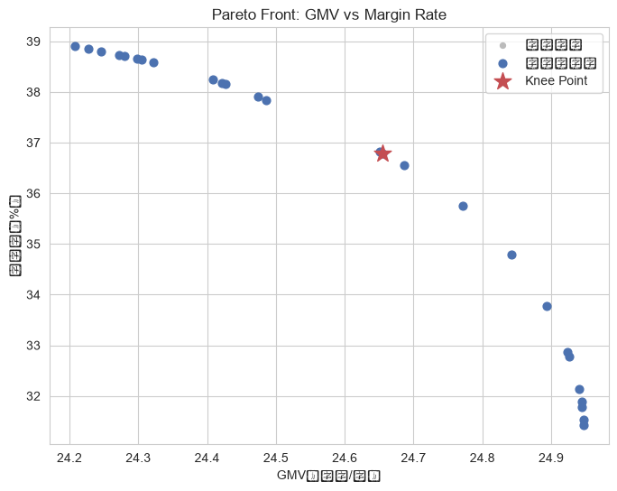
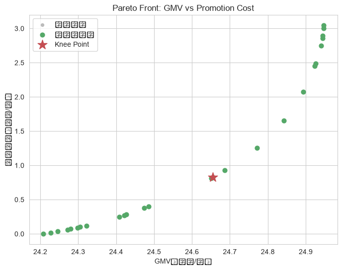

# 多目标优化：促销折扣决策

- **数据来源**：`data/ecommerce/ecommerce.db`（6 个一级品类历史量价成本）
- **决策变量**：各品类折扣率 d ∈ [0.85, 1.00]，共 16 档
- **方法**：加权扫描 + 非支配筛选，权重单纯形 66 组 → 帕累托解 26 个

<a id="toc"></a>
## 目录

- [1 问题定义：促销折扣的多目标权衡](#sec-1)
  - [1.1 品类基线（历史 531 天）](#sec-1-1)
- [2 方法与求解](#sec-2)
- [3 帕累托前沿](#sec-3)
  - [3.1 投影一：GMV × 毛利率](#sec-3-1)
  - [3.2 投影二：GMV × 优惠成本](#sec-3-2)
- [4 Knee Point 推荐方案](#sec-4)

---
<a id="sec-1"></a>

# 1. 问题定义：促销折扣的多目标权衡

大促期间需要为 6 个一级品类分别设定折扣率 d ∈ [0.85, 1.00]。三个目标互相冲突：

1. **GMV 最大化**：降价放量，卖得越多 GMV 越高；

2. **毛利最大化**：降价压缩单件毛利，过度放量未必补得回来；

3. **优惠成本最小化**：让利总额直接影响营销费用。

不存在同时最优的解，目标是求出**帕累托前沿**并给出 knee point 推荐方案。

<a id="sec-1-1"></a>

## 1.1 品类基线（历史 531 天）

| 一级品类   |   累计销量(件) |      累计GMV(元) |       累计成本(元) |    件单价(元) |   日均销量(件/天) |   弹性假设 |
|:-------|----------:|--------------:|--------------:|----------:|------------:|-------:|
| 手机数码   |     13660 | 45037376.4400 | 27249566.3200 | 3297.0261 |     25.7250 | 1.5000 |
| 家用电器   |     14397 | 47711107.6100 | 29065278.1000 | 3313.9618 |     27.1130 | 1.2000 |
| 服装鞋帽   |     12922 |  8757066.5900 |  5622272.6400 |  677.6866 |     24.3352 | 2.2000 |
| 美妆个护   |     14887 |  4569871.6600 |  2829339.9400 |  306.9706 |     28.0358 | 2.0000 |
| 食品饮料   |     11475 |  2128603.3600 |  1340984.6300 |  185.4992 |     21.6102 | 1.0000 |
| 母婴用品   |     12147 | 20339484.6700 | 12427145.7200 | 1674.4451 |     22.8757 | 1.1000 |

**说明：** 价格弹性为业务先验假设（数据库中无价格实验数据）：服装鞋帽 2.2、美妆个护 2.0（冲动消费型，弹性高），手机数码 1.5、家用电器 1.2，食品饮料 1.0、母婴用品 1.1（刚需，弹性低）。销量放大系数 `mult = 1 + e·(1−d)`，线性弹性模型。

<a id="sec-2"></a>

# 2. 方法与求解

**加权扫描法**：在权重单纯形 w=(w_GMV, w_毛利, w_成本)、步长 0.1 的 66 组权重上，最小化 `−w₁·GMV − w₂·毛利 + w₃·优惠成本`（目标先做极差归一化）。

由于目标函数按品类求和、决策变量按品类独立，加权问题**可分离**：每组权重下逐品类在 16 档折扣网格上独立枚举，避免了 16^6 的组合爆炸。

```python
for w in weight_grid:                    # 权重单纯形扫描
    for c in categories:                 # 可分离：逐品类独立求解
        d_c = argmin over grid of (-w1*GMV_c - w2*Profit_c + w3*Cost_c)
    solutions[d_vec] = total_objectives(d_vec)
pareto_front = non_dominated(solutions)  # 非支配筛选
```

<a id="sec-3"></a>

# 3. 帕累托前沿

去重后共 26 个方案，其中非支配（帕累托）解 26 个。

<a id="sec-3-1"></a>

## 3.1 投影一：GMV × 毛利率



**中文说明：** 横轴 = 日 GMV（万元）；纵轴 = 毛利率（%%）。灰色为被支配解，蓝色为非支配解，红星为 knee point。

**解释：** 前沿呈左上-右下走向：GMV 越高毛利率越低，二者此消彼长。前沿中段斜率最大的位置（knee）意味着“再压 1 个点毛利率换来的 GMV 增量开始锐减”。

<a id="sec-3-2"></a>

## 3.2 投影二：GMV × 优惠成本



**中文说明：** 横轴 = 日 GMV（万元）；纵轴 = 日优惠成本（万元）。

**解释：** GMV 与优惠成本同向增长——高 GMV 方案必然伴随高让利。该投影帮助回答“每多花 1 万元让利能换回多少 GMV”的预算效率问题。

<a id="sec-4"></a>

# 4. Knee Point 推荐方案

Knee point 定义：三目标归一化后（成本取反向）离乌托邦点 (1,1,1) 欧氏距离最近的帕累托解，代表三目标最均衡的折中。

| 一级品类   |   推荐折扣率 | 折扣力度   |
|:-------|--------:|:-------|
| 手机数码   |  0.9600 | 10 折   |
| 家用电器   |  1.0000 | 10 折   |
| 服装鞋帽   |  0.8500 | 8 折    |
| 美妆个护   |  0.8700 | 9 折    |
| 食品饮料   |  1.0000 | 10 折   |
| 母婴用品   |  1.0000 | 10 折   |

| 指标    | 推荐方案取值   | 说明                    |
|:------|:---------|:----------------------|
| 日 GMV | 246551 元 | 原价基线 242078 元，提升 1.8% |
| 日毛利   | 90693 元  | 毛利率 36.78%            |
| 日优惠成本 | 8296 元   | 占 GMV 3.36%           |

**解读：** 高弹性品类（服装鞋帽、美妆个护）应给到更深折扣以换取放量；刚需品类（食品饮料、母婴用品）保持接近原价，避免无效让利。若业务方更偏 GMV（如冲榜）或更偏毛利（如季末利润考核），可沿前沿向相应方向移动选点。
