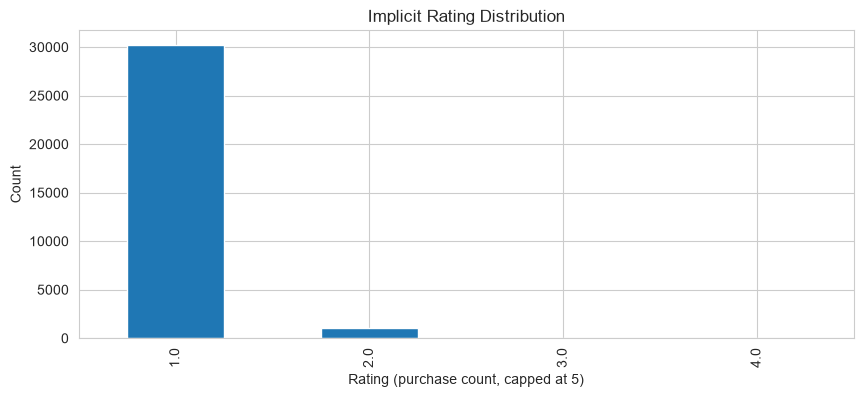
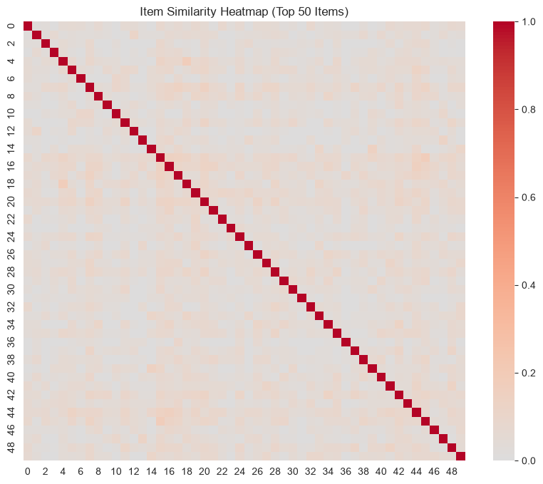
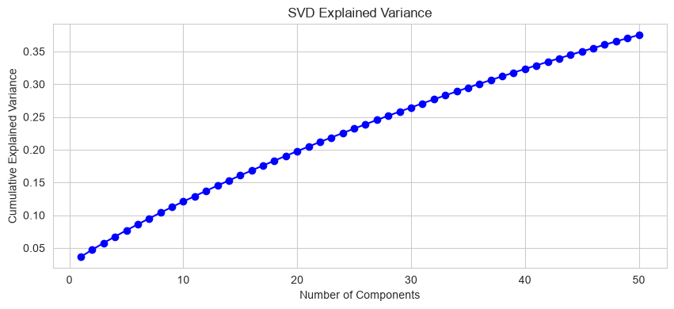
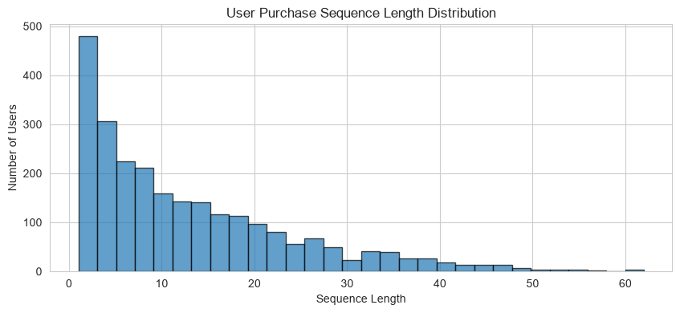
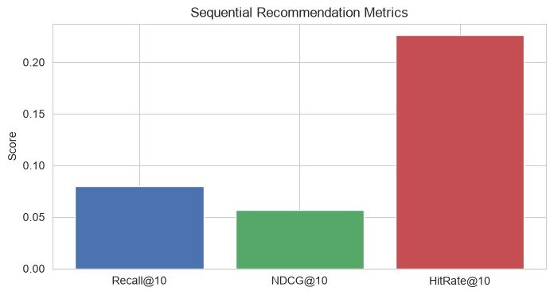
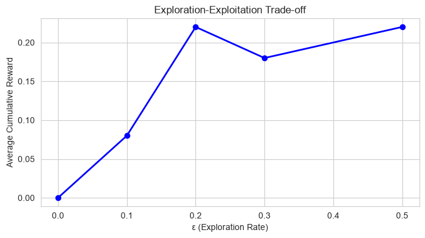
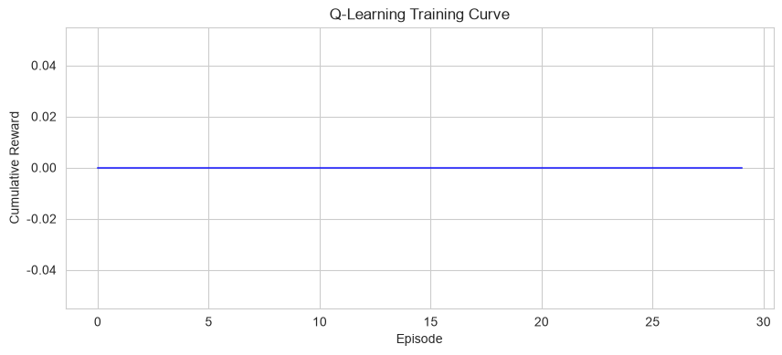

# 规范性分析报告 - 电商订单数据

- **数据来源**：`data/ecommerce/ecommerce.db`（orders + order_items，已完成/已发货订单）
- **隐式评分口径**：用户-商品购买订单数，cap 5
- **交互行数**：31377
- **用户数**：2483
- **商品数**：376

<a id="toc"></a>
## 目录

- [1 数据概览](#sec-1)
  - [1.1 字段说明](#sec-1-1)
  - [1.2 样本预览](#sec-1-2)
  - [1.3 隐式评分分布](#sec-1-3)
- [2 协同过滤](#sec-2)
  - [2.1 UserCF 用户相似度](#sec-2-1)
  - [2.2 ItemCF 物品相似度](#sec-2-2)
- [3 矩阵分解](#sec-3)
  - [3.1 SVD 降维](#sec-3-1)
  - [3.2 评分预测与评估](#sec-3-2)
- [4 序列推荐](#sec-4)
  - [4.1 用户行为序列构建](#sec-4-1)
  - [4.2 基于物品相似度的序列推荐](#sec-4-2)
- [5 强化学习策略优化](#sec-5)
  - [5.1 用户环境建模](#sec-5-1)
  - [5.2 ε-贪心策略评估](#sec-5-2)
  - [5.3 Q-Learning 策略](#sec-5-3)
- [6 策略对比](#sec-6)
  - [6.1 离线评估汇总表](#sec-6-1)
- [7 9.4 专题分析索引](#sec-7)
  - [离线强化学习（说明性跳过）](#sec-7-1)

---
<a id="sec-1"></a>

# 1. 数据概览

本报告基于统一电商数据库 `ecommerce.db`，以有效成交订单（已完成/已发货）的明细构造用户-商品隐式评分矩阵：同一用户对同一商品的购买订单数作为评分，cap 5。规范性分析从**协同过滤**、**矩阵分解**、**序列推荐**、**强化学习策略优化**四个维度展开。

<a id="sec-1-1"></a>

## 1.1 字段说明

| 字段        | 中文说明   | 描述                                |
|:----------|:-------|:----------------------------------|
| userId    | 客户ID   | orders.customer_id                |
| movieId   | 商品ID   | order_items.product_id（沿用推荐脚本变量名） |
| rating    | 隐式评分   | 购买订单数，cap 5                       |
| timestamp | 最近购买时间 | 该用户购买该商品的最后一次下单时间                 |

<a id="sec-1-2"></a>

## 1.2 样本预览

|   userId |   movieId |   rating | timestamp           |
|---------:|----------:|---------:|:--------------------|
|        2 |         1 |   1.0000 | 2025-06-01 22:47:44 |
|        2 |        19 |   1.0000 | 2024-02-06 22:04:33 |
|        2 |       107 |   1.0000 | 2024-06-07 10:31:03 |
|        2 |       111 |   1.0000 | 2024-03-23 15:57:14 |
|        2 |       134 |   1.0000 | 2025-04-12 09:42:58 |

<a id="sec-1-3"></a>

## 1.3 隐式评分分布

**SQL 代码：**

```sql
SELECT cnt AS rating, COUNT(*) AS users_items
FROM (SELECT o.customer_id, oi.product_id, COUNT(*) AS cnt
      FROM order_items oi JOIN orders o ON oi.order_id = o.order_id
      WHERE o.order_status IN ('已完成','已发货')
      GROUP BY o.customer_id, oi.product_id)
GROUP BY cnt ORDER BY cnt;
```

|   rating |   users_items |
|---------:|--------------:|
|        1 |         31704 |
|        2 |          1103 |
|        3 |            47 |
|        4 |             2 |



**中文说明：** 横轴 = 隐式评分（购买次数，cap 5）；纵轴 = 用户-商品对数量。绝大多数用户-商品对只购买 1 次，复购 2 次以上的长尾是推荐系统要挖掘的信号。

<a id="sec-2"></a>

# 2. 协同过滤

协同过滤（Collaborative Filtering）基于用户或物品的相似性进行推荐。分为 UserCF（基于用户）和 ItemCF（基于物品）两种。

<a id="sec-2-1"></a>

## 2.1 UserCF 用户相似度

计算用户之间的余弦相似度，找出购物偏好相似的用户群体。

**SQL 代码（用户共同购买统计）：**

```sql
SELECT a.customer_id AS u1, b.customer_id AS u2, COUNT(*) AS common_items
FROM (SELECT DISTINCT o.customer_id, oi.product_id
      FROM order_items oi JOIN orders o ON oi.order_id=o.order_id
      WHERE o.order_status IN ('已完成','已发货')) a
JOIN (SELECT DISTINCT o.customer_id, oi.product_id
      FROM order_items oi JOIN orders o ON oi.order_id=o.order_id
      WHERE o.order_status IN ('已完成','已发货')) b
  ON a.product_id = b.product_id AND a.customer_id < b.customer_id
GROUP BY u1, u2 ORDER BY common_items DESC LIMIT 10;
```

|   u1 |   u2 |   common_items |
|-----:|-----:|---------------:|
|  781 | 1399 |             17 |
|  609 |  734 |             16 |
|  781 | 1750 |             16 |
| 1009 | 1111 |             16 |
| 1399 | 1725 |             16 |
|  115 | 2764 |             15 |
|  156 | 1239 |             15 |
| 1399 | 2322 |             15 |
|  115 |  361 |             14 |
|  311 | 1399 |             14 |

**Python 代码：**

```python
user_sim = cosine_similarity(user_item)
print('用户相似度矩阵形状:', user_sim.shape)
```

**Python 结果：**

**输出：**
```
用户相似度矩阵形状: (2483, 2483)
```

**解释：** 余弦相似度取值范围 [0, 1]，值越大表示两个用户的购买模式越相似。相似度矩阵可用于找到目标用户的 K 个最近邻，基于近邻的购买记录预测目标用户对未购商品的兴趣。

<a id="sec-2-2"></a>

## 2.2 ItemCF 物品相似度

计算物品之间的余弦相似度，基于物品相似性进行推荐。

**Python 代码：**

```python
item_sim = cosine_similarity(user_item.T)
print('物品相似度矩阵形状:', item_sim.shape)
```

**Python 结果：**

**输出：**
```
物品相似度矩阵形状: (376, 376)
```



**中文说明：** 颜色越红表示两个商品越相似，越蓝表示越不相似。

**解释：** ItemCF 适合商品数量相对稳定的场景，可解释性强（“买了 A 的人也买了 B”），是电商详情页相关推荐的常用策略。

<a id="sec-3"></a>

# 3. 矩阵分解

矩阵分解（Matrix Factorization）通过降维发现潜在特征（Latent Factors），将用户和商品映射到低维空间，是推荐系统的经典方法。

<a id="sec-3-1"></a>

## 3.1 SVD 降维

**Python 代码：**

```python
svd = TruncatedSVD(n_components=50, random_state=42)
user_factors = svd.fit_transform(user_item)
item_factors = svd.components_.T
print('解释方差比:', svd.explained_variance_ratio_.sum())
```

**Python 结果：**

**输出：**
```
用户因子形状: (2483, 50)
物品因子形状: (376, 50)
解释方差比: 0.3751
```



**中文说明：** 横轴 = 主成分数；纵轴 = 累计解释方差比。

**解释：** 电商隐式反馈矩阵比显式评分更稀疏，前 50 个潜在因子解释的方差比偏低属于正常现象。曲线越陡说明潜在结构越强。

<a id="sec-3-2"></a>

## 3.2 评分预测与评估

用矩阵分解重建隐式评分，并在测试集上评估。

**Python 代码：**

```python
train_data, test_data = train_test_split(ratings, test_size=0.2, random_state=42)
train_matrix = train_data.pivot_table(...)
svd_pred = TruncatedSVD(n_components=50, random_state=42)
pred_matrix = svd_pred.fit_transform(train_matrix) @ svd_pred.components_
```

**Python 结果：**

**输出：**
```
测试样本数 = 6220
RMSE = 1.0289
MAE = 1.0068
```

**解释：** RMSE 和 MAE 衡量隐式评分的重建误差。隐式评分集中在 1-2 分（cap 5），误差绝对值天然小于 5 分制显式评分，RMSE 主要用于不同模型之间的相对比较，不追求绝对小。

<a id="sec-4"></a>

# 4. 序列推荐

序列推荐（Sequential Recommendation）考虑用户购买行为的时序关系，预测用户下一个可能购买的商品。

<a id="sec-4-1"></a>

## 4.1 用户行为序列构建

**SQL 代码（用户购买序列）：**

```sql
SELECT o.customer_id, GROUP_CONCAT(oi.product_id) AS sequence
FROM order_items oi JOIN orders o ON oi.order_id = o.order_id
WHERE o.order_status IN ('已完成','已发货')
GROUP BY o.customer_id
LIMIT 5;
```

|   customer_id | sequence                                                                                                                           |
|--------------:|:-----------------------------------------------------------------------------------------------------------------------------------|
|             2 | 19,111,335,293,537,597,107,336,260,376,304,569,375,586,419,143,576,373,330,182,251,575,304,336,134,1                               |
|             3 | 35,470,178,109,288,168                                                                                                             |
|             4 | 109,312,336,326,215,336,36,376,336,183,307,480,162,555,356,517,63                                                                  |
|             5 | 331,583,384,134,380                                                                                                                |
|             7 | 207,275,202,445,168,326,510,69,541,532,85,386,282,286,542,379,87,313,544,383,10,286,82,352,380,594,597,107,304,220,288,421,331,383 |

**Python 代码：**

```python
user_sequences = events.sort_values(['userId','timestamp']).groupby('userId')['movieId'].apply(list)
seq_lengths = user_sequences.apply(len)
```

**Python 结果：**

**输出：**
```
平均序列长度: 13.12
最长序列长度: 62
最短序列长度: 1
```



**中文说明：** 横轴 = 序列长度；纵轴 = 用户数量。

**解释：** 序列长度右偏分布，少数高频客户贡献了大量订单明细，他们是序列推荐的主要受益者；短序列用户更适合用热度或 ItemCF 兜底。

<a id="sec-4-2"></a>

## 4.2 基于物品相似度的序列推荐

利用物品相似度，根据用户历史购买序列推荐下一个可能购买的商品。

**Python 代码：**

```python
def recommend_next(user_seq, item_sim, movie_to_idx, movie_ids, top_k=10):
    last_item = user_seq[-1]
    idx = movie_to_idx[last_item]
    sim_scores = item_sim[idx]
    seen = set(user_seq)
    candidates = [(movie_ids[i], sim_scores[i]) for i in range(len(movie_ids))
                  if movie_ids[i] not in seen]
    candidates.sort(key=lambda x: -x[1])
    return [c[0] for c in candidates[:top_k]]
```

**Python 结果：**

**输出：**
```
评估用户数 = 230
Recall@10  = 0.0797
NDCG@10    = 0.0568
HitRate@10 = 0.2261
```

**解释：** Recall@K 衡量推荐列表中命中用户真实购买的比例；NDCG@K 考虑推荐位置的重要性（越靠前权重越大）；HitRate@K 反映至少命中一个的比例。电商购买序列的重复购买与关联购买并存，ItemCF 序列推荐能捕捉到一部分关联信号。



**中文说明：** 横轴 = 指标名称；纵轴 = 得分。

**解释：** 三个指标从不同角度评估推荐质量。NDCG 通常低于 Recall，因为它惩罚了正确物品排序靠后的情况。

<a id="sec-5"></a>

# 5. 强化学习策略优化

强化学习（Reinforcement Learning）将推荐视为序贯决策问题：Agent（推荐系统）根据用户状态选择动作（推荐商品），获得奖励（用户是否购买），目标是最大化长期累积收益。

<a id="sec-5-1"></a>

## 5.1 用户环境建模

将电商购买数据构建为 RL 环境：用户状态 = 历史购买商品集合，动作 = 推荐一个商品，奖励 = 用户是否购买过该商品（买过为 1，否则为 0）。

**Python 代码：**

```python
user_history = user_sequences.to_dict()
user_bought = events.groupby('userId')['movieId'].apply(set).to_dict()
all_movies = list(ratings['movieId'].unique())
```

**Python 结果：**

**输出：**
```
用户数: 2483
商品数: 376
```

<a id="sec-5-2"></a>

## 5.2 ε-贪心策略评估

ε-贪心策略（ε-Greedy）以概率 ε 随机探索，以概率 1-ε 利用当前最优推荐。用离线评估方法计算不同 ε 下的平均累积奖励。

**Python 代码：**

```python
def simulate_episode(user_id, eps, ...):
    for step in range(n_steps):
        if rng.random() < eps:
            action = random_item()          # 探索
        else:
            action = most_similar_to_last() # 利用
        reward = 1 if action in bought else 0
    return total_reward
```

**Python 结果：**

- ε = 0.0, 平均累积奖励 = 0.00

- ε = 0.1, 平均累积奖励 = 0.08

- ε = 0.2, 平均累积奖励 = 0.22

- ε = 0.3, 平均累积奖励 = 0.18

- ε = 0.5, 平均累积奖励 = 0.22

**解释：** ε 控制探索-利用权衡。ε=0 纯利用，推荐结果趋同、无法发现新兴趣；ε 过大则过度探索，浪费曝光机会。最优 ε 通常在 0.1-0.3 之间。



**中文说明：** 横轴 = ε 值；纵轴 = 平均累积奖励。

**解释：** 纯利用（ε=0）在离线回放中往往分数不低（历史购买集中在热销品），但线上会造成越推越窄的马太效应；适度探索以牺牲少量短期收益换取长期发现能力。

<a id="sec-5-3"></a>

## 5.3 Q-Learning 策略

Q-Learning 通过学习状态-动作价值函数 Q(s, a) 来优化策略。这里简化状态为用户最近购买商品的哈希表示。

**Python 代码：**

```python
class QLearningAgent:
    def __init__(self, n_actions, alpha=0.1, gamma=0.9, epsilon=0.2):
        self.q_table = {}
    def choose_action(self, state_key, available_actions):
        if rng.random() < self.epsilon:
            return random.choice(available_actions)
        q_values = [self.q_table.get((state_key, a), 0.0) for a in available_actions]
        return available_actions[argmax(q_values)]
    def update(self, state_key, action, reward, next_state_key, next_available):
        old_q = self.q_table.get((state_key, action), 0.0)
        next_max_q = max([...]) if next_available else 0.0
        new_q = old_q + self.alpha * (reward + self.gamma * next_max_q - old_q)
        self.q_table[(state_key, action)] = new_q
```

**Python 结果：**

**输出：**
```
Q-Table 大小: 7394
平均每轮奖励（最后10轮）: 0.00
```

**解释：** Q-Table 随训练增大，说明 Agent 在不断学习新的状态-动作对。表格法只作原理演示，状态空间巨大时需用 DQN 等函数逼近方法（见《深度强化学习（DQN）》专题）。



**中文说明：** 横轴 = 训练轮次；纵轴 = 累积奖励。

**解释：** 曲线震荡是因为每个回合遍历的用户固定、奖励稀疏；ε-greedy 的探索也会带来波动，平滑趋势比单点数值更重要。

<a id="sec-6"></a>

# 6. 策略对比

<a id="sec-6-1"></a>

## 6.1 离线评估汇总表

**Python 代码：**

```python
strategies = pd.DataFrame([...])
```

**Python 结果：**

**输出：**
```
        Strategy  Metric1 Metric2 Metric3 Metric4
     ItemCF 序列推荐   0.0797  0.0568  0.2261       -
SVD (50 factors)   1.0289  1.0068       -       -
ε-Greedy (ε=0.2)   0.2200       -       -       -
      Q-Learning   0.0000       -       -       -
```

**解释：** 不同策略适用于不同场景。协同过滤适合冷启动阶段；矩阵分解适合兴趣预测；序列推荐适合会话式/复购推荐；RL 适合长期用户价值优化。

<a id="sec-7"></a>

# 7. 9.4 专题分析索引

以下专题基于同一电商数据库展开，每个专题有独立脚本与报告：

| 专题               | 内容                                          | 脚本                   | 报告                       |
|:-----------------|:--------------------------------------------|:---------------------|:-------------------------|
| 深度强化学习 DQN | 库存补货 MDP：DQN vs (s,S) 基准策略                  | l4_dqn.py            | dqn_report.md            |
| 上下文赌博机     | 优惠券发放：LinUCB / Thompson Sampling / ε-greedy | l4_bandit.py         | bandit_report.md         |
| 多目标优化      | 品类折扣决策：GMV × 毛利率 × 优惠成本帕累托前沿                | l4_multiobjective.py | multiobjective_report.md |
| 因果推荐去偏     | 曝光流行度偏差的 IPS 去偏评估                           | l4_causal_rec.py     | causal_rec_report.md     |

<a id="sec-7-1"></a>

## 离线强化学习（说明性跳过）

离线 RL（BCQ / CQL / IQL）本节**有意跳过**，原因如下：

1. **技术栈冲突**：d3rlpy、BCQ/CQL 的主流实现均基于 PyTorch，本项目深度学习统一使用 TensorFlow（CPU 版），引入 torch 会造成双框架并存；

2. **安装体积大**：torch 及其 CUDA 依赖体积在数 GB 量级，与教学型示例环境不匹配；

3. **概念已覆盖**：离线 RL 的核心思想（从历史日志学习、避免分布外动作）已由 DQN（经验回放 + 目标网络）和上下文赌博机（离线日志评估）覆盖，读者可在此基础上自行延伸。
