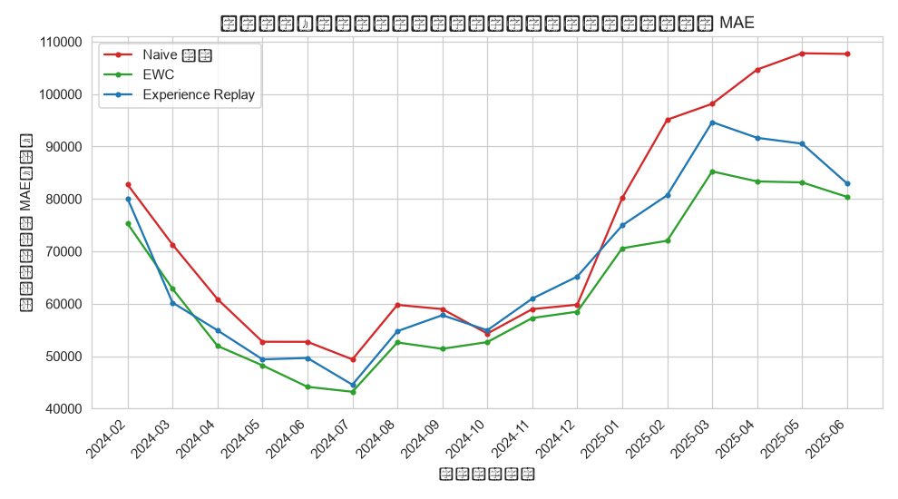
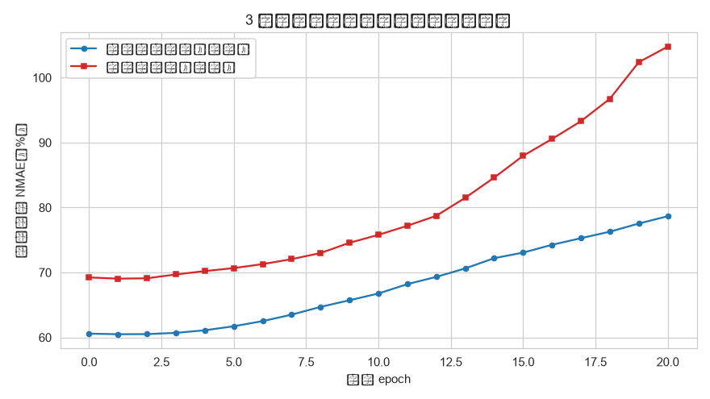
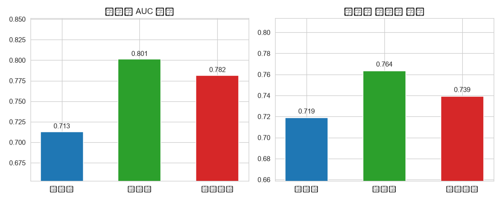

# L5 认知性分析：让系统自己进化

> **一句话**：世界一直在变，一次性训练好的模型上线就开始衰减；认知性分析让系统**记住旧知识、快速学新任务、同时看懂多种信号**。
> 数据源统一为 `../ecommerce/ecommerce.db`，方法论总览见 [../README.md](../README.md)。

---

## 1. 这层解决什么问题

前四层假设“数据是静止的”：同一份数据训一次模型，误差稳定。真实业务里数据是**持续到达**的：

- 每月新订单进来，模型要不要重训？只重训会不会忘掉历史月份？
- 新品类上线没有任何历史数据，怎么给出第一版预测？
- 客户的评价文本、行为埋点、订单表格三种信号，怎么合并成一个判断？

L5 关心的是**系统的寿命**：在分布漂移、任务新增、模态异构的环境下，如何持续可用。

## 2. 方法地图

| 方法 | 解决的问题 | 关键概念 | 关键指标 |
|---|---|---|---|
| 持续学习 | 新数据到来时如何不忘旧知识 | 灾难性遗忘、可塑性-稳定性权衡 | 首月遗忘率、历史平均误差 |
| 参数正则（EWC） | 用参数重要性锁住旧知识 | 对角 Fisher 信息、λ 惩罚 | 遗忘增幅、当月误差 |
| 经验回放 | 用旧样本缓冲抑制遗忘 | 蓄水池采样、混训比例 | 缓冲成本、遗忘增幅 |
| 元学习 | 用少量样本快速适应新任务 | Reptile、任务分布、参数初始化 | 零样本误差、触底轮次 |
| 多模态融合 | 文本 / 表格 / 行为信号如何合并 | 双塔、池化、融合头 | 各模态 AUC、融合增益 |
| 漂移检测 | 分布什么时候变了 | 统计检验、误差监控 | 检测延迟、误报率 |

## 3. 关键成果

**持续学习（日 GMV 序列，18 个月度批次）。** 首月离线训练后按月增量更新：

| 策略 | 首月 MAE 变化 | 最终历史平均 MAE | 当月 MAE |
|---|---|---|---|
| Naive 微调 | 77,753 → 89,091 元（**+15%**） | 107,665 元 | 89,999 元 |
| EWC（λ=500） | 70,189 → 65,929 元（−6%） | **80,391 元** | 86,912 元 |
| Experience Replay（缓冲 128） | 66,243 → 62,644 元（−5%） | 82,953 元 | 95,446 元 |

灾难性遗忘是真实发生的：只做微调的模型在大促月份更新后被极端分布“带偏”，历史月份误差一路抬升。EWC 与回放分别以**参数锁定**和**旧样本混训**把历史平均误差压低约 23%~25%，同时当月拟合能力几乎无损。

**元学习（跨品类少样本，Reptile）。** 每个一级品类是一个 task，留出 3 个新品类，只给前 14 天支撑数据微调：

- 零样本（未微调）：元初始化平均 NMAE **60.6%**，随机初始化 69.2%，直接训练 30 轮 71.4%——**元参数本身已编码品类 GMV 的通用动态**。
- 少样本适应：元初始化在 3/3 个品类优于随机初始化（60.1% vs 67.1%），且平均第 3 轮触底，随机初始化要到第 7 轮。
- 教训：只有 7 条支撑样本，微调必须早停；低量级高波动品类（食品饮料）甚至以零样本为最优。

**多模态融合（评论文本 + 行为表格预测复购）。** 1,788 名有评价记录的客户，特征窗口与标签窗口按时间切分：

| 模型 | AUC | 准确率 |
|---|---|---|
| 仅文本（jieba + Embedding + 池化） | 0.7130 | 0.7188 |
| 仅表格（17 维 RFM / 行为 / 画像） | **0.8012** | 0.7635 |
| 双塔融合 | 0.7816 | 0.7393 |

表格行为特征是复购预测的主干；千级样本下融合的额外参数抵消了文本的微弱增量，融合未稳定超越最佳单模态——**多模态并非必然更优，收益需要数据量与任务复杂度支撑**。







## 4. 专题索引

| 报告 | 内容 | 适合谁 |
|---|---|---|
| [continual_report.md](continual_report.md) | Naive / EWC / 回放的遗忘曲线与热力图 | 做模型持续迭代的人 |
| [meta_report.md](meta_report.md) | Reptile 跨品类少样本适应与三种基线对比 | 做新品冷启动的人 |
| [multimodal_report.md](multimodal_report.md) | 文本塔 + 表格塔的复购预测与模态贡献分析 | 做多源特征融合的人 |

## 5. 方法提醒

1. **“训一次就上线”必然衰减**：至少要有误差监控与重训触发条件。
2. **别把重训当万能**：只微调会遗忘，只全量重训成本高，稳定性机制要按存储预算选。
3. **少样本必须早停**：支撑样本少时轮数一多就过拟合，验证集或固定轮数上限都要提前定。
4. **多模态不是必赢**：先做单模态基线，融合增益要用同一划分验证，不能靠直觉。
5. **漂移检测要区分类型**：缓慢漂移靠定期更新，突变漂移（大促）靠主动加权。

## 6. 如何运行

```powershell
python src/data/L5/l5_continual.py
python src/data/L5/l5_meta.py
python src/data/L5/l5_multimodal.py
```

完整环境与执行顺序见 [../run.md](../run.md)。真实大模型 API 接入与教育领域知识追踪不适用于本电商数据，已标注为说明性跳过。
