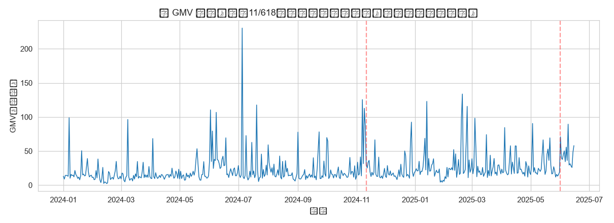
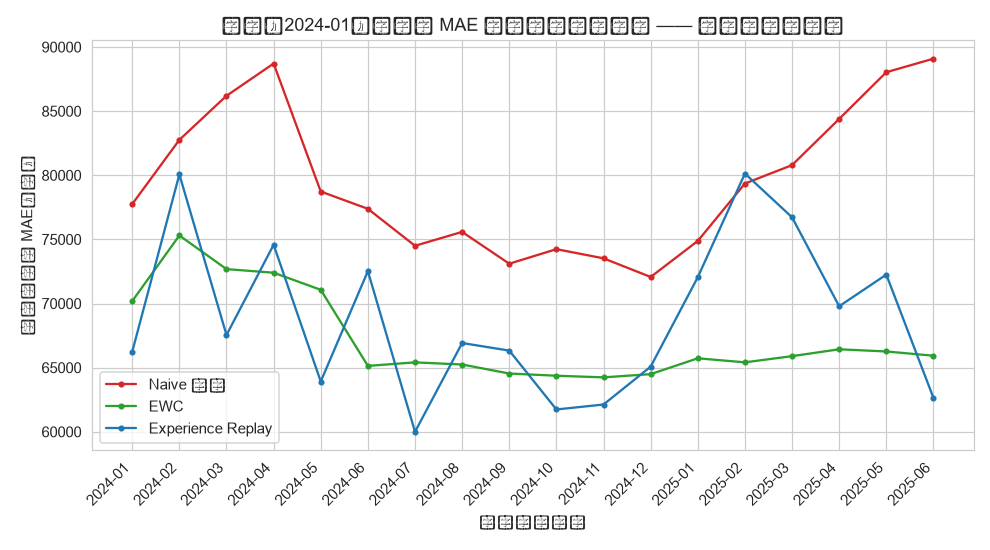
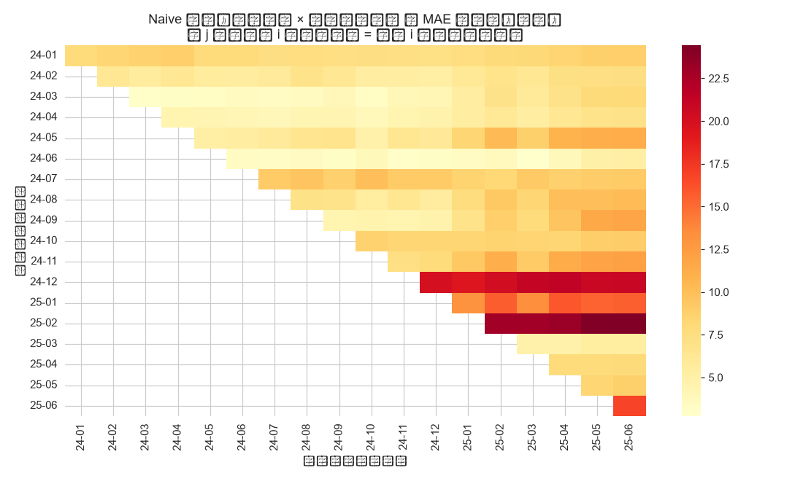
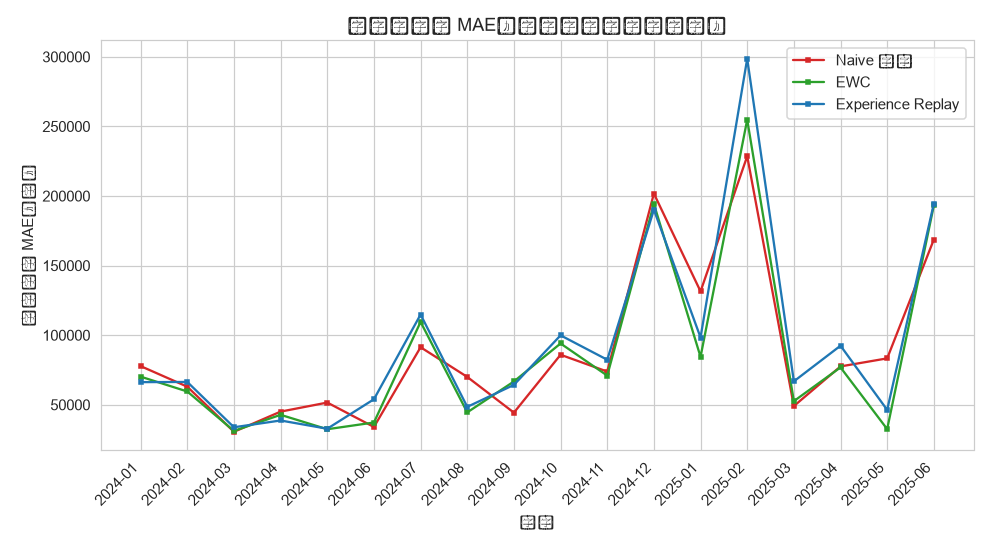

# L5 认知性分析：持续学习 —— 概念漂移下的日 GMV 预测模型

- **数据来源**：`../ecommerce/ecommerce.db`（orders 表，已完成+已发货订单）
- **序列长度**：532 天（2024-01-01 ~ 2025-06-15），共 18 个月度批次
- **预测任务**：用过去 7 天 GMV 预测第 8 天（log1p 变换 + 首月 z-score 标准化）
- **更新协议**：首月离线训练后，数据按月增量到达，每月用新数据更新模型

---

## 1. 场景与概念漂移

电商 GMV 是典型的**非平稳时序**：双 11、618 大促带来数量级尖峰，春节造成低谷，叠加缓慢增长趋势与周末效应。模型若只训练一次就上线，误差会随分布漂移持续放大；若每月简单微调，又会**遗忘**历史月份的规律（灾难性遗忘）。持续学习的目标是在**可塑性**（学会新知识）与**稳定性**（不忘旧知识）之间取得平衡。

**中文说明：** 横轴 = 日期；纵轴 = 日 GMV（万元）。红色虚线标注双 11 与 618 大促。

**解释：** 序列存在明显的趋势增长与大促脉冲，月度分布差异显著，构成天然的概念漂移场景。

## 2. 实验设置

| 配置项 | 取值 |
|:--|:--|
| 模型 | MLP(7→32→16→1) |
| 首月训练 | 40 epochs, Adam(lr=0.001) |
| 每月更新 | 15 epochs, batch=16 |
| 每月测试集 | 该月最后 7 个样本（当月未见） |
| EWC λ | 500（对角 Fisher 由当月训练数据梯度平方估计） |
| 回放缓冲 | 蓄水池采样，容量 128 条 |
| 随机种子 | 42 |

三种策略：

1. **Naive 微调**：每月仅当月数据直接微调 —— 基线，预期出现灾难性遗忘；
2. **EWC**：损失中追加 `λ/2·ΣFᵢ(θᵢ-θ*ᵢ)²` 惩罚，Fisher 信息越大（对旧任务越重要）的参数越不允许移动；
3. **Experience Replay**：维护一个蓄水池缓冲区，每月训练时混入历史样本回放。

## 3. 遗忘曲线

**中文说明：** 横轴 = 模型更新到达的月份；纵轴 = 更新完成后在**全部历史月份**（不含当月）测试集上的平均 MAE。

**解释：** 曲线越低且越平，说明策略抗遗忘能力越强。Naive 微调的误差随更新次数总体抬升，尤其在大促月份（2024-11、2025-06）更新后对普通月份的预测明显恶化——模型被极端分布"带偏"。EWC 与回放通过不同机制（参数锁定 / 旧样本混训）抑制遗忘，具体幅度见第 7 节汇总表。

## 4. 首月测试集误差（灾难性遗忘度量）

**中文说明：** 横轴 = 更新到达月份；纵轴 = 模型在首月（2024-01）测试集上的 MAE。

**解释：** 该曲线是灾难性遗忘的经典度量：模型离首月越远、经历的更新越多，若首月误差持续爬升即代表旧知识被冲刷。Naive 微调下首月误差从 77,753 元变为 89,091 元（+15%）；EWC 与回放分别以参数惩罚和样本混训对抗这一退化。

## 5. 月份 × 更新 误差热力图（Naive）

**中文说明：** 第 i 行第 j 列 = 模型更新到第 j 个月后、在第 i 个月测试集上的 MAE。只看下三角（j≥i）。

**解释：** 热力图直观呈现遗忘的时空结构——同一行向右颜色加深表示该月知识被后续更新逐渐覆盖；大促月份所在的列整体颜色突变，说明极端分布更新是遗忘的主要推手。

## 6. 当月误差（可塑性）

**中文说明：** 横轴 = 月份；纵轴 = 该月数据训练后、当月留出测试集上的 MAE。

**解释：** 三种策略对当月新数据的拟合能力接近，说明 EWC 的稳定性约束并没有显著牺牲可塑性；大促月份三者误差同步冲高，属于任务本身难度（罕见的极端分布）。

## 7. 汇总对比

| 策略 | 首月MAE(初始,元) | 首月MAE(最终,元) | 遗忘增幅 | 历史平均MAE(最终,元) | 当月MAE(全程均值,元) |
|:--|--:|--:|--:|--:|--:|
| Naive 微调 | 77,753 | 89,091 | +15% | 107,665 | 89,999 |
| EWC（λ=500） | 70,189 | 65,929 | -6% | 80,391 | 86,912 |
| Experience Replay（缓冲 128） | 66,243 | 62,644 | -5% | 82,953 | 95,446 |

## 8. 结论

1. **灾难性遗忘真实发生**：Naive 微调下首月测试误差从 77,753 元放大到 89,091 元（+15%），最终历史月份平均 MAE 107,665 元，为三者最差；大促月份的极端分布更新是遗忘的主要推手。
2. **EWC 有效但依赖 λ**：以对角 Fisher 近似参数重要性，首月遗忘增幅 -6%，最终历史平均 MAE 80,391 元，较 Naive 下降 25%；λ 过小保护不足、过大则牺牲当月拟合，需按业务容忍度调参。
3. **Experience Replay**：首月遗忘增幅 -5%，最终历史平均 MAE 82,953 元，较 Naive 下降 23%；代价是需要额外存储与每次更新的混合训练开销。
4. **综合排名**：按最终历史平均 MAE，EWC（λ=500） 最优、Naive 微调 最差。工程上推荐"稳定性机制（EWC 或回放，按存储预算二选一）+ 漂移检测触发重训"的组合——日常维持稳定，遇到大促级分布突变时主动放大当月样本的训练权重。

---

## 附：说明性跳过

- **真实 LLM API 接入**：环境中无可用 API Key，本层示例跳过真实大模型调用，相关语义能力以可复现的本地方法替代演示。
- **知识追踪（DKT/SAKT/AKT）**：教育领域专用技术，电商数据库中无"知识点-作答"对应概念，不适用，跳过。