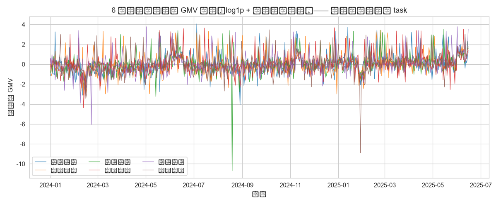
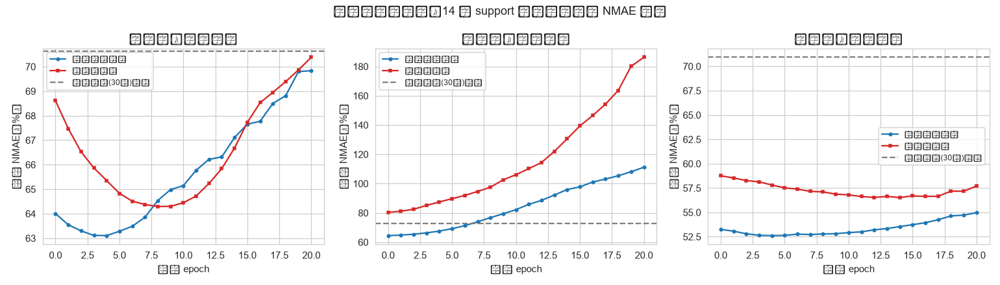

# L5 认知性分析：元学习 —— 跨品类少样本销量预测

- **数据来源**：`../ecommerce/ecommerce.db`（orders × order_items × products × categories）
- **任务定义**：每个一级品类 = 一个 task，共 6 个：家用电器、手机数码、服装鞋帽、母婴用品、美妆个护、食品饮料
- **算法**：Reptile（一阶 MAML 近似，`θ ← θ + ε(θ′−θ)`，无需二阶导）
- **模型**：LSTM(16) → Dense(8) → Dense(1)，输入过去 7 天预测第 8 天
- **测试协议**：留出品类 母婴用品、食品饮料、美妆个护；仅给新品类前 14 天 support 微调，在之后 90 天上测 NMAE（MAE/测试期均值，避免 MAPE 在低销量日爆炸）

---

## 1. 场景与动机

电商业务不断上线新品类，新品类没有历史数据，无法训练专属预测模型。元学习的目标是从**已有多个品类**的销量动态中提炼"如何快速学习一个品类"的元知识——一个对多任务都敏感的参数初始化，使得新品类只用极少数样本微调几步即可可用。

**中文说明：** 横轴 = 日期；纵轴 = 品类内标准化后的日 GMV。

**解释：** 各品类都受大促与季节影响（共享结构），但量级、波动幅度、增长趋势不同（任务异构）。共享结构是元学习可利用的跨任务知识，异构性则要求模型具备快速适应能力。

## 2. 实验设置

| 配置项 | 取值 |
|:--|:--|
| 元训练 | Reptile, 200 次元迭代, ε=0.5, 任务内 4 epochs @ lr=0.001 |
| 任务采样 | 每次随机选 1 个品类 + 随机截取 60 天片段 |
| support | 新品类前 14 天（滑窗样本 7 条） |
| 测试 | support 之后 90 天（滑窗样本 83 条） |
| 对比 | A=元学习初始化微调 / B=随机初始化微调(同步数) / C=直接训练(随机初始化+小数据练 30 轮) |
| 随机种子 | 42 |

## 3. 少样本适应曲线

**中文说明：** 每个子图对应一个留出的新品类；横轴 = 在 14 天 support 上微调的 epoch 数（0 = 未微调）；纵轴 = 之后 90 天测试集上的 NMAE。灰色虚线 = "直接训练"基线的最终成绩。

**解释：** 元学习初始化的**起点误差**（epoch 0，未见过新品类任何数据）已明显低于随机初始化，说明元参数本身编码了品类 GMV 的通用动态。两条曲线都在前 2~5 轮触底后回升——只有 7 条支撑样本时，微调轮数稍多即过拟合，少样本适应必须配合早停。个别低量级、高波动品类（食品饮料）上任何微调都反而引入噪声，以零样本为最优，说明元知识迁移也存在任务相似度上限。

## 4. 平均适应曲线（3 个新品类）

**中文说明：** 横轴 = 适应 epoch；纵轴 = 3 个留出品类测试 NMAE 的均值。

**解释：** 平均曲线抹平了单品类的偶然性：元学习初始化在**每一个 epoch** 上都低于随机初始化，两者之间的垂直距离就是元学习带来的"少样本红利"——在只有 7 条滑窗训练样本的条件下，红利尤为关键。

## 5. 汇总对比（NMAE，%）

**零样本起点（未微调，epoch 0）：**

| 测试品类 | A 元学习初始化 | B 随机初始化 |
|:--|--:|--:|
| 母婴用品 | 64.0 | 68.6 |
| 食品饮料 | 64.5 | 80.3 |
| 美妆个护 | 53.3 | 58.8 |
| **平均** | **60.6** | **69.2** |

**微调后（14 天 support）：** "最优"为适应窗口内的早停参考点（理论下限，实际需用验证集近似）；"最终"为满 20 轮。

| 测试品类 | A 最优 | A 最终(20轮) | B 最优 | B 最终(20轮) | C 直接训练(30轮) |
|:--|--:|--:|--:|--:|--:|
| 母婴用品 | 63.1 | 69.8 | 64.3 | 70.4 | 70.6 |
| 食品饮料 | 64.5 | 111.2 | 80.3 | 186.3 | 72.7 |
| 美妆个护 | 52.6 | 55.0 | 56.5 | 57.7 | 70.9 |
| **平均** | **60.1** | **78.7** | **67.1** | **104.8** | **71.4** |

## 6. 结论

1. **零样本即插即用**：元学习初始化在未见新品类任何数据时，平均 NMAE 仅 60.6%，在 3/3 个品类上优于随机初始化（69.2%），且已低于"直接训练 30 轮"的平均成绩（71.4%）——元参数本身已编码品类 GMV 的通用动态，新品类冷启动可直接给出基线预测。
2. **少样本适应更快更准**：以早停参考点计，元初始化在 3/3 个品类上优于随机初始化（平均 60.1% vs 67.1%）；元初始化平均第 3 轮触底，随机初始化第 7 轮——同样的 7 条支撑样本，好的初始化让适应收敛更快、终态更优。
3. **少样本微调必须早停**：仅 7 条训练样本下，两种初始化触底后继续微调即过拟合、误差回升（见适应曲线后半段）；食品饮料这类低量级高波动品类甚至以零样本为最优。"直接训练"的成绩对轮数极不稳定，不能当作可靠基线。
4. **业务建议**：新品类上线以元初始化零样本预测起步，真实数据到达后少量轮数微调并严格早停（留出验证天或固定不超过 5 轮），显著缩短"无数据可预测"的冷启动窗口。

---

## 附：说明性跳过

- **真实 LLM API 接入**：环境中无可用 API Key，本层示例跳过真实大模型调用，相关语义能力以可复现的本地方法替代演示。
- **知识追踪（DKT/SAKT/AKT）**：教育领域专用技术，电商数据库中无"知识点-作答"对应概念，不适用，跳过。