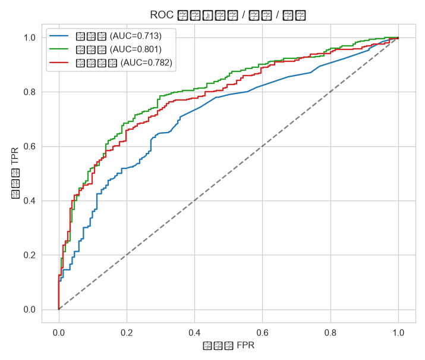
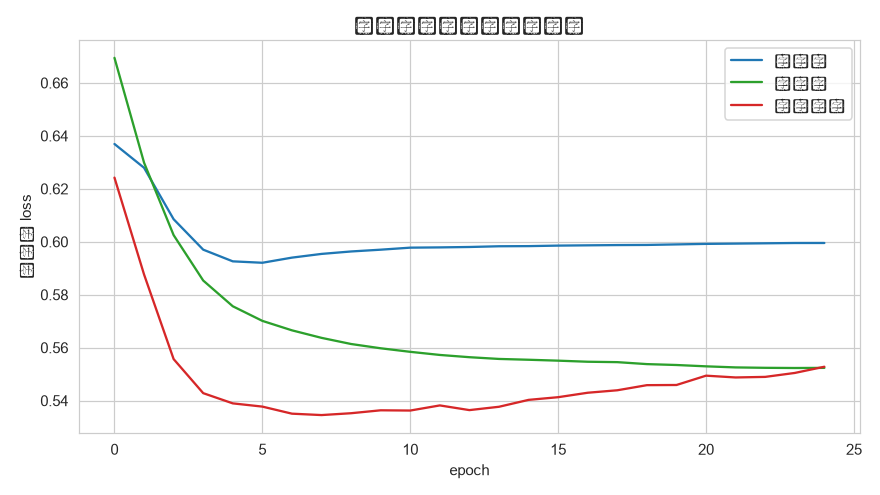

# L5 认知性分析：多模态学习 —— 评论文本 + 客户行为预测复购

- **数据来源**：`../ecommerce/ecommerce.db`（reviews / orders / user_events / customers）
- **预测任务**：用 2025-03-17 之前（特征窗口）的数据，预测客户在末 90 天（标签窗口）是否复购（≥1 笔已完成订单记为 1）——特征与标签按时间切分，避免泄漏
- **样本**：特征窗口内有评价记录的客户 1788 名，末 90 天复购占比 71.9%
- **模态一（文本）**：该客户全部评价拼接 → jieba 分词 → Embedding(32) + GlobalAveragePooling
- **模态二（表格）**：RFM + 浏览/加购计数 + 加购率 + 客单价 + 年龄/活跃度 + 评价数/平均星级 + 性别/会员等级独热，共 17 维
- **融合**：双塔结构，文本塔与表格塔各自编码后拼接，接 Dense(32)+Dropout+Sigmoid

---

## 1. 场景与动机

复购预测的信号分散在两种异构数据里：**评价文本**承载客户的主观态度（满意/抱怨/复购意愿关键词），**行为表格**承载客观消费强度（RFM、活跃度）。单模态模型只能看到信号的一个侧面；多模态学习通过双塔结构分别编码再融合，检验"1+1 是否大于 2"。

## 2. 实验设置

| 配置项 | 取值 |
|:--|:--|
| 词表 | jieba 分词, 词频 Top-2000, 序列截断/补齐 60 词 |
| 文本塔 | Embedding(32) → GlobalAveragePooling → Dense(32) |
| 表格塔 | Dense(32) → Dense(16)，输入标准化 |
| 融合头 | Concatenate → Dense(32) → Dropout(0.2) → Sigmoid |
| 训练 | 25 epochs, batch=64, Adam(lr=0.001), 15% 验证划分 |
| 数据划分 | 分层抽样 70%% 训练 / 30%% 测试，三模型同一划分 |
| 随机种子 | 42 |

## 3. 三模型对比

**中文说明：** 左图 = 测试集 AUC；右图 = 测试集准确率。

**解释：** 表格模态（RFM、活跃度等）是复购预测的主干信号；文本模态单独看信息量有限。本样本规模下融合未稳定超越最佳单模态，说明文本塔提供的增量不足以抵消双塔引入的额外参数——多模态收益需要数据量与任务复杂度支撑。

**中文说明：** 三模型在测试集上的 ROC 曲线，越靠近左上角越好。

**解释：** 若融合曲线在大部分阈值区间位于单模态曲线上方，说明增益不是某个阈值下的偶然，而是整体排序能力的提升；若曲线相互穿插，则说明两模态在不同区间各有胜负、融合收益不稳定。

## 4. 训练收敛

**中文说明：** 横轴 = epoch；纵轴 = 验证集二元交叉熵。

**解释：** 仅文本模型验证损失下降缓慢且平台较高，反映文本信号较弱；仅表格与融合模型收敛更快、终态更低。验证损失未持续回升，说明 25 轮训练内未出现严重过拟合。

## 5. 指标汇总

| 模型 | AUC | 准确率 |
|:--|--:|--:|
| 仅文本 | 0.7130 | 0.7188 |
| 仅表格 | 0.8012 | 0.7635 |
| 双塔融合 | 0.7816 | 0.7393 |

## 6. 结论

1. **表格行为特征是复购预测的主干**：仅表格 AUC=0.801，高于仅文本的 0.713——RFM 与活跃度等客观消费强度是"会不会再买"的主要信号来源。
2. **融合增益有限**：双塔融合 AUC=0.782，较仅文本 +6.9 个百分点、较仅表格 -2.0 个百分点——千级样本下双塔的额外参数抵消了文本的微弱增量，多模态并非必然更优。
3. **融合方式务实**：GlobalAveragePooling 的均值池化虽然丢失语序，但在短评价语料上足够稳定、零外部依赖；双塔结构允许两模态分别预训练/更新，工程上易于增量接入新模态。
4. **局限说明**：特征与标签已按时间切分（2025-03-17 之前 vs 末 90 天），无标签泄漏；但样本仅千级、未做超参搜索，指标仅用于演示模态间的相对贡献。

---

## 附：说明性跳过

- **真实 LLM API 接入**：环境中无可用 API Key，本层示例跳过真实大模型调用，文本语义以本地 jieba + Embedding 的可复现方案替代。
- **知识追踪（DKT/SAKT/AKT）**：教育领域专用技术，电商数据库中无"知识点-作答"对应概念，不适用，跳过。