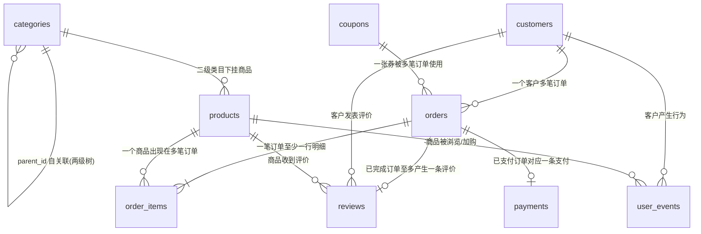
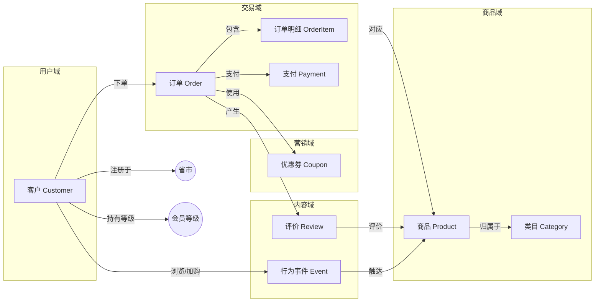

# 电商分析数据集说明

本目录提供一套**确定性生成**的多表关联电商数据集，作为 L1~L5 各层分析示例的统一数据源。

确定性机制（DataClerk 式）：

- 显式随机源：生成全程只用一个 `random.Random(42)`，不触碰全局 `random`
- 锚定"今天"：所有日期相对固定的 `2025-06-15` 生成，不读系统时钟
- 固定生成顺序：类目 → 客户 → 商品 → 订单 → 支付 → 评价 → 行为事件
- 金额一律保留两位小数

同一份 `generate_dataset.py` 在任何时间、任何机器上运行，产出字节级一致的 `ecommerce.db`（本项目实测两次生成 SHA256 相同：`c957ca93...`）。

## 1. 生成与校验

```powershell
# 在项目根目录的 .venv 环境下
python data/ecommerce/generate_dataset.py --force   # 生成/重建 ecommerce.db
python data/ecommerce/_verify.py                     # 校验外键与金额一致性
```

数据规模（种子 42）：

| 表 | 行数 | 说明 |
|---|---|---|
| categories | 30 | 6 个一级类目 × 各 4 个二级类目 |
| customers | 3,000 | 注册会员 |
| products | 600 | 每个二级类目 25 个商品 |
| coupons | 8 | 满减/折扣/无门槛三类 |
| orders | 19,669 | 2024-01-01 ~ 2025-06-15 |
| order_items | 36,907 | 订单明细 |
| payments | 19,181 | 已支付订单的支付记录 |
| reviews | 5,976 | 已签收订单评价（含中文文本） |
| user_events | 76,905 | 浏览/加购埋点 |

数据中刻意埋入的模式：双 11、618 大促峰值，春节低谷，周末效应，缓慢增长趋势，约 1.2% 批发型异常订单（单件商品数量 30~200）与 0.5% 价格异常订单（单价 ×10）——后两者是 L2 异常检测的靶子。

> **已知问题（当前 build）**：约 21% 订单存在 `shipped_at` 时刻早于同日 `paid_at` 的时刻错位（日期粒度正确），系生成器中发货时钟独立随机所致，已被 [../engineering/data_quality_report.md](../engineering/data_quality_report.md) 的质量规则捕获。当前 `ecommerce.db`（SHA256 `c957ca93...`）保持原样，L1~L5 报告均基于此 build 生成；如需修复，改 `generate_dataset.py` 中发货时间逻辑后 `--force` 重新生成，但 rng 流会变化，整个库数据与所有下游报告数字都会改变，需重跑各层脚本。

## 2. 表结构

完整 DDL（含逐字段注释）见 [schema.sql](schema.sql)。字段要点如下。

### 2.1 categories 类目表

| 字段 | 类型 | 说明 |
|---|---|---|
| category_id | INTEGER PK | 类目ID |
| parent_id | INTEGER FK | 父类目，NULL=一级类目 |
| category_name | TEXT | 类目名称 |
| level | INTEGER | 1=一级，2=二级 |

### 2.2 customers 客户表

| 字段 | 类型 | 说明 |
|---|---|---|
| customer_id | INTEGER PK | 客户ID |
| customer_name | TEXT | 姓名（合成） |
| gender | TEXT | 男 / 女 |
| age | INTEGER | 年龄 18-65 |
| province / city | TEXT | 省份 / 城市（10 省 23 市） |
| register_date | TEXT | 注册日期 |
| member_level | TEXT | 普通 / 白银 / 黄金 / 钻石 |
| activity_score | REAL | 活跃度（生成参数，决定下单频率） |

### 2.3 products 商品表

| 字段 | 类型 | 说明 |
|---|---|---|
| product_id | INTEGER PK | 商品ID |
| category_id | INTEGER FK | 所属二级类目 |
| product_name | TEXT | 品牌+品类词+型号 |
| brand | TEXT | 品牌 |
| list_price | REAL | 标价（元） |
| cost | REAL | 成本价（元） |
| stock | INTEGER | 库存 |
| status | TEXT | 在售 / 下架 |
| created_date | TEXT | 上架日期 |
| popularity / quality_score | REAL | 生成参数：受欢迎度 / 质量分（影响评价星级） |

### 2.4 orders 订单表

| 字段 | 类型 | 说明 |
|---|---|---|
| order_id | INTEGER PK | 订单ID |
| customer_id | INTEGER FK | 下单客户 |
| coupon_id | INTEGER FK | 用券ID，可空 |
| order_status | TEXT | 已完成 / 已发货 / 待付款 / 已取消 |
| channel | TEXT | APP / 小程序 / 网页 / 线下 |
| created_at ~ delivered_at | TEXT | 下单/支付/发货/签收 时间链 |
| freight_amount | REAL | 运费（满 99 免运费） |
| discount_amount | REAL | 优惠金额 |
| total_amount | REAL | 实付 = Σ明细小计 + 运费 |

### 2.5 order_items 订单明细表

| 字段 | 类型 | 说明 |
|---|---|---|
| item_id | INTEGER PK | 明细行ID |
| order_id | INTEGER FK | 所属订单 |
| product_id | INTEGER FK | 商品 |
| quantity | INTEGER | 件数 |
| unit_price | REAL | 成交单价（含促销浮动） |
| item_discount | REAL | 分摊优惠（末行兜底，保证合计=订单优惠） |
| subtotal | REAL | 小计 = 单价×数量 - 分摊优惠 |

### 2.6 payments / reviews / user_events / coupons

- **payments**：order_id FK、payment_method（微信支付/支付宝/银行卡/余额）、payment_amount、paid_at、payment_status（成功/失败/已退款）
- **reviews**：order_id + product_id + customer_id 三个 FK、rating（1-5 星）、review_content（中文短文本，L1 文本分析语料）、created_at（每单至多一条）
- **user_events**：customer_id + product_id FK、event_type（view/cart）、event_time（约 6 成落在同客户同商品下单前 7 天内，其余为未转化行为）
- **coupons**：coupon_type（满减/折扣/无门槛）、threshold_amount（门槛）、discount_value（减免额或折扣率）、valid_from/valid_to（分全年/双11/618 三档）

## 3. 表间业务关系



关系要点：

1. **orders ↔ products 是多对多**，靠 order_items 连接，分析销量必须 JOIN 明细表。
2. **金额链路**：`orders.total_amount = Σ(order_items.subtotal) + freight_amount`；`Σ(item_discount) = orders.discount_amount`。两条等式已在校验脚本中验证。
3. **状态机**：待付款 →（支付）→ 已发货 →（签收）→ 已完成；任何阶段可转为已取消。时间链字段的**日期**满足 `created_at ≤ paid_at ≤ shipped_at ≤ delivered_at`，未到达的节点为 NULL；**时刻**层面约 21% 已发货订单存在 `shipped_at` 早于同日 `paid_at` 的错位（见第 7 节已知问题），构造"支付到发货时长"类指标时需按日期为粒度。
4. **行为-交易闭环**：约 6 成 user_events 落在同客户 + 同商品成交订单的下单前 7 天内，可构造"浏览→加购→购买"漏斗；其余为未转化行为，漏斗分母应取全部浏览事件。
5. 评价只挂在**已完成**订单上，每单**至多一条**，rating 分布由商品 quality_score 驱动，做情感/词频分析时有天然标签。

## 4. 关键业务术语

| 术语 | 口径 | SQL 示意 |
|---|---|---|
| GMV | 已完成+已发货订单的 total_amount 合计 | `SUM(total_amount) WHERE order_status IN ('已完成','已发货')` |
| 客单价 | GMV / 订单数 | `SUM/COUNT` |
| 件单价 | GMV / 销售件数 | `SUM(total)/SUM(quantity)` |
| 连带率 | 平均每单商品件数 | `SUM(quantity)/COUNT(DISTINCT order_id)` |
| 复购率 | 购买 ≥2 次的客户占比 | 按 customer_id 分组计数 |
| 退货/退款率 | 已退款支付单占比 | payments.payment_status='已退款' |
| 转化率 | 浏览→加购→购买的漏斗比例 | user_events 按 event_type 统计 |
| 动销率 | 有销量的商品占比 | order_items 去重 product_id / products |
| 毛利率 | (成交额-成本)/成交额 | subtotal - cost×quantity |
| RFM | 最近一次消费/频率/金额三维分群 | 基于 orders 按客户聚合 |
| 优惠率 | 优惠金额占标价金额比例 | discount / (subtotal+discount) |

## 5. 业务实体图谱



实体关系文字版（三元组）：

- 客户-下单→订单（1:N）；订单-包含→订单明细（1:N）；明细-对应→商品（N:1）
- 商品-归属→二级类目（N:1）；二级类目-归属→一级类目（N:1）
- 订单-使用→优惠券（N:1，可空）；订单-支付→支付单（1:0..1）
- 订单-产生→评价（1:0..1）；评价-指向→商品、客户
- 客户-产生→浏览/加购事件（1:N）；事件-指向→商品（N:1）

## 6. 各层分析用法索引

| 层次 | 用法 |
|---|---|
| L1 描述性 | 单表统计、多维交叉（省×品类）、地理分布、评价文本词频 |
| L2 诊断性 | 优惠券因果效应、Granger 因果、异常订单检测（注入的批发/价格异常）、RFM 聚类、购买序列模式 |
| L3 预测性 | 日 GMV 时序预测（含大促峰值）、客户复购分类、XGBoost/LightGBM、SHAP 解释 |
| L4 规范性 | 订单数据做推荐、优惠券发放的上下文赌博机、库存/定价 MDP、多目标优化 |
| L5 认知性 | 概念漂移下的持续学习、跨品类元学习、评价文本+行为的多模态融合 |
