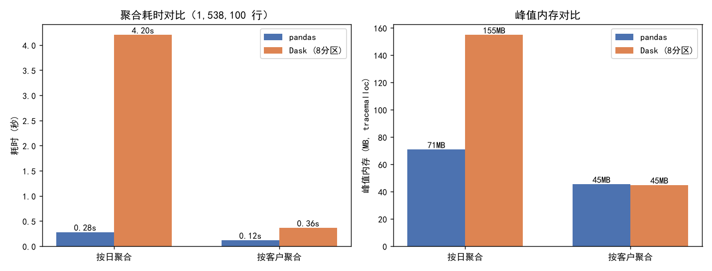

# 工程化：从“能跑通”到“能上线”

> **一句话**：分析脚本在自己电脑上跑通，不等于能在生产上稳定运行；工程化关注**可复现、可监控、可扩展、可评估**。
> 数据源统一为 `../ecommerce/ecommerce.db`，方法论总览见 [../README.md](../README.md)。

---

## 1. 这层解决什么问题

分析师写的脚本通常是“一次性”的：手动跑一遍、看一眼图表、得出结论。要让它变成**团队可复用、线上可运行**的能力，需要解决四件事：

- **可评估**：策略上线后，怎么用数据证明它真的有效，而不是靠感觉；
- **可扩展**：数据量从几十万涨到上亿，单机 pandas 跑不动了怎么办；
- **可监控**：脏数据在进入下游之前被发现，而不是在报表出错之后；
- **可复现**：同一份输入，任何人任何时候跑出同样的结果。

## 2. 主题地图

| 主题 | 解决的问题 | 关键概念 | 报告 |
|---|---|---|---|
| 分布式计算 | 单机处理不动时如何水平扩展 | Dask DataFrame、分区、惰性执行、内存峰值 | [distributed_report.md](distributed_report.md) |
| A/B 测试 | 策略上线后如何证明有效 | 哈希分桶、A/A 同质、显著性检验、效应量、功效、多重比较 | [ab_test_report.md](ab_test_report.md) |
| 数据质量监控 | 脏数据如何在下游之前被拦截 | 列级契约、表级一致性、契约即代码、熔断 | [data_quality_report.md](data_quality_report.md) |

## 3. 关键成果

**分布式计算。** 把 `user_events` 放大到 154 万行，同一套 `groupby-agg`（含 `nunique`）分别用 pandas 与 Dask 执行：

| 任务 | pandas | Dask（8 分区） |
|---|---|---|
| 按日聚合 | 0.28 s / 70.8 MB | 4.20 s / 154.8 MB |
| 按客户聚合 | 0.12 s / 45.4 MB | 0.36 s / 44.8 MB |

两套引擎结果逐值相等。结论很反直觉：**单机数据量未超内存时，pandas 更快**，Dask 的价值在“数据超出内存 / 需要多机”，而不在小规模加速。分区数也不是越多越好（本例 8 分区最优，16 分区反而变慢）。

**A/B 测试。** 以 MD5 哈希稳定分桶（A 1,513 人 / B 1,487 人，SRM 检验 p=1.000），先跑 A/A 同质性再上实验：

- 基线客单价、频次、转化率三项均不显著，分桶通过同质性检验；
- 实验期客单价：A 4,751.65 元 vs B 5,113.43 元，均值差 +361.77 元，Welch t p=6.59e-03、Mann-Whitney U p=1.06e-04，参数与非参数结论一致；
- 实验期转化率：0.828 → 0.873（+4.5pp），比例 z 检验 p=5.93e-04，功效 0.93；
- 购买频次无显著差异；Bonferroni 校正后客单价与转化率仍显著；
- 样本量估算：检出 d=0.10 的客单价效应每组需 1,571 人，检出 +2pp 转化率每组需 5,319 人。

**数据质量监控。** 43 条规则（列级契约 + 表级一致性）真实数据通过 42 条，唯一失败是时间链“支付 ≤ 发货”存在 3,840 行**时刻级错位**（按日期比较则 0 行违规）——这类问题只能靠规则化校验暴露，人工抽查很难发现。随后在内存副本注入 9 类脏数据，15 条规则精准命中，证明规则集具备检出能力，且不改动源库。




## 4. 工程建议

1. **数据量判断先行**：小于单机内存 1/3 用 pandas / Polars；超出或需多机再上 Dask / Spark。
2. **分桶用哈希不用随机数**：同一客户跨会话、跨实验的归属必须稳定。
3. **先 A/A 再 A/B**：分桶不均或基线失衡时，任何实验结论都不可信。
4. **指标预注册**：检验族预先确定，统一报告校正后 p 值，避免事后挑指标。
5. **规则即代码、版本化管理**：每次 ETL 后自动校验，失败规则数非零即熔断下游。
6. **质量分入时序库**：把各表失败率作为监控指标，而不是只看一次布尔通过。

## 5. 如何运行

```powershell
python src/data/engineering/eng_distributed.py
python src/data/engineering/eng_ab_test.py
python src/data/engineering/eng_data_quality.py
```

分布式与质量监控脚本额外依赖 `dask` 与 `pandera`，安装方式见 [../run.md](../run.md)。

## 6. 说明性跳过

- **特征存储（Feast / Tecton）**：需要常驻服务与注册中心，不适合脚本化示例。
- **模型部署（MLflow / BentoML）**：需要常驻 tracking server / API server，超出脚本示例范围。
