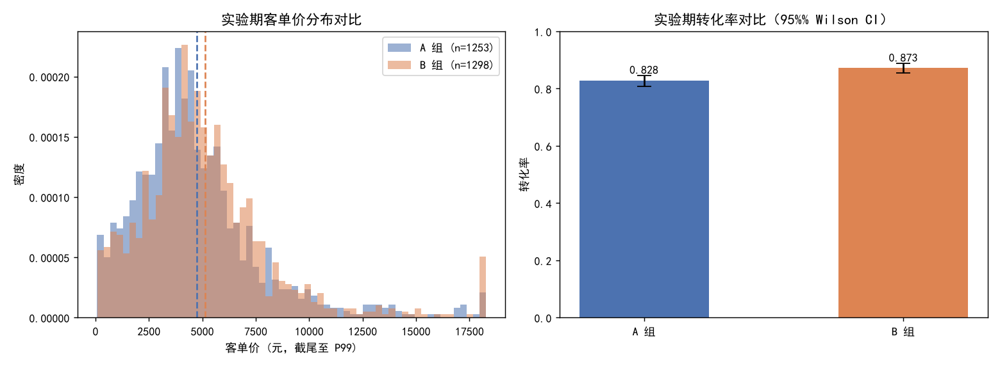

# A/B 测试分析框架报告 — 新券策略实验

- **数据来源**：`data/ecommerce/ecommerce.db`（orders × customers，已支付订单 18,133 笔，剔除批发/价格异常订单 226 笔后 17,907 笔进入指标口径）
- **分桶方式**：`MD5(customer_id) mod 100 < 50 → A`，稳定、可复现、与业务字段无关
- **实验场景**：B 组实施新券策略（更高面额券），观测 **客单价 / 购买频次 / 转化率** 三个指标
- **显著性水平**：α = 0.05

## 1. 可复用分析流程

```
稳定分桶（哈希） → 样本比例/基线 A/A 同质性检验 → 实验期指标构造
→ 检验套件（Welch t + Mann-Whitney U + 比例 z）→ 效应量与置信区间
→ 统计功效分析 → 多重比较校正（Bonferroni）→ 样本量估算
```

分桶结果：A 组 1513 人，B 组 1487 人（占比 0.496，SRM 检验 chi2 p = 1.000，无样本比例失衡）。

## 2. A/A 基线同质性检验（真实数据，策略前）

| 指标 | A 组均值 | B 组均值 | 检验 | p 值 | 结论 |
|---|---|---|---|---|---|
| 基线客单价 | 4741.80 | 4763.75 | Welch t | 0.865 | 不显著 |
| 基线购买频次 | 5.995 | 5.942 | Welch t | 0.811 | 不显著 |
| 基线转化率 | 0.828 | 0.832 | 比例 z | 0.786 | 不显著 |

三项基线指标均不显著，分桶方案通过同质性检验。

## 3. 实验期观测构造说明

实验期数据为演示检验流程而模拟：B 组客单价叠加 **+8%** 乘性效应（含对数正态个体噪声 σ=0.10），B 组未购客户按 **25%** 概率被新券转化（未购占比 ≈17%，相当于全组转化率 +4pp 左右；转化者客单价取全库消费客户中位数）。A 组仅叠加同等噪声，作为策略真实效应的检验靶子。

## 4. A/B 检验结果

### 4.1 客单价（消费客户，Welch t + Mann-Whitney U）

| 项 | 值 |
|---|---|
| A 组均值 | 4751.65 元 (n=1253) |
| B 组均值 | 5113.43 元 (n=1298) |
| 均值差 (B−A) | 361.77 元，95% CI [100.86, 622.68] |
| Welch t 检验 | t=-2.719, p=6.59e-03 → **显著** |
| Mann-Whitney U | p=1.06e-04 → **显著** |
| Cohen's d | 0.108 |
| 统计功效 (1−β) | 0.775 |

### 4.2 购买频次

| 项 | 值 |
|---|---|
| A / B 均值 | 5.995 / 5.983 单 |
| 均值差 95% CI | [-0.4475, 0.4231] |
| Welch t p 值 | 0.956 → 不显著 |
| Cohen's d | -0.002 |

### 4.3 转化率（比例 z 检验）

| 项 | 值 |
|---|---|
| A 组转化率 | 0.828，95% Wilson CI [0.808, 0.846] |
| B 组转化率 | 0.873，95% Wilson CI [0.855, 0.889] |
| 绝对提升 | +4.5 pp（相对提升 +5.4%） |
| 比例 z 检验 | z=3.435, p=5.93e-04 → **显著** |
| 统计功效 (1−β) | 0.931 |

### 4.4 DID 双重差分稳健性验证（客单价）

第 2 节基线已平衡，DID 此处作为稳健性交叉验证——当基线失衡时它是修正手段，基线平衡时它应与差分估计一致：

| 项 | 值 |
|---|---|
| 基线组间差 (B−A) | +21.95 元 |
| 实验期组间差 (B−A) | +361.77 元 |
| **DID 效应估计** | **+339.82 元**，95% CI [-23.63, 703.26] |
| DID z 检验 | z=1.833, p=6.69e-02 → 不显著 |

等价地，也可用 CUPED（以基线指标作协变量的方差缩减）达到同类目的：基线相关性越高，方差缩减越明显，对高方差指标（如客单价）尤其重要。



## 5. 多重比较校正（Bonferroni）

三个指标构成一个检验族，族系错误率需控制在 α=0.05（校正后阈值 α'=0.0167）：

| 指标 | 原始 p | Bonferroni 校正 p | 校正后结论 |
|---|---|---|---|
| 客单价 | 6.59e-03 | 1.98e-02 | 显著 |
| 购买频次 | 0.9562 | 1.0000 | 不显著 |
| 转化率 | 5.93e-04 | 1.78e-03 | 显著 |

## 6. 样本量估算示例（实验设计阶段）

| 目标 | 参数 | 每组所需样本量 |
|---|---|---|
| 客单价检出 d=0.10 | α=0.05 双侧，功效 0.8，两组等大 | 1,571 人 |
| 转化率检出 +2pp（基线 0.828） | 同上 | 5,319 人 |

## 7. 结论

1. 分桶通过 SRM 检查（p=1.000）；A/A 基线三项指标均不显著，分桶同质性通过。DID 稳健性验证效应 +339.82 元（p=6.69e-02）。
2. 客单价：Welch t p=6.59e-03、Mann-Whitney U p=1.06e-04，参数/非参数结论一致（显著）；效应量 d=0.108、功效 0.78——高方差指标在小效应下功效有限，Bonferroni 校正后 仍显著。
3. 转化率：绝对提升 +4.5pp（z 检验 p=5.93e-04，功效 0.93）。检出显著。
4. 频次指标差异小（d=-0.002），功效不足时不应下"无效应"结论，应扩充实验时长或改用更敏感的指标口径。
5. 工程化要点：分桶用哈希而非随机数，保证同一客户跨会话/跨实验归属稳定；指标口径先剔除异常订单；先跑 A/A 再上实验；检验族预注册指标数，报告统一给校正后 p 值。
