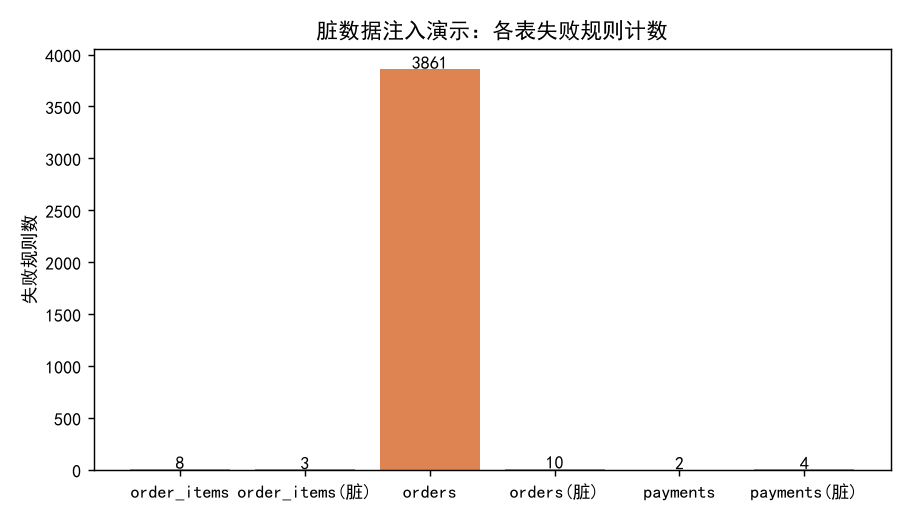

# 数据质量监控报告 — orders / order_items / payments

- **数据来源**：`data/ecommerce/ecommerce.db`（只读）
- **校验框架**：列级规则用 **pandera 0.35.0** `DataFrameSchema`（`lazy=True` 一次收集全部失败）；表级一致性规则（时间链/跨表金额/外键/重复/空值率）用 pandas 断言实现——pandera 对跨行、跨表规则表达力有限，生产实践通常两层并存
- **两部分**：① 真实数据校验；② 内存脏数据注入校验（演示失败统计与失败样例行，**不改动数据库文件**）

## 1. 校验规则清单

| 类别 | 规则 |
|---|---|
| 列级（pandera） | 金额非负（total/freight/discount/subtotal/unit_price/payment_amount）、枚举值域（order_status/channel/payment_method/payment_status）、quantity>0、关键列非空 |
| 表级（pandas） | 时间链三段分别校验 created≤paid / paid≤shipped / shipped≤delivered（NULL 跳过）；total_amount = Σsubtotal + freight_amount（容差 0.02 元）；行内 subtotal = unit_price×quantity − item_discount；外键完整（order_items/payments → orders，order_items → products）；主键唯一；关键列空值率=0 |

## 2. 真实数据校验结果

共 43 条规则，通过 42，失败 1。

| 表 | 规则 | 检查行数 | 失败数 | 状态 |
|---|---|---|---|---|
| orders | 列校验 order_id: not_nullable | 19669 | 0 | ✅ 通过 |
| orders | 列校验 customer_id: not_nullable | 19669 | 0 | ✅ 通过 |
| orders | 列校验 order_status: not_nullable | 19669 | 0 | ✅ 通过 |
| orders | 列校验 order_status: isin | 19669 | 0 | ✅ 通过 |
| orders | 列校验 channel: not_nullable | 19669 | 0 | ✅ 通过 |
| orders | 列校验 channel: isin | 19669 | 0 | ✅ 通过 |
| orders | 列校验 freight_amount: not_nullable | 19669 | 0 | ✅ 通过 |
| orders | 列校验 freight_amount: greater_than_or_equal_to | 19669 | 0 | ✅ 通过 |
| orders | 列校验 discount_amount: not_nullable | 19669 | 0 | ✅ 通过 |
| orders | 列校验 discount_amount: greater_than_or_equal_to | 19669 | 0 | ✅ 通过 |
| orders | 列校验 total_amount: not_nullable | 19669 | 0 | ✅ 通过 |
| orders | 列校验 total_amount: greater_than_or_equal_to | 19669 | 0 | ✅ 通过 |
| orders | 列校验 created_at: not_nullable | 19669 | 0 | ✅ 通过 |
| order_items | 列校验 item_id: not_nullable | 36907 | 0 | ✅ 通过 |
| order_items | 列校验 order_id: not_nullable | 36907 | 0 | ✅ 通过 |
| order_items | 列校验 product_id: not_nullable | 36907 | 0 | ✅ 通过 |
| order_items | 列校验 quantity: not_nullable | 36907 | 0 | ✅ 通过 |
| order_items | 列校验 quantity: greater_than | 36907 | 0 | ✅ 通过 |
| order_items | 列校验 unit_price: not_nullable | 36907 | 0 | ✅ 通过 |
| order_items | 列校验 unit_price: greater_than_or_equal_to | 36907 | 0 | ✅ 通过 |
| order_items | 列校验 item_discount: not_nullable | 36907 | 0 | ✅ 通过 |
| order_items | 列校验 item_discount: greater_than_or_equal_to | 36907 | 0 | ✅ 通过 |
| order_items | 列校验 subtotal: not_nullable | 36907 | 0 | ✅ 通过 |
| payments | 列校验 payment_id: not_nullable | 19181 | 0 | ✅ 通过 |
| payments | 列校验 order_id: not_nullable | 19181 | 0 | ✅ 通过 |
| payments | 列校验 payment_method: not_nullable | 19181 | 0 | ✅ 通过 |
| payments | 列校验 payment_method: isin | 19181 | 0 | ✅ 通过 |
| payments | 列校验 payment_amount: not_nullable | 19181 | 0 | ✅ 通过 |
| payments | 列校验 payment_amount: greater_than_or_equal_to | 19181 | 0 | ✅ 通过 |
| payments | 列校验 payment_status: not_nullable | 19181 | 0 | ✅ 通过 |
| payments | 列校验 payment_status: isin | 19181 | 0 | ✅ 通过 |
| orders | 时间链段1 created≤paid（NULL 跳过） | 19669 | 0 | ✅ 通过 |
| orders | 时间链段2 paid≤shipped（NULL 跳过） | 19669 | 3840 | ❌ 失败 |
| orders | 时间链段3 shipped≤delivered（NULL 跳过） | 19669 | 0 | ✅ 通过 |
| orders | 金额一致 total = Σsubtotal + freight（容差0.02元） | 19669 | 0 | ✅ 通过 |
| orders | 主键 order_id 唯一 | 19669 | 0 | ✅ 通过 |
| orders | 关键列空值率=0（order_id/customer_id/order_status/created_at/total_amount） | 98345 | 0 | ✅ 通过 |
| order_items | 行内一致 subtotal = unit_price×quantity − item_discount（容差0.02元） | 36907 | 0 | ✅ 通过 |
| order_items | 外键完整 order_items.order_id ⊆ orders.order_id | 36907 | 0 | ✅ 通过 |
| order_items | 外键完整 order_items.product_id ⊆ products.product_id | 36907 | 0 | ✅ 通过 |
| order_items | 主键 item_id 唯一 | 36907 | 0 | ✅ 通过 |
| payments | 外键完整 payments.order_id ⊆ orders.order_id | 19181 | 0 | ✅ 通过 |
| payments | 主键 payment_id 唯一 | 19181 | 0 | ✅ 通过 |

### 2.1 真实发现：时间链段2（paid≤shipped）存在数据缺陷

时间链三段中仅段2失败：3840 行（占已支付订单约 20.0%）的 `shipped_at` 早于同日 `paid_at`；**日期粒度重测失败 0 行**，即日期次序正确、仅时刻错位——可定位为数据生成器缺陷（发货时刻生成时未以支付时刻为下界），而非业务异常。其余全部规则通过：金额链路（total=Σsubtotal+freight、行内 subtotal 勾稽）在 0.02 元容差下闭合，外键与主键完整，关键列无空值。

对下游的影响与处置：凡依赖 `shipped_at − paid_at` 时长（如发货时效 KPI）的分析须先按日期粒度取整或剔除该 3840 行；本次按任务约束不改动 `data/ecommerce`，缺陷记录于此待上游修复。

**orders / 时间链段2 paid≤shipped（NULL 跳过）**（失败 3840 行，示例前 5 行）：

```
 order_id  customer_id  coupon_id order_status channel          created_at             paid_at          shipped_at        delivered_at  freight_amount  discount_amount  total_amount
        2         1210        NaN          已完成     小程序 2024-01-01 19:30:04 2024-01-01 19:49:04 2024-01-01 07:23:13 2024-01-05 10:42:27             0.0              0.0       1909.44
        9         1831        NaN          已完成     APP 2024-01-01 13:59:22 2024-01-01 13:59:22 2024-01-01 06:51:49 2024-01-06 14:41:05             0.0              0.0       5280.73
       10         2723        NaN          已完成     小程序 2024-01-01 07:03:15 2024-01-01 07:15:15 2024-01-01 00:27:52 2024-01-03 11:07:41             0.0              0.0       9043.18
       17         2086        NaN          已完成     小程序 2024-01-01 22:24:51 2024-01-01 22:27:51 2024-01-01 02:40:37 2024-01-02 04:41:26             0.0              0.0       3263.35
       32         1530        NaN          已完成      网页 2024-01-02 10:08:54 2024-01-02 10:21:54 2024-01-02 09:00:15 2024-01-03 17:24:42             0.0              0.0      24927.84
```

## 3. 脏数据注入演示（内存副本）

向内存副本注入 9 类典型脏数据：负金额 5 处、非法枚举 7 处、时间链乱序 3 处、订单金额不一致 3 处、主键重复 2 行、关键列空值 2 处、孤儿外键 4 处、行内金额不一致 3 处、quantity=0 共 3 处。重跑同一套规则，共 39 条，失败 15 条：

| 表 | 规则 | 检查行数 | 失败数 | 状态 |
|---|---|---|---|---|
| orders(脏) | 列校验 customer_id: not_nullable | 19671 | 2 | ❌ 失败 |
| orders(脏) | 列校验 order_status: not_nullable | 19671 | 0 | ✅ 通过 |
| orders(脏) | 列校验 order_status: isin | 19671 | 3 | ❌ 失败 |
| orders(脏) | 列校验 channel: not_nullable | 19671 | 0 | ✅ 通过 |
| orders(脏) | 列校验 channel: isin | 19671 | 2 | ❌ 失败 |
| orders(脏) | 列校验 freight_amount: not_nullable | 19671 | 0 | ✅ 通过 |
| orders(脏) | 列校验 freight_amount: greater_than_or_equal_to | 19671 | 0 | ✅ 通过 |
| orders(脏) | 列校验 total_amount: not_nullable | 19671 | 0 | ✅ 通过 |
| orders(脏) | 列校验 total_amount: greater_than_or_equal_to | 19671 | 3 | ❌ 失败 |
| order_items(脏) | 列校验 item_id: not_nullable | 36907 | 0 | ✅ 通过 |
| order_items(脏) | 列校验 order_id: not_nullable | 36907 | 0 | ✅ 通过 |
| order_items(脏) | 列校验 product_id: not_nullable | 36907 | 0 | ✅ 通过 |
| order_items(脏) | 列校验 quantity: not_nullable | 36907 | 0 | ✅ 通过 |
| order_items(脏) | 列校验 quantity: greater_than | 36907 | 3 | ❌ 失败 |
| order_items(脏) | 列校验 unit_price: not_nullable | 36907 | 0 | ✅ 通过 |
| order_items(脏) | 列校验 unit_price: greater_than_or_equal_to | 36907 | 0 | ✅ 通过 |
| order_items(脏) | 列校验 item_discount: not_nullable | 36907 | 0 | ✅ 通过 |
| order_items(脏) | 列校验 item_discount: greater_than_or_equal_to | 36907 | 0 | ✅ 通过 |
| order_items(脏) | 列校验 subtotal: not_nullable | 36907 | 0 | ✅ 通过 |
| payments(脏) | 列校验 payment_id: not_nullable | 19181 | 0 | ✅ 通过 |
| payments(脏) | 列校验 order_id: not_nullable | 19181 | 0 | ✅ 通过 |
| payments(脏) | 列校验 payment_method: not_nullable | 19181 | 0 | ✅ 通过 |
| payments(脏) | 列校验 payment_method: isin | 19181 | 2 | ❌ 失败 |
| payments(脏) | 列校验 payment_amount: not_nullable | 19181 | 0 | ✅ 通过 |
| payments(脏) | 列校验 payment_amount: greater_than_or_equal_to | 19181 | 2 | ❌ 失败 |
| payments(脏) | 列校验 payment_status: not_nullable | 19181 | 0 | ✅ 通过 |
| payments(脏) | 列校验 payment_status: isin | 19181 | 0 | ✅ 通过 |
| orders | 时间链段1 created≤paid（NULL 跳过） | 19671 | 0 | ✅ 通过 |
| orders | 时间链段2 paid≤shipped（NULL 跳过） | 19671 | 3841 | ❌ 失败 |
| orders | 时间链段3 shipped≤delivered（NULL 跳过） | 19671 | 3 | ❌ 失败 |
| orders | 金额一致 total = Σsubtotal + freight（容差0.02元） | 19671 | 11 | ❌ 失败 |
| orders | 主键 order_id 唯一 | 19671 | 4 | ❌ 失败 |
| orders | 关键列空值率=0（order_id/customer_id/order_status/created_at/total_amount） | 98355 | 2 | ❌ 失败 |
| order_items | 行内一致 subtotal = unit_price×quantity − item_discount（容差0.02元） | 36907 | 6 | ❌ 失败 |
| order_items | 外键完整 order_items.order_id ⊆ orders.order_id | 36907 | 2 | ❌ 失败 |
| order_items | 外键完整 order_items.product_id ⊆ products.product_id | 36907 | 0 | ✅ 通过 |
| order_items | 主键 item_id 唯一 | 36907 | 0 | ✅ 通过 |
| payments | 外键完整 payments.order_id ⊆ orders.order_id | 19181 | 2 | ❌ 失败 |
| payments | 主键 payment_id 唯一 | 19181 | 0 | ✅ 通过 |

### 3.1 失败样例行

**orders(脏) / 列校验 customer_id: not_nullable**（失败 2 行，示例前 2 行）：

```
 order_id  customer_id  coupon_id order_status channel          created_at             paid_at          shipped_at        delivered_at  freight_amount  discount_amount  total_amount
        1         <NA>        NaN          已完成     APP 2024-01-01 15:53:49 2024-01-01 15:55:49 2024-01-02 11:29:47 2024-01-06 21:34:54             0.0              0.0        315.92
        2         <NA>        NaN          已完成     小程序 2024-01-01 19:30:04 2024-01-01 19:49:04 2024-01-01 07:23:13 2024-01-05 10:42:27             0.0              0.0       1909.44
```

**orders(脏) / 列校验 order_status: isin**（失败 3 行，示例前 3 行）：

```
 order_id  customer_id  coupon_id order_status channel          created_at             paid_at          shipped_at        delivered_at  freight_amount  discount_amount  total_amount
     1691         1321        NaN          已丢失     小程序 2024-03-04 04:04:28 2024-03-04 04:13:28 2024-03-05 19:51:22 2024-03-09 22:25:10             0.0              0.0        396.10
    13717         2261        NaN          已丢失     APP 2025-02-14 03:40:35 2025-02-14 03:59:35 2025-02-15 22:36:12 2025-02-19 21:55:58             0.0              0.0       8562.76
    16887          171        NaN          已丢失     小程序 2025-05-02 23:58:50 2025-05-02 23:59:50 2025-05-03 08:21:35 2025-05-08 21:31:02             0.0              0.0        489.67
```

**orders(脏) / 列校验 channel: isin**（失败 2 行，示例前 2 行）：

```
 order_id  customer_id  coupon_id order_status channel          created_at             paid_at          shipped_at        delivered_at  freight_amount  discount_amount  total_amount
    10355           22        NaN          已完成     元宇宙 2024-11-13 10:53:02 2024-11-13 10:59:02 2024-11-13 15:07:52 2024-11-15 03:19:34             0.0              0.0       2308.80
    19190          754        NaN          待付款     元宇宙 2025-06-12 13:21:26                 NaN                 NaN                 NaN             0.0              0.0       2498.17
```

**orders(脏) / 列校验 total_amount: greater_than_or_equal_to**（失败 3 行，示例前 3 行）：

```
 order_id  customer_id  coupon_id order_status channel          created_at             paid_at          shipped_at        delivered_at  freight_amount  discount_amount  total_amount
     1756         1868        NaN          已完成     APP 2024-03-07 20:35:15 2024-03-07 20:56:15 2024-03-07 11:09:09 2024-03-09 12:17:42             0.0              0.0        -100.0
    12875         1742        NaN          已完成     APP 2025-01-19 15:55:45 2025-01-19 15:59:45 2025-01-19 21:25:38 2025-01-21 11:52:56             0.0              0.0        -100.0
    15223          280        NaN          已完成     APP 2025-03-22 01:05:47 2025-03-22 01:28:47 2025-03-23 12:18:40 2025-03-26 22:33:07             0.0              0.0        -100.0
```

**order_items(脏) / 列校验 quantity: greater_than**（失败 3 行，示例前 3 行）：

```
 item_id  order_id  product_id  quantity  unit_price  item_discount  subtotal
   23764     12645         188         0     2701.32            0.0   2701.32
   28845     15372         422         0      135.73            0.0    271.46
   34203     18211         285         0      255.68            0.0    511.36
```

**payments(脏) / 列校验 payment_method: isin**（失败 2 行，示例前 2 行）：

```
 payment_id  order_id payment_method  payment_amount             paid_at payment_status
       3170      3221             贝壳         2185.43 2024-04-26 21:59:26             成功
      12116     12285             贝壳          383.58 2025-01-05 01:26:16             成功
```

**payments(脏) / 列校验 payment_amount: greater_than_or_equal_to**（失败 2 行，示例前 2 行）：

```
 payment_id  order_id payment_method  payment_amount             paid_at payment_status
      15875     16103           微信支付            -5.0 2025-04-13 21:50:35             成功
      16463     16703            银行卡            -5.0 2025-04-27 14:59:05             成功
```

**orders / 时间链段2 paid≤shipped（NULL 跳过）**（失败 3841 行，示例前 5 行）：

```
 order_id  customer_id  coupon_id order_status channel          created_at             paid_at          shipped_at        delivered_at  freight_amount  discount_amount  total_amount
        2         <NA>        NaN          已完成     小程序 2024-01-01 19:30:04 2024-01-01 19:49:04 2024-01-01 07:23:13 2024-01-05 10:42:27             0.0              0.0       1909.44
        9         1831        NaN          已完成     APP 2024-01-01 13:59:22 2024-01-01 13:59:22 2024-01-01 06:51:49 2024-01-06 14:41:05             0.0              0.0       5280.73
       10         2723        NaN          已完成     小程序 2024-01-01 07:03:15 2024-01-01 07:15:15 2024-01-01 00:27:52 2024-01-03 11:07:41             0.0              0.0       9043.18
       17         2086        NaN          已完成     小程序 2024-01-01 22:24:51 2024-01-01 22:27:51 2024-01-01 02:40:37 2024-01-02 04:41:26             0.0              0.0       3263.35
       32         1530        NaN          已完成      网页 2024-01-02 10:08:54 2024-01-02 10:21:54 2024-01-02 09:00:15 2024-01-03 17:24:42             0.0              0.0      24927.84
```

**orders / 时间链段3 shipped≤delivered（NULL 跳过）**（失败 3 行，示例前 3 行）：

```
 order_id  customer_id  coupon_id order_status channel          created_at             paid_at          shipped_at        delivered_at  freight_amount  discount_amount  total_amount
    13754         2713        5.0          已完成     小程序 2025-02-15 05:59:20 2025-02-15 05:59:20 2025-02-16 12:38:09 2023-01-01 00:00:00             0.0           456.71       4110.43
    14601         2059        3.0          已完成     APP 2025-03-07 21:47:07 2025-03-07 21:59:07 2025-03-08 06:56:50 2023-01-01 00:00:00             0.0            50.00      15357.33
    15083         1801        2.0          已完成     APP 2025-03-18 06:06:37 2025-03-18 06:19:37 2025-03-18 07:32:43 2023-01-01 00:00:00             0.0            20.00        392.02
```

**orders / 金额一致 total = Σsubtotal + freight（容差0.02元）**（失败 11 行，示例前 5 行）：

```
 order_id  customer_id  coupon_id order_status channel          created_at             paid_at          shipped_at        delivered_at  freight_amount  discount_amount  total_amount
     1756         1868        NaN          已完成     APP 2024-03-07 20:35:15 2024-03-07 20:56:15 2024-03-07 11:09:09 2024-03-09 12:17:42             0.0              0.0       -100.00
     1803          326        NaN          已完成     小程序 2024-03-08 11:15:51 2024-03-08 11:23:51 2024-03-09 10:02:49 2024-03-11 10:38:30             0.0              0.0      11525.51
     4476         1102        NaN          已完成     APP 2024-06-03 20:55:11 2024-06-03 20:59:11 2024-06-03 18:11:10 2024-06-05 20:41:03             0.0              0.0        443.09
     8727          341        NaN          已完成      网页 2024-10-02 21:07:08 2024-10-02 21:23:08 2024-10-02 18:03:53 2024-10-03 05:57:40             0.0              0.0       3384.00
     8859          818        NaN          待付款     APP 2024-10-06 12:24:19                 NaN                 NaN                 NaN            50.0              0.0       4779.37
```

**orders / 主键 order_id 唯一**（失败 4 行，示例前 4 行）：

```
 order_id  customer_id  coupon_id order_status channel          created_at             paid_at          shipped_at        delivered_at  freight_amount  discount_amount  total_amount
        1         <NA>        NaN          已完成     APP 2024-01-01 15:53:49 2024-01-01 15:55:49 2024-01-02 11:29:47 2024-01-06 21:34:54             0.0              0.0        315.92
        2         <NA>        NaN          已完成     小程序 2024-01-01 19:30:04 2024-01-01 19:49:04 2024-01-01 07:23:13 2024-01-05 10:42:27             0.0              0.0       1909.44
        1          578        NaN          已完成     APP 2024-01-01 15:53:49 2024-01-01 15:55:49 2024-01-02 11:29:47 2024-01-06 21:34:54             0.0              0.0        315.92
        2         1210        NaN          已完成     小程序 2024-01-01 19:30:04 2024-01-01 19:49:04 2024-01-01 07:23:13 2024-01-05 10:42:27             0.0              0.0       1909.44
```

**order_items / 行内一致 subtotal = unit_price×quantity − item_discount（容差0.02元）**（失败 6 行，示例前 5 行）：

```
 item_id  order_id  product_id  quantity  unit_price  item_discount  subtotal
    3401      1803         586         1     2454.69            0.0 999999.00
    8387      4476         495         1      192.18            0.0 999999.00
   20469     10910         175         1     3527.23            0.0 999999.00
   23764     12645         188         0     2701.32            0.0   2701.32
   28845     15372         422         0      135.73            0.0    271.46
```

**order_items / 外键完整 order_items.order_id ⊆ orders.order_id**（失败 2 行，示例前 2 行）：

```
 item_id  order_id  product_id  quantity  unit_price  item_discount  subtotal
   16366  99999999         365         1      201.12           0.00    201.12
   20130  99999999         114         2     5155.09          47.08  10263.10
```

**payments / 外键完整 payments.order_id ⊆ orders.order_id**（失败 2 行，示例前 2 行）：

```
 payment_id  order_id payment_method  payment_amount             paid_at payment_status
       6801  99999999           微信支付         9709.26 2024-08-03 10:57:57             成功
      13437  99999999            支付宝         2414.44 2025-02-12 22:35:25             成功
```



## 4. 结论与工程建议

1. 真实数据 42/43 条规则通过。唯一失败为时间链段2（3840 行时刻级错位、日期级正确），已定位为数据生成器缺陷——这正是质量监控的价值：README 声称的不变量与数据实际状态存在偏差，只能靠规则化校验暴露。金额链路在 0.02 元容差下完全闭合，与 `_verify.py` 结论一致。
2. 注入演示验证了规则集的检出能力：9 类脏数据全部被对应规则捕获，且 pandera `lazy=True` 模式能一次返回全部失败明细（含失败值与行号），适合作为监控报表数据源。
3. 工程化落地建议：
   - 规则即代码，版本化管理；每次 ETL 后自动跑校验，失败规则数非零即熔断下游任务。
   - 两层结构：pandera 管列级契约（类型/值域/非空），SQL 或 pandas 管跨行跨表一致性（外键、金额勾稽、时间链）。
   - 监控指标化：把各表 `n_fail/n_check` 作为质量分指标入时序库，超阈值告警，而非只看布尔通过与否。
