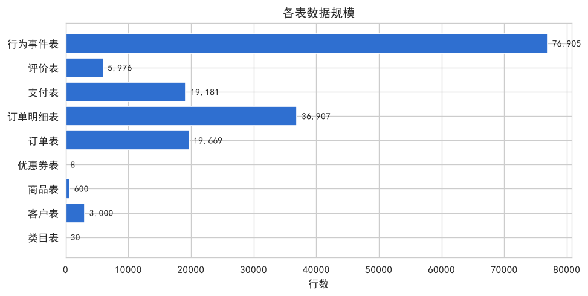
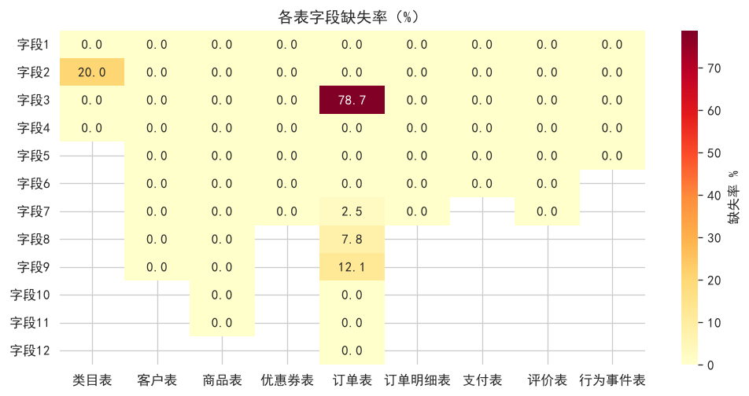
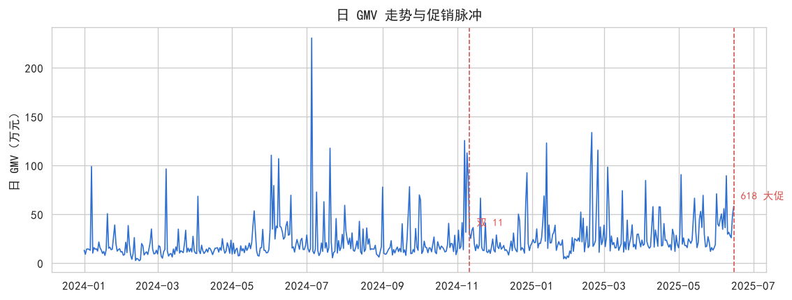
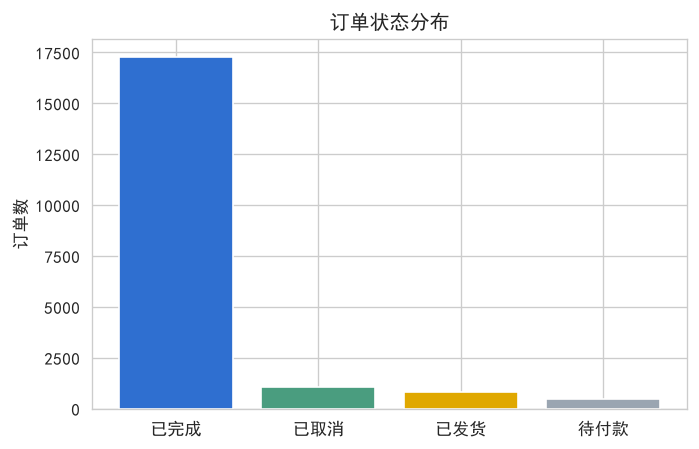
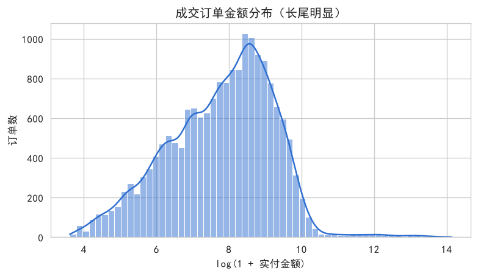
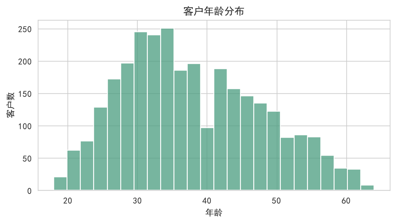
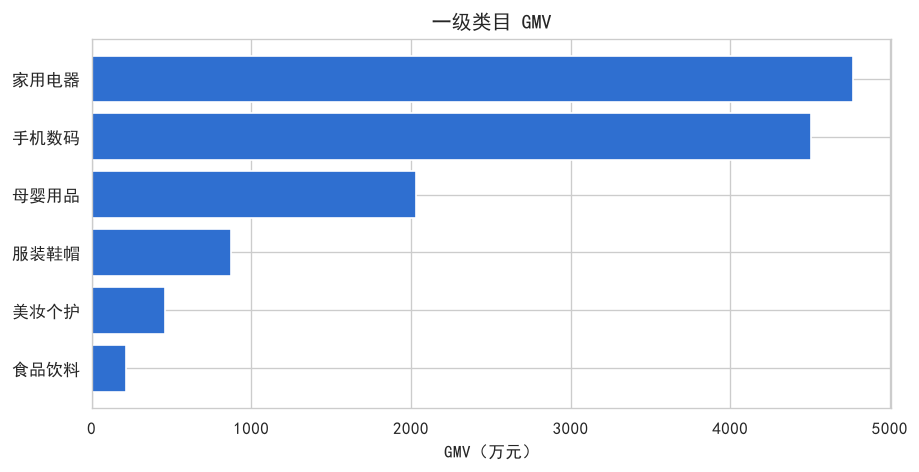
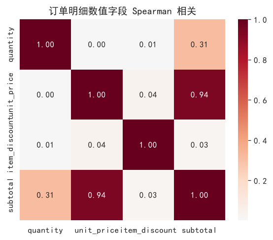
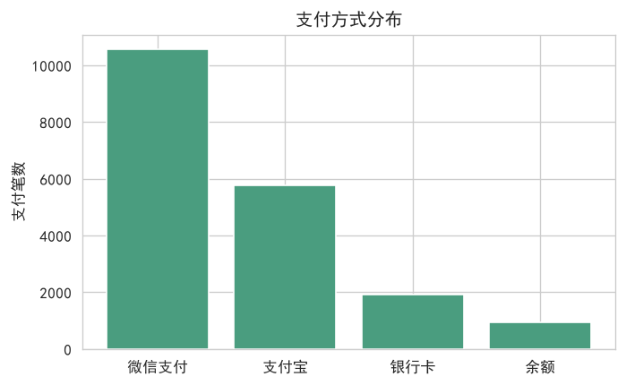
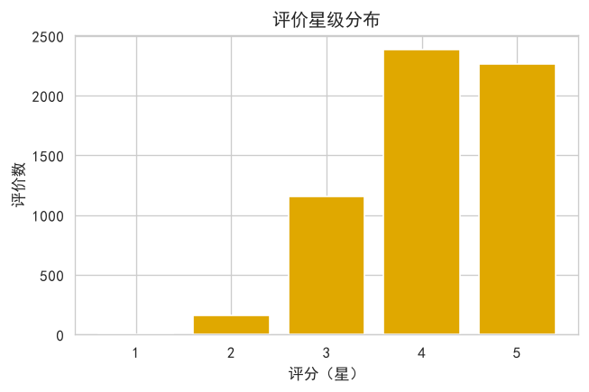

# 数据探查报告 · 电商数据集

> 数据源：`ecommerce.db`　|　生成时间：2026-10-31 20:12:36　|　表数量：9　|　总行数：162,276

本报告对电商交易链路的九张表做系统体检：先看整体规模与结构，再逐表检查字段质量，最后验证跨表的口径一致性，给出建模就绪度结论。所有数字均可由脚本复现。

## 一、结论摘要

- 数据规模：9 张表、162,276 行，覆盖 532 天（2024-01-01 ~ 2025-06-15）。
- 一致性：11 项跨表检查中，10 项通过，1 项提示，0 项风险。
- 字段质量：主键唯一、外键完整；金额勾稽与状态机时间链按日期粒度成立。
- 已知口径：同一日内存在发货时刻早于支付时刻的错位，属于时刻精度现象，不影响按日聚合的业务指标。

## 二、数据集总览

| 表 | 中文名 | 行数 | 字段数 | 重复行 | 候选主键 |
|---|---|---:|---:|---:|---|
| `categories` | 类目表 | 30 | 4 | 0 | category_id、category_name |
| `customers` | 客户表 | 3,000 | 9 | 0 | customer_id |
| `products` | 商品表 | 600 | 11 | 0 | product_id、product_name |
| `coupons` | 优惠券表 | 8 | 7 | 0 | coupon_id、coupon_name |
| `orders` | 订单表 | 19,669 | 12 | 0 | order_id |
| `order_items` | 订单明细表 | 36,907 | 7 | 0 | item_id |
| `payments` | 支付表 | 19,181 | 6 | 0 | payment_id、order_id |
| `reviews` | 评价表 | 5,976 | 7 | 0 | review_id、order_id、created_at |
| `user_events` | 行为事件表 | 76,905 | 5 | 0 | event_id |

**读图：** 行为事件表体量最大（埋点为高频日志），订单与明细是交易分析的主表，主数据表（类目、客户、商品、优惠券）保持小体量，符合维度表与事实表的典型比例。

## 三、字段质量总览

存在缺失的字段：

| 表 | 字段 | 缺失数 | 缺失率 | 业务解释 |
|---|---|---:|---:|---|
| 类目表 | `parent_id` | 6 | 20.00% | 一级类目没有父节点，NULL 表示类目树的根 |
| 订单表 | `coupon_id` | 15,480 | 78.70% | 该订单未使用优惠券 |
| 订单表 | `paid_at` | 488 | 2.48% | 订单尚未支付（待付款或已取消） |
| 订单表 | `shipped_at` | 1,536 | 7.81% | 订单尚未发货 |
| 订单表 | `delivered_at` | 2,377 | 12.09% | 订单尚未签收 |

各表均未发现常量列、近常量列与完全重复行。

## 四、逐表画像

### 4.1 类目表（`categories`）

两级类目树，parent_id 自关联。共 30 行、4 个字段。

| 字段 | 类型 | 缺失率 | 唯一值 | 关键信息 |
|---|---|---:|---:|---|
| `category_id` | 数值 | 0.00% | 30 | 均值 15.50，中位数 15.50，范围 [1.00, 30.00]，IQR 异常率 0.00% |
| `parent_id` | 数值 | 20.00% | 6 | 均值 13.50，中位数 13.50，范围 [1.00, 26.00]，IQR 异常率 0.00% |
| `category_name` | 文本 | 0.00% | 30 | 平均长度 2.8 字，最长 4 字 |
| `level` | 数值 | 0.00% | 2 | 均值 1.80，中位数 2.00，范围 [1.00, 2.00]，IQR 异常率 20.00% |

### 4.2 客户表（`customers`）

注册会员主数据。共 3,000 行、9 个字段。

| 字段 | 类型 | 缺失率 | 唯一值 | 关键信息 |
|---|---|---:|---:|---|
| `customer_id` | 数值 | 0.00% | 3,000 | 均值 1500.50，中位数 1500.50，范围 [1.00, 3000.00]，IQR 异常率 0.00% |
| `customer_name` | 文本 | 0.00% | 2,302 | 平均长度 2.5 字，最长 3 字 |
| `gender` | 分类 | 0.00% | 2 | 女 1,504、男 1,496 |
| `age` | 数值 | 0.00% | 47 | 均值 37.90，中位数 36.50，范围 [18.00, 64.00]，IQR 异常率 0.00% |
| `province` | 分类 | 0.00% | 10 | 广东省 497、浙江省 391、江苏省 369、四川省 278 |
| `city` | 文本 | 0.00% | 21 | 平均长度 3.0 字，最长 3 字 |
| `register_date` | 时间 | 0.00% | 780 | 2023-01-01 ~ 2025-03-01 |
| `member_level` | 分类 | 0.00% | 4 | 普通 1,821、白银 739、黄金 294、钻石 146 |
| `activity_score` | 数值 | 0.00% | 2,244 | 均值 0.22，中位数 0.16，范围 [0.00, 0.94]，IQR 异常率 1.87% |

### 4.3 商品表（`products`）

SPU 级商品主数据。共 600 行、11 个字段。

| 字段 | 类型 | 缺失率 | 唯一值 | 关键信息 |
|---|---|---:|---:|---|
| `product_id` | 数值 | 0.00% | 600 | 均值 300.50，中位数 300.50，范围 [1.00, 600.00]，IQR 异常率 0.00% |
| `category_id` | 数值 | 0.00% | 24 | 均值 16.00，中位数 16.00，范围 [2.00, 30.00]，IQR 异常率 0.00% |
| `product_name` | 文本 | 0.00% | 600 | 平均长度 9.1 字，最长 12 字 |
| `brand` | 文本 | 0.00% | 25 | 平均长度 2.6 字，最长 4 字 |
| `list_price` | 数值 | 0.00% | 599 | 均值 1761.67，中位数 797.46，范围 [23.09, 8785.83]，IQR 异常率 6.00% |
| `cost` | 数值 | 0.00% | 598 | 均值 1010.94，中位数 451.22，范围 [11.00, 5830.42]，IQR 异常率 5.83% |
| `stock` | 数值 | 0.00% | 353 | 均值 243.32，中位数 241.50，范围 [0.00, 500.00]，IQR 异常率 0.00% |
| `status` | 分类 | 0.00% | 2 | 在售 571、下架 29 |
| `created_date` | 时间 | 0.00% | 379 | 2023-06-01 ~ 2024-12-29 |
| `popularity` | 数值 | 0.00% | 533 | 均值 0.17，中位数 0.11，范围 [0.00, 0.84]，IQR 异常率 4.17% |
| `quality_score` | 数值 | 0.00% | 146 | 均值 4.23，中位数 4.22，范围 [3.50, 5.00]，IQR 异常率 0.00% |

### 4.4 优惠券表（`coupons`）

营销券规则。共 8 行、7 个字段。

| 字段 | 类型 | 缺失率 | 唯一值 | 关键信息 |
|---|---|---:|---:|---|
| `coupon_id` | 数值 | 0.00% | 8 | 均值 4.50，中位数 4.50，范围 [1.00, 8.00]，IQR 异常率 0.00% |
| `coupon_name` | 分类 | 0.00% | 8 | 满99减10 1、满199减20 1、满399减50 1、满999减150 1 |
| `coupon_type` | 分类 | 0.00% | 3 | 满减 5、折扣 2、无门槛 1 |
| `threshold_amount` | 数值 | 0.00% | 7 | 均值 324.25，中位数 249.00，范围 [0.00, 999.00]，IQR 异常率 0.00% |
| `discount_value` | 数值 | 0.00% | 7 | 均值 40.23，中位数 15.00，范围 [0.90, 150.00]，IQR 异常率 12.50% |
| `valid_from` | 时间 | 0.00% | 3 | 2024-01-01 ~ 2025-05-25 |
| `valid_to` | 时间 | 0.00% | 3 | 2024-11-15 ~ 2025-06-20 |

### 4.5 订单表（`orders`）

订单主表，一单可含多商品。共 19,669 行、12 个字段。

| 字段 | 类型 | 缺失率 | 唯一值 | 关键信息 |
|---|---|---:|---:|---|
| `order_id` | 数值 | 0.00% | 19,669 | 均值 9835.00，中位数 9835.00，范围 [1.00, 19669.00]，IQR 异常率 0.00% |
| `customer_id` | 数值 | 0.00% | 2,513 | 均值 1472.26，中位数 1444.00，范围 [2.00, 3000.00]，IQR 异常率 0.00% |
| `coupon_id` | 数值 | 78.70% | 8 | 均值 2.80，中位数 2.00，范围 [1.00, 8.00]，IQR 异常率 0.00% |
| `order_status` | 分类 | 0.00% | 4 | 已完成 17,292、已取消 1,048、已发货 841、待付款 488 |
| `channel` | 分类 | 0.00% | 4 | APP 11,107、小程序 4,718、网页 2,933、线下 911 |
| `created_at` | 时间 | 0.00% | 19,664 | 2024-01-01 ~ 2025-06-15 |
| `paid_at` | 时间 | 2.48% | 19,156 | 2024-01-01 ~ 2025-06-15 |
| `shipped_at` | 时间 | 7.81% | 18,124 | 2024-01-01 ~ 2025-06-17 |
| `delivered_at` | 时间 | 12.09% | 17,290 | 2024-01-02 ~ 2025-06-22 |
| `freight_amount` | 数值 | 0.00% | 5 | 均值 0.21，中位数 0.00，范围 [0.00, 12.00]，IQR 异常率 2.30% |
| `discount_amount` | 数值 | 0.00% | 949 | 均值 36.32，中位数 0.00，范围 [0.00, 29499.38]，IQR 异常率 21.30% |
| `total_amount` | 数值 | 0.00% | 19,389 | 均值 6962.04，中位数 2894.25，范围 [36.07, 1385049.12]，IQR 异常率 6.08% |

### 4.6 订单明细表（`order_items`）

订单与商品的多对多连接表。共 36,907 行、7 个字段。

| 字段 | 类型 | 缺失率 | 唯一值 | 关键信息 |
|---|---|---:|---:|---|
| `item_id` | 数值 | 0.00% | 36,907 | 均值 18454.00，中位数 18454.00，范围 [1.00, 36907.00]，IQR 异常率 0.00% |
| `order_id` | 数值 | 0.00% | 19,669 | 均值 9829.58，中位数 9845.00，范围 [1.00, 19669.00]，IQR 异常率 0.00% |
| `product_id` | 数值 | 0.00% | 559 | 均值 293.34，中位数 292.00，范围 [1.00, 600.00]，IQR 异常率 0.00% |
| `quantity` | 数值 | 0.00% | 130 | 均值 2.32，中位数 1.00，范围 [1.00, 198.00]，IQR 异常率 0.64% |
| `unit_price` | 数值 | 0.00% | 33,672 | 均值 1593.91，中位数 685.22，范围 [20.46, 86145.80]，IQR 异常率 5.80% |
| `item_discount` | 数值 | 0.00% | 3,678 | 均值 19.36，中位数 0.00，范围 [0.00, 29499.38]，IQR 异常率 21.39% |
| `subtotal` | 数值 | 0.00% | 34,627 | 均值 3710.20，中位数 1066.43，范围 [21.49, 1384521.60]，IQR 异常率 7.88% |

### 4.7 支付表（`payments`）

已支付订单的支付流水。共 19,181 行、6 个字段。

| 字段 | 类型 | 缺失率 | 唯一值 | 关键信息 |
|---|---|---:|---:|---|
| `payment_id` | 数值 | 0.00% | 19,181 | 均值 9591.00，中位数 9591.00，范围 [1.00, 19181.00]，IQR 异常率 0.00% |
| `order_id` | 数值 | 0.00% | 19,181 | 均值 9729.71，中位数 9718.00，范围 [1.00, 19667.00]，IQR 异常率 0.00% |
| `payment_method` | 分类 | 0.00% | 4 | 微信支付 10,554、支付宝 5,752、银行卡 1,930、余额 945 |
| `payment_amount` | 数值 | 0.00% | 18,911 | 均值 7019.60，中位数 2903.17，范围 [36.07, 1385049.12]，IQR 异常率 6.06% |
| `paid_at` | 时间 | 0.00% | 19,156 | 2024-01-01 ~ 2025-06-15 |
| `payment_status` | 分类 | 0.00% | 3 | 成功 18,477、已退款 508、失败 196 |

### 4.8 评价表（`reviews`）

已签收订单的客户评价。共 5,976 行、7 个字段。

| 字段 | 类型 | 缺失率 | 唯一值 | 关键信息 |
|---|---|---:|---:|---|
| `review_id` | 数值 | 0.00% | 5,976 | 均值 2988.50，中位数 2988.50，范围 [1.00, 5976.00]，IQR 异常率 0.00% |
| `order_id` | 数值 | 0.00% | 5,976 | 均值 9631.85，中位数 9689.50，范围 [9.00, 19667.00]，IQR 异常率 0.00% |
| `product_id` | 数值 | 0.00% | 503 | 均值 292.74，中位数 291.00，范围 [1.00, 600.00]，IQR 异常率 0.00% |
| `customer_id` | 数值 | 0.00% | 1,955 | 均值 1472.06，中位数 1441.50，范围 [2.00, 3000.00]，IQR 异常率 0.00% |
| `rating` | 数值 | 0.00% | 5 | 均值 4.13，中位数 4.00，范围 [1.00, 5.00]，IQR 异常率 2.76% |
| `review_content` | 文本 | 0.00% | 19 | 平均长度 15.2 字，最长 18 字 |
| `created_at` | 时间 | 0.00% | 5,976 | 2024-01-03 ~ 2025-06-27 |

### 4.9 行为事件表（`user_events`）

浏览 / 加购埋点日志。共 76,905 行、5 个字段。

| 字段 | 类型 | 缺失率 | 唯一值 | 关键信息 |
|---|---|---:|---:|---|
| `event_id` | 数值 | 0.00% | 76,905 | 均值 38453.00，中位数 38453.00，范围 [1.00, 76905.00]，IQR 异常率 0.00% |
| `customer_id` | 数值 | 0.00% | 2,505 | 均值 1472.32，中位数 1442.00，范围 [2.00, 3000.00]，IQR 异常率 0.00% |
| `product_id` | 数值 | 0.00% | 571 | 均值 293.64，中位数 292.00，范围 [1.00, 600.00]，IQR 异常率 0.00% |
| `event_type` | 分类 | 0.00% | 2 | view 57,743、cart 19,162 |
| `event_time` | 时间 | 0.00% | 76,044 | 2023-12-25 ~ 2025-06-15 |

## 五、业务分布速览

**读图：** 日 GMV 呈缓慢增长叠加周末周期，双 11、618 形成数量级尖峰，春节出现低谷。这种“趋势 + 周期 + 脉冲”的结构决定了时序模型必须显式处理大促效应。

**读图：** 成交金额右偏长尾，多数订单集中在低客单区间，少量高客单订单贡献显著 GMV，按均值做预算或按总量做预测都需要同时报告分位数。

## 六、跨表一致性检查

| 检查项 | 口径 | 结果 | 结论 |
|---|---|---|---|
| 外键完整性 | 所有外键都能在主表中找到对应记录 | 0 处违规 | 通过 |
| 订单金额勾稽 | 实付金额 = 明细小计之和 + 运费 | 0 单不一致 | 通过 |
| 优惠金额勾稽 | 明细分摊优惠之和 = 订单优惠金额 | 0 单不一致 | 通过 |
| 时间链顺序（日期） | 下单 ≤ 支付 ≤ 发货 ≤ 签收（按日期比较） | 0 单逆序 | 通过 |
| 时间链时刻精度 | 同一日内存在时刻错位的订单数（日期粒度不受影响） | 3,840 单，构造"支付到发货时长"类指标时应按日期为粒度 | 提示 |
| 支付记录覆盖 | 已完成 / 已发货订单都应有支付记录 | 0 单缺失 | 通过 |
| 支付金额一致性 | 成功支付金额 = 订单实付金额 | 0 单不一致 | 通过 |
| 评价归属 | 评价只应挂在已完成订单上 | 0 条越界 | 通过 |
| 评价唯一性 | 每个订单至多一条评价 | 0 单重复 | 通过 |
| 行为-交易闭环 | 浏览 / 加购事件可关联到 7 天内的成交订单 | 57.21% 可闭环 | 通过 |
| 优惠券门槛 | 使用满减券的订单金额应达到门槛 | 0 单未达标 | 通过 |

**口径提示：** 订单时间链的日期顺序成立；同一日内的时刻错位约覆盖两成已发货订单，因此“支付到发货时长”类指标应按日期为粒度，或先做时刻清洗再计算。行为事件中 57.21% 可闭环 可在下单前 7 天内闭环，其余为未转化行为，漏斗分母应取全部浏览事件。

## 七、建模就绪度

| 维度 | 结论 |
|---|---|
| 主键与外键 | 全部表有稳定主键，九表外键完整，可直接做多表 JOIN |
| 缺失处理 | 主数据表无缺失；订单时间链的 NULL 是状态语义，应按状态机解释 |
| 异常值 | 数值字段存在少量业务型异常（批发大单、价格异常），是 L2 异常检测的靶子，不应直接剔除 |
| 时间序列 | 532 天日粒度，可支撑趋势 / 季节 / 大促三类建模 |
| 文本语料 | 评价正文约 3 千条，可用于情感与词频分析 |
| 推荐场景 | 用户-商品隐式反馈矩阵可直接从订单明细构造 |

---

*报告由 `profiling/data_profiling_report.py` 生成，图表位于 `profiling/images/`。*